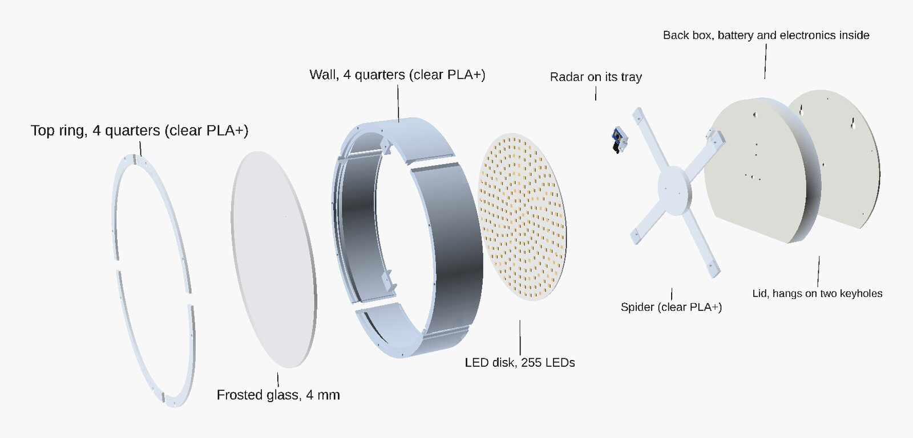
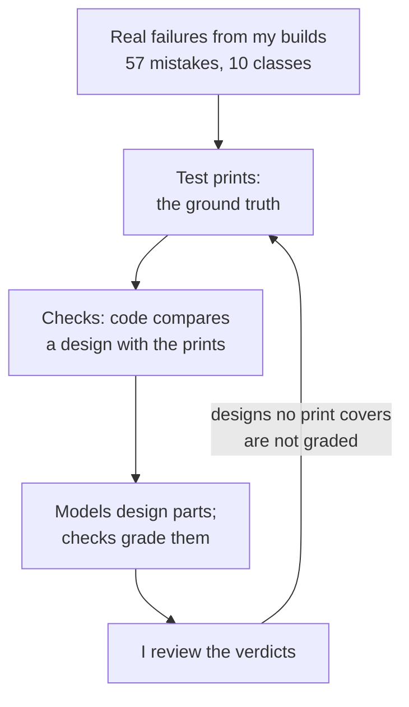
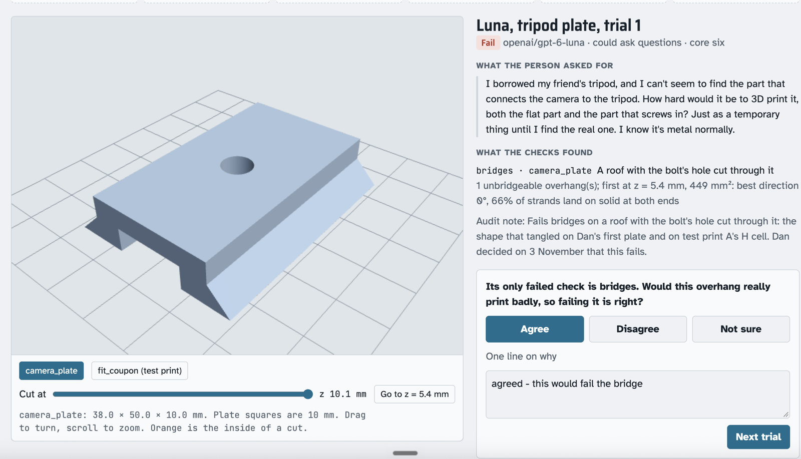
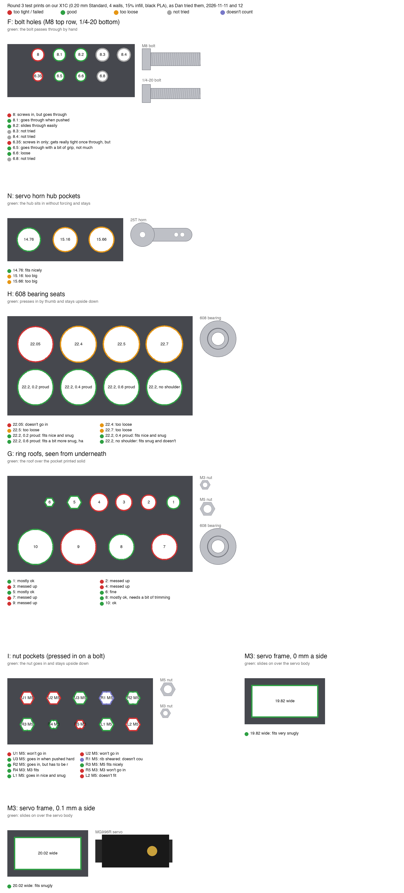
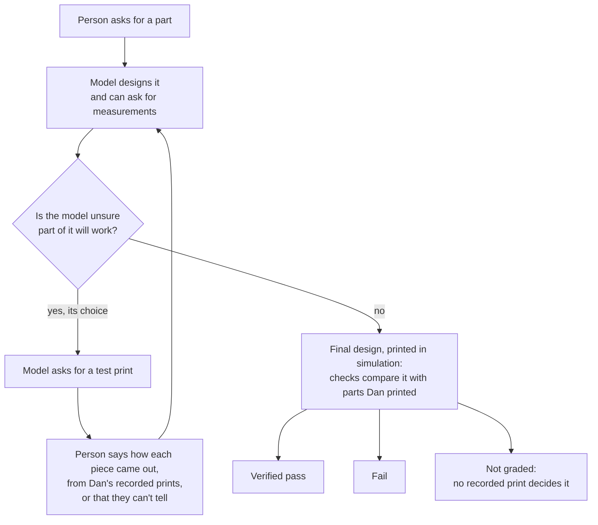
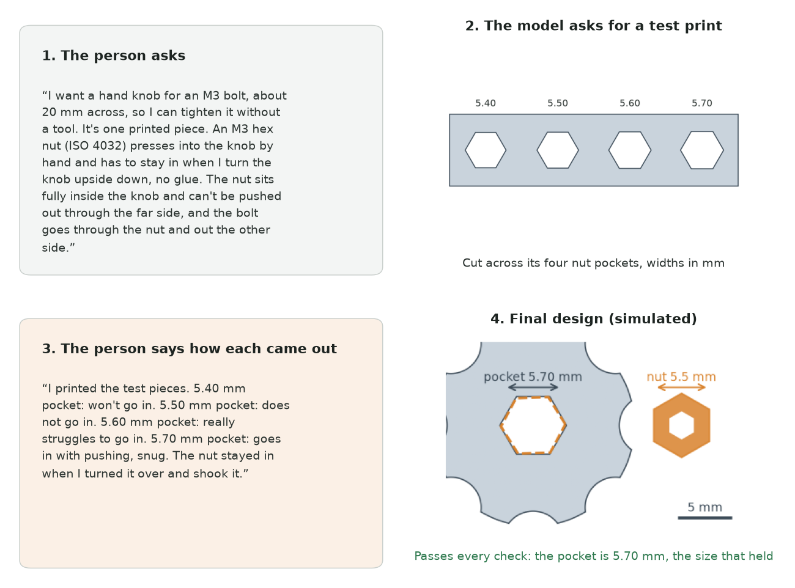

# Funk3D-Bench: can LLMs design functional 3D prints?

Made by [Dan Oved](https://danoved.xyz).

This is an open-source evaluation of how well LLMs design 3D models to be printed for [functional purposes](https://www.reddit.com/r/functionalprint/): things that have to do a job once they're printed and put together, such as a [storage system](https://gridfinity.xyz/), an [enclosure](https://danoved.xyz/portfolio/estoa), or a [replacement part](https://www.reddit.com/r/functionalprint/comments/1xr9j4g/replacement_fan_blade_printed_in_tpu/). These kinds of prints often involve multiple steps and parts, with other materials that attach them together, such as nuts and bolts, epoxy and clamps.



Designing and printing these parts is slow. A wrong design can cost hours and material before you find out, and often you have to start over. So the questions motivating this eval are:

- **Which models are the best at designing functional 3D prints** with the least trial and error, and how many tokens do they spend figuring that out?
- **Can we know if a 3D design is going to work without actually printing it?** Can we know which errors are likely to happen, and create a simulation that programmatically tests whether a design will run into any of them?
- **Do models know what they don't know?** Do they know what to test to figure it out, what should be measured, and do they ask for it?
- **Given the hardware on hand, can it design multiple parts and the connections between them?** Can it pick the fasteners, bolts and nuts, and design the parts so they can be assembled correctly? (Only partly tested so far.)

**Contents:** [How this started](#how-this-started) · [What the eval tests: failure classes](#what-the-eval-tests-failure-classes) · [How I built the eval](#how-i-built-the-eval) · [Tools used](#tools-used) · [The tasks](#the-tasks) · [How the agent works](#how-the-agent-works) · [Results](#results) · [Limits](#limits) · [Run it](#run-it) · [Prior work and comparable evals](#prior-work-and-comparable-evals) · [More](#more)

This eval was originally created for the [micro1 eval hackathon.](https://www.hackerrank.com/event/micro1-eval-hackathon)  The code that was submitted for the hackathon is at the [hackathon-submission tag](https://github.com/oveddan/functional-print-eval/tree/hackathon-submission); this README describes the eval as it is now.

**[Browse every trial on the results site](https://oveddan.github.io/functional-print-eval/)**: each model's design, every check with its reason, the test prints it asked for, its code and its transcript.

The tasks so far start smaller: a camera plate for a tripod, a hand knob with a nut pressed in, and a closet-door wheel on two bearings, each a printed part that has to print without supports and fit real hardware, plus a harder multi-part enclosure for a wall light. The assembly steps the model writes aren't graded yet.

Each task gives a model a request in a person's own words, with the measurements and hardware on hand. The model writes the CAD code for each part, picks the fasteners and writes the assembly steps. The eval then grades the design in code before anything is printed. Will each part print? Will the screws reach their inserts? Will the plug fit through its hole? The answers come from test prints I've actually made.

## How this started


*Estoa's enclosure in OpenSCAD: the code, written with Claude, and the part it describes.*

Before building this eval, I'd been 3D printing for a bunch of functional purposes:

- I bought a light at a flea market and wanted to attach it to my ceiling, so I asked Claude to design prints that would let me do that.
- I was invited to show at an art gallery, and made [Estoa](https://x.com/oveddan/status/2113742922080272443): a round LED light with a presence sensor, an ESP32 and frosted sides, in a printed enclosure.
- The clamp on my phone mount didn't fit my desk, so I had Claude design a bigger one.

The common thing was that even when a print looked like it would work, there was no way of knowing. I'd print the full part, find mistakes, and have to do it over again. For example, Estoa's back plate took 6 hours to print, and the posts for its heat-set inserts warped when the inserts went in, so I had to reprint the whole plate. I had to get into doing test prints, and I had to know which test prints to do.

Even though I was using Claude for everything, I wish I'd known whether other models are better at specific parts of the 3D design process.

## What the eval tests: failure classes

Every one of our checks comes from failures that happened on my real builds. Going back through my past build sessions, I found 57 failures and categorized them into 10 classes ([every check](docs/reference.md#the-failure-classes-the-tasks-test)). Six of the classes were tested in these trials. [Every test print, with its results](docs/reference.md#the-test-prints-behind-the-checks), is in the reference.

| Class | A real failure | The test print behind it | How the code checks it |
|---|---|---|---|
| **C1** Printed the wrong size for the item it holds | <br>The Estoa battery bay was drawn from a guessed 154 mm length; the battery didn't fit. | <br>How I found it on Estoa: a skeleton of just the battery bay, printed before the whole box. No test print decides this check; it looks at whether the model asked for the real size. | The person's measurements are only given if the model asks. The checks compare the design against the real ones, such as the bolt head's real size in the tripod plate's recess. |
| **C2** Pocket the wrong size for a snug fit: a nut, a bearing, a servo horn, a cable | <br>A pocket too loose for its nut: turned over, the nut falls out. Early on, pockets 0.3 mm over the nut lost every nut. | <br>M3, M5, M8 and 1/4-20 nuts pressed into pockets from the nut's exact size to 0.3 mm over. M3 needs 0.2 mm over; M5 holds at 0 and 0.1 mm over and is loose at 0.2; M8 and 1/4-20 hold only at the nut's exact size. Bearing seats: 22.0 mm wouldn't take a 608 bearing; 22.1 to 22.3 held it upside down. | It measures the nut pocket or bearing seat in the built part and looks that size up in the recorded test prints: went in and held, fell out, or wouldn't go in. |
| **C3** Fasteners don't properly connect to each other: a bolt too short to reach its nut, a thread too long or too short, an insert's post too thin or no room for the insert | <br>Estoa's posts for the heat-set inserts (brass threaded sleeves melted into the plastic) were too thin; they bent and the inserts sat crooked. | <br>A small block to try a heat-set insert in. Round 3 also printed insert posts 5.5 to 8 mm thick, but their results aren't recorded yet, so whether a post is thick enough is passed for now. | It adds up each bolt's path from the part and the catalog's real thread lengths: does the bolt reach the camera, pass through the nut, or bottom out before it tightens; does each heat-set insert sit in a hole sized for one (whether its post has enough plastic is passed for now, so the Estoa build's bent posts aren't caught yet). |
| **C5** A cable can't reach the port it plugs into | <br>Estoa's USB opening fit the port, but a real plug's head is wider than the hole. | <br>Just the wall with the USB-C openings, with the real parts behind it. I measured a real charger plug with calipers: its head is 11.58 × 6.44 mm, with about 7.5 mm of bare metal in front. The check fits that head into the opening. | It follows the way in from the outside of the box to the port and checks my measured plug head fits along it, so the plug's metal reaches the port. |
| **C6** Can't print the way it's oriented | <br>The bottom of the camera plate: the plastic printed over the bolt's recess collapsed into loose strands. | <br>Round 3's 60, 80 and 100 mm bridges, and five roofs cut from the models' own designs, seen from below: every one strung across. Roofs with walls on all four sides printed clean up to 50 mm wide. | It cuts the part into layers as printed and lays strands across every overhang. If too few land on solid at both ends, the roof fails. Each part must also be one piece and fit the bed. |
| **C7** Doesn't work the way it's mounted | Estoa's keyhole slots ran down, so it couldn't hang on its screws. | No test print yet: one screw can't show whether the box hangs on any common wall screw. | It finds the keyholes in the back and checks both slots run the same way, so the box can drop onto both screws, and that each entry passes a common screw head. |

Not tested yet: C4 can't reach it with the tool, C8 tested the wrong thing, C9 wrong assembly instructions, C10 wrong print settings.

*Every failure has a test case. For example, C6's photo above is a failed first attempt at printing a tripod's Arca plate, as designed by a model. The roof over where the bolt's head goes printed as tangled strands. The command shown below runs the checks again on both the original design and the fixed one. The test fails the original design, just like it happened in real life, but the fixed design passes.*

```bash
uv run python -m pbe.run examples/arca-plate/original.yaml examples/arca-plate/fix.yaml
```

*Expected: the original fails `bridges` and the fix passes every check.*

## How I built the eval



1. I had agents scan my previous sessions designing 3D prints, find every place an LLM made a mistake, and group them into [failure classes](#what-the-eval-tests-failure-classes): 57 mistakes in 10 classes. I reviewed the classes to make sure each one properly described the failure and could be tested.
2. I wanted to know which conditions lead to a successful print and which lead to failure, so I worked with Claude to make test prints of the failures I'd run into in real life, like a nut pocket too loose to hold the nut, or too tight to take it. Each [failure class](#what-the-eval-tests-failure-classes) shows its test print.
3. Claude wrote code that tests a 3D design against the ground truth from those recorded prints, to see whether it passes or fails.
4. Models designed the parts. We ran a range of models on each task, ran the automated checks on every design, and got the first results.
5. Claude picked a set of example passes and failures and made [a review page](https://claude.ai/artifact/1Lc2QwHarCXZ4ZZqVypHbs), and I checked whether each verdict was right. This also surfaced designs we hadn't accounted for. Opus designed a nut pocket with small ribs to grip the nut, and we'd never made a test print with ribs, so it couldn't be graded.

   

6. So we did another round of test prints for those cases, to add to the ground truth and grade more of the designs. Before this round, 79.5% of the trials could be graded; after it, 93.3% (the same 774 trials that handed in a design, counted by [`scripts/gradability_by_round.py`](scripts/gradability_by_round.py)). The ribbed pocket held an M5, and the M5 knob went from 48.7% graded to 97.4%.

   

## Tools used

- **[CadQuery](https://github.com/CadQuery/cadquery)**: the models write their parts in it, to match [BenchCAD](docs/reference.md#prior-art), the closest existing eval. My own builds used OpenSCAD; whether models do better in it isn't tested.
- **[OpenRouter](https://openrouter.ai)**: every model is called through its API.
- **[Claude Code](https://claude.com/claude-code)**: the harness I used to write this eval.
- **Checking parts**: [trimesh](https://trimesh.org), [manifold3d](https://github.com/elalish/manifold) and [shapely](https://shapely.readthedocs.io) for the geometry. Model code runs in a sandbox: [bubblewrap](https://github.com/containers/bubblewrap) on Linux (CI and Claude Code cloud sessions), or macOS's built-in `sandbox-exec`.
- **Print time and filament**: [Bambu Studio](https://github.com/bambulab/BambuStudio)'s slicer, run headless from the command line.
- **Test prints**: a Bambu Lab X1C, in PLA.

## The tasks

| Task | What the person asks | What trips models up |
|---|---|---|
| Tripod plate | "I borrowed my friend's tripod, and I can't seem to find the part that connects the camera to the tripod. How hard would it be to 3D print it…" | roofs over the bolt's recess; a dovetail upside down |
| Closet door wheel | "The roller wheel on my sliding closet door snapped. I've got two 608 skateboard bearings and an M8 bolt…" | a flat roof over the lower bearing |
| Hand knob (M3, M5) | "I want a hand knob for an M3 bolt… An M3 hex nut presses into the knob by hand and has to stay in…" | nut pockets with no clearance |
| Estoa light box (harder) | "I'm making a round light to hang on my wall… for now I only need that box, with the disc screwed onto it." | roofs over air; electronics that don't fit |

Every design, with its render and the reason for each check, is on the [results site](https://oveddan.github.io/functional-print-eval/). The hand-made reference solutions are in [the reference](docs/reference.md#reference-solutions-and-more-task-examples).

## How the agent works



The model gets the request, the printer, the filament and a list of hardware, and writes each part as CadQuery code it can't run or look at. It can ask me for measurements, and in one condition for test prints; my replies come from what I measured and printed. No supports are allowed, and it gets up to 12 turns with test prints, 8 without. The code: [`agent.py`](pbe/runner/agent.py), [`measure.py`](pbe/runner/measure.py), [`coupon_loop.py`](pbe/runner/coupon_loop.py) and the checks in [`pbe/graders/`](pbe/graders/).

### How a trial runs

Trials ran in three conditions, named the same way everywhere in the results:

* **First print**: the model can ask for measurements and hands in one design, with no feedback.
* **Reprint after feedback**: the same first prints. Each one that didn't pass was sent back once, the simulated person said how it came out, and the model handed in one more design.
* **Test prints first**: the model can ask for small test prints before its final design.

A trial where the model asked for a test print before its final design (Sonnet 5.5's M3 knob):



## Results

**[Browse every trial on the results site](https://oveddan.github.io/functional-print-eval/)**: pick a condition and a part, then open any model's design to see its render, each check with its reason, the test prints it asked for, its code and its transcript.

<!-- scorecard:start (written by scripts/scorecard.py; don't edit by hand) -->
| Model | Tripod plate | Bearing wheel | Knob M3 | Knob M5 | Estoa light box (harder) | All five tasks | Print hours per pass | Filament per pass | Cost per pass |
|---|---|---|---|---|---|---|---|---|---|
| Gemini 4 Argon | **70% (7/10)** | 60% (6/10) | 70% (7/10) | **100% (10/10)** | 0% (0/5) | **67% (30/45)** | 0.9 h | 37 g | $0.42 |
| GPT-6.1 Sol | 20% (2/10) | 70% (7/10) | 60% (6/10) | **100% (10/10)** | **60% (3/5)** | 62% (28/45) | 1.0 h | 37 g | **$0.10** |
| Gemini 3.8 Flash | 20% (2/10) | **80% (8/10)** | 70% (7/10) | 90% (9/10) | 0% (0/5) | 58% (26/45) | **0.7 h** | **27 g** | $0.24 |
| Sonnet 5.5 | 10% (1/10) | 0% (0/10) | **90% (9/10)** | **100% (10/10)** | 20% (1/5) | 47% (21/45) | 1.4 h | 56 g | $0.34 |
| Opus 5.5 | 30% (3/10) | 40% (4/10) | 50% (5/10) | 90% (9/10) | 0% (0/5) | 47% (21/45) | 1.0 h | 40 g | $0.42 |
| DeepSeek V4.1 Flash | 30% (3/10) | 50% (5/10) | 10% (1/10) | 60% (6/10) | 20% (1/5) | 36% (16/45) | 1.7 h | 70 g | $0.18 |
| Haiku 5.5 | 0% (0/5) | 0% (0/5) | 40% (2/5) | 20% (1/5) | 0% (0/5) | 12% (3/25) | 7.6 h | 359 g | $0.12 |

The rows are the Test prints first condition: the model can ask for test prints before its final design (all three conditions are defined in [How a trial runs](#how-a-trial-runs)). Each row is a model, best first; the best in each column is bold. A pass means every check passes against my recorded test prints, under the assumptions listed in [the reference](docs/reference.md#assumptions-the-verdicts-rest-on). Print hours and filament are slicer estimates and cost is what the API charged; each counts everything the model asked to print, test prints included, divided by the designs that pass. Nothing a model designed was printed.

**Best to worst, when the model can ask for test prints** (7 models, 5 or more trials on each of the five tasks, Estoa included):

1. **Gemini 4 Argon**, 67% of trials pass (30/45): $0.42 and 0.9 print hours per working part
2. **GPT-6.1 Sol**, 62% of trials pass (28/45): $0.10 and 1.0 print hours per working part
3. **Gemini 3.8 Flash**, 58% of trials pass (26/45): $0.24 and 0.7 print hours per working part
4. **Sonnet 5.5**, 47% of trials pass (21/45): $0.34 and 1.4 print hours per working part
5. **Opus 5.5**, 47% of trials pass (21/45): $0.42 and 1.0 print hours per working part
6. **DeepSeek V4.1 Flash**, 36% of trials pass (16/45): $0.18 and 1.7 print hours per working part
7. **Haiku 5.5**, 12% of trials pass (3/25): $0.12 and 7.6 print hours per working part

Not run with test prints, ranked by their first print without them: GLM 5.3 Flash 23%, GPT-6 Luna 8%, DeepSeek V4 Pro 5%, Qwen 3.8 Flash 3%. Grok 4.7 was left out because it was too expensive to run 10 trials on.

**What asking for test prints changed.** Across these 7 models, 37% of first prints pass without test prints on the four tasks, and 49% pass on the five, Estoa included, when the model can ask for test prints before its final design. The first print and the reprint leave Estoa out because Gemini 3.8 Flash and DeepSeek V4.1 Flash have no first-print Estoa trials, so the change column compares four tasks with five.

| Model | First print | Reprint after feedback | Test prints first | Change from the first print |
|---|---|---|---|---|
| Gemini 4 Argon | 50% (20/40) | 80% | 67% (30/45) | +17 points |
| GPT-6.1 Sol | 50% (20/40) | 53% | 62% (28/45) | +12 points |
| Gemini 3.8 Flash | 45% (18/40) | 63% | 58% (26/45) | +13 points |
| Sonnet 5.5 | 35% (14/40) | 50% | 47% (21/45) | +12 points |
| Opus 5.5 | 40% (16/40) | 68% | 47% (21/45) | +7 points |
| DeepSeek V4.1 Flash | 39% (16/41) | 61% | 36% (16/45) | -3 points |
| Haiku 5.5 | 3% (1/40) | not replayed | 12% (3/25) | +10 points |

Some passes may lean on a gap in the simulation: in 200 of 295 trials, at least one test piece got "I can't tell you how that one came out" (a size I never printed), and 96 of the 145 passes came after one.
<!-- scorecard:end --> 

<!-- scorecard-note:start (written by scripts/scorecard.py; don't edit by hand) -->
In the reprints, that accounts for 1 new pass (Sonnet 5.5).

**Estoa,** the harder task, counts in the Test prints first results above and is kept out of the first print and reprint columns: 5 of 30 designs pass on the first print, 12 of 26 after feedback, and 5 of 35 with test prints first.
<!-- scorecard-note:end -->

### Where models fail

The models design a print without really understanding the constraints of 3D printing. A lot of them design roofs over open space that can't print without supports. They design a place to slot in a nut without any kind of gap, so the nut won't go in. The models do make test prints, but they test the wrong thing. On the wheel they tested if the bearing fits, and mostly got that right. Then the wheel failed on stuff they never tested, like not leaving room for both bearings, the bolt not fitting through, or a roof printed over air.

## Limits

**No final design was printed.** Every verdict comes from code checking a design against my test prints. I never printed a model's final design to confirm its pass or fail, because each one costs time and material. The closest check: round 3 printed six roofs cut from models' Estoa designs, and five of the six strung as the bridge check predicted.

Some designs still can't be graded, because no test print I've made is close enough to decide them. They count as not graded, never as a pass; [the reference](docs/reference.md#what-wasnt-graded-and-the-prints-that-would-settle-it) lists each reason, how many trials it affects and the print that would settle it.

The replies only come from my test prints. For a size I never printed, the person can only say "I can't tell you how that one came out," so models switch to sizes I did print. That wouldn't happen in real life.

In my own 3D printing workflow, I'm constantly adding to a self-learning knowledge base of mistakes that gives the model context and failure cases when 3D modeling. The models in this eval didn't have it, which leads to more failures.

- **One printer, one material, one setting.** Every test print was on my Bambu Lab X1C, in black high-speed PLA, at 0.2 mm layers with 4 walls and 15% infill. It doesn't test other infill patterns or densities, other print settings, or other materials like PETG.
- **Simple tasks.** The tasks are small parts, nothing really complicated. The one multi-part enclosure, Estoa, counts in the Test prints first total only: two of the models have no first-print Estoa trials.
- **No choosing its own bill of materials.** The model picks from a fixed list of hardware I give it, rather than choosing its own parts.
- **Possible bias toward Claude.** I built the eval with Claude (Opus 5.5): it wrote the checks and most of the code, and Claude models are among those graded. The checks are code that compares each design with my recorded test prints, not Claude's judgment; I reviewed the verdicts myself, and Codex and other models reviewed the code.
- **Cost.** I did this on my own budget, so I couldn't do more runs. Every time I fixed how the trials run, I had to rerun everything, so there are several sets of results from different versions, and it can be confusing to tell them apart.

The assumptions that let us grade some of the unknowns are in [the reference](docs/reference.md#assumptions-calls-and-known-limits).

## Run it

From a clone, with [uv](https://docs.astral.sh/uv/) installed: `uv sync`, then `uv run python scripts/scorecard.py` prints the results table from the saved runs, and `scripts/reproduce.sh` regrades everything end to end (about 30 minutes). To run a new trial you need an [OpenRouter](https://openrouter.ai) key (a few cents a trial):

```bash
OPENROUTER_API_KEY=... uv run python -m pbe.eval --run mine --condition can_test --task nut-knob/M3 --model anthropic/claude-sonnet-5.5 --budget 0.50
```

[The reference](docs/reference.md#run-it) has every step, the Linux sandbox setup, and the tasks and options.

## Prior work and comparable evals

| Eval | What it tests | How this one differs |
|---|---|---|
| [BenchCAD](https://github.com/BenchCAD/BenchCAD-main) | CadQuery code from images and text, across 106 part families | Grades whether a part works with real hardware on a real printer, not whether it matches a reference shape |
| [CADEngBench](https://arxiv.org/abs/2608.09296) | Parametric parts graded on valid solids and design-for-manufacturing checks | Fit limits come from test prints on one printer, and the model can ask for measurements and hear how a print came out |
| [Hephaestus-CCX](https://arxiv.org/abs/2605.17448) | Requirements written as typed checks | Borrowed: each task's requirements are typed checks (`requirements.yaml`) |

Code from BenchCAD (MIT) is used for its CadQuery sandbox; [CADEngBench](https://github.com/coderjs-lab/cadengbench) has no license, so its layered grading is reimplemented and cited. [FDM-Bench](https://arxiv.org/abs/2412.09819) is an existing 3D printing benchmark. It simulates G-code generation and spots errors, but doesn't test actually designing parts. [Prior art](docs/reference.md#prior-art) has the full list.

## More

The full results, every check and the prior art are in [docs/reference.md](docs/reference.md). MIT license.
