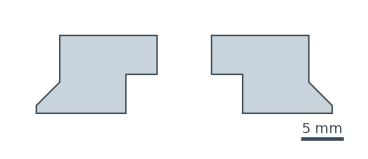
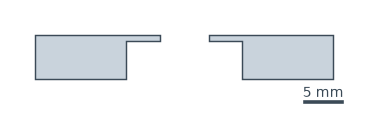
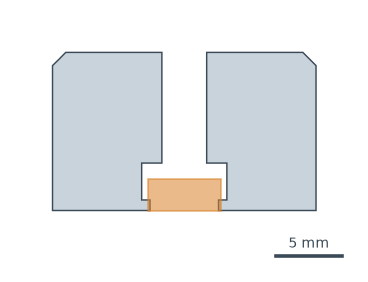
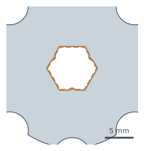
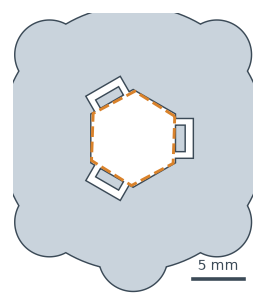

# Print-and-Build Eval

Can a frontier model design a 3D-printed part that a person at home can print, test and assemble, when some of what decides whether it works can only be learned by printing?

A person asks in plain language for a printed fix: a camera plate, a knob with a nut pressed in, a wheel with bearings. The model gets the request, the printer and filament, and a bin of common hardware. It can ask the person to measure their own things. It hands in CadQuery code for each part, the hardware it uses, a manual, and any test prints it wants made first. Code checks then decide, part by part, whether the design would print and fit, using limits taken from real test prints on one printer. Where no print on record can decide, the check says so: **not graded**, never a pass.

**Who it's for.** The at-home 3D printing market is growing rapidly ([CONTEXT's figures: shipments of printers under $2,500 rose 26% in 2025, and Bambu Lab sold 37% of them](https://www.tomshardware.com/3d-printing/bambu-lab-overtakes-creality-as-the-worlds-top-selling-budget-3d-printer-brand)). A lot more 3D printers are becoming available and more affordable to home users: the Bambu Lab A1 Mini is about $200 ([Wirecutter's top pick](https://www.nytimes.com/wirecutter/reviews/best-home-3d-printer/)). That opens up tons of possibilities, like fixing a broken part you had at the house, or doing a creative project where you want to connect two parts together that you didn't know how to connect. This is really a project about functional 3D printing.

**Why it matters.** Before, you had to pay for Fusion or Rhino, take a 3D modeling course and start learning 3D modeling, and iteration took forever. Even for me, I had to learn parametric modeling in Rhino to make a screw. Now, with LLMs and OpenSCAD, you can prompt-design a model and print it without needing to pay for any software. But it makes a lot of assumptions, and it makes a lot of mistakes. With 3D printing in particular, mistakes are expensive: they cost time, they cost material, and they cost you waiting for hours to get results. When software writes software, you write tests, see the results instantly, and do your fix. I think it's really important to know which models are doing the best at this kind of functional 3D printing.

## Where this came from

Over the past month, I've been working on a bunch of 3D printing projects at home. Back in grad school, I did a lot of 3D printing, and it would take me a while to get anything done. I had to leave 3D prints overnight and wouldn't know if they would work. I would come in the morning, and then something was broken. This month, I had access to a 3D printer.

I was asked a week before a gallery show to make [a piece](https://x.com/oveddan/status/2113742922080272443) for it. Starting with an LED disc I had from 5 years back, I collaborated with Opus 5.5 to 3D model, fabricate and program the concept around it: it rewards stillness; built with a presence sensor, ESP32, frosted glass. Working with Opus 5.5, I was able to do a lot more than I could do before. It told me about heat-set threaded inserts I could use that I didn't even know about, which melt into plastic with a soldering iron, so that a screw can securely join two pieces. The piece was fabricated with a combination of 3D printed PLA, and frosted glass. In the front, where the lights are shown, the sides are made of transparent, sanded PLA. In the back, opaque white PLA.


*The enclosure coming apart and back together: top ring, frosted glass, wall, LED disk, radar, spider, back box and lid. A render from [the piece's portfolio page](https://danoved.xyz/portfolio/estoa).*

A key part of this process was definitely doing test prints:
- to see how the frosting looked
- to see if the inserts can be inserted into the hole size that the model created and we printed.

|  |  |
|---|---|
| Oct 2: the frosting test print, unsanded; the layer lines show every LED as a streak | after wet-sanding at 120, then 220 grit |

Just because something says it's the size doesn't mean it's going to fit snugly into a print of PLA.

|  |  |  |
|---|---|---|
| Oct 1: making the original test print | using a soldering iron to insert it | Oct 2: screwing it to a top piece |
|  |  |  |
| Oct 4: the back plate print not working with the material molding | Oct 5: a test print that fixes it | the back plate, nicely fixed |

One common issue is that the model kept designing prints for the enclosure that held the battery without knowing its size, or how the cable would go from the battery to the board. So this led to designs that would not work; the holder for the battery was too small, so it couldn't fit in properly, and the cable from the battery would never reach the USB-C port. Test prints would have caught this, or if it asked me for measurements. We went through multiple iterations. I printed a final backplate. It took maybe 6 hours and tons of material, and there were all these issues with it. I printed out something it designed, but the way it was designed, I could not reach the insert to screw into.


*The full back box printing overnight, Oct 4, at 100% infill. From the session records: a skeleton test print on Oct 3 caught the first battery bay, drawn from a guessed 154 mm battery and a guessed cable exit (the real power bank is 155 x 74 x 18 mm). The test piece after it left out the bay's end stop, so this box had only 0.5 mm of play there and had to be reprinted.*

I bought an old light from the flea market, and I wanted to install it, but I didn't have anything to connect it to the ceiling. I worked with Opus 5.5 to design something to hold the cable, and then something that would make it flush with the ceiling. It came out great, but there were always a few mistakes on the way, such as: the part that hangs on the cable did not have enough spacing to allow the cable to properly slide through and grip. The holes, which were 6.6 mm, were too narrow for a 6 mm cable, as it didn't give any room to flex. The original test print for that part also was too thick, so it couldn't hang properly on the hook.

I was just working with Opus 5.5, but it would have been great to be able to know: which model is the best for this task, which is going to be the cheapest to run, and which is going to get me to the answer (my final print) the fastest with the least amount of trial and error, and the least amount of material used.

### The failure classes the tasks test

<!-- failure-classes:start (written by report/atlas/build.py --readme; don't edit by hand) -->
57 failures from real builds with an AI agent, each traced to its session (`seeds/`) and sorted into one of 10 classes that don't depend on the object (`seeds/classes.yaml`). They came from: Tripod and phone stand (12), Estoa light piece (34), Lamp mount and organizer (8), The eval's own test prints (3). The graded tasks test 5 of the classes; each is below with the requirements that test it, one real failure, and photos, which are hosted rather than committed.

#### C1: Designing from unmeasured dimensions

13 failures in the builds. Tested by:

- `tripod-plate` R4, the bolt's head fits in its recess

**From the builds** (Estoa light piece): Modeled the power-bank bay from a guessed 154 mm length and a guessed cable exit, without asking for measurements. Found by: skeleton test print; the battery didn't fit and the cable would be crushed against the breakout.

|  |  |
|---|---|
| Estoa's back-box skeleton, Oct 3, with the real power bank on it. The bay was drawn from a guessed 154 mm battery and a guessed cable exit; the power bank didn't fit. *Dan's photo* | Half an hour later, the fix. A 1:1 paper floor plan with the real power bank, USB-C breakout and cable laid on it, before anything else was printed. *Dan's photo* |

#### C2: Fit clearance wrong for the printer

4 failures in the builds. Tested by:

- `tripod-plate` R3, the camera's bolt goes through the plate, with its head on the clamp side
- `nut-knob` R4, the nut presses in by hand and stays in upside down on this printer, or a test print would have found a size that does
- `bearing-wheel` R3, the bearings press in and stay in on this printer, or a test print would find a size where they do

**From the builds** (Tripod and phone stand): Nut pockets at af+0.3 mm; every nut fell out. Found by: three rounds of test prints.

#### C3: Fastener stack-up arithmetic

6 failures in the builds. Tested by:

- `tripod-plate` R5, the bolt reaches into the camera
- `nut-knob` R5, the bolt passes through the nut and out the other side (at least ISO 273's fine clearance hole)
- `bearing-wheel` R4, the M8 bolt goes through

**From the builds** (Estoa light piece): Lid-screw posts about 8 mm across and 26 mm tall, freestanding, with 4.3 mm holes for 5 mm inserts; they softened, bent and flared, and inserts sat off-centre. Dan followed the instructed technique. Found by: assembly.

|  |  |
|---|---|
| A lid-screw post after its heat-set insert went in, Oct 5. The post was too thin and tall for a 5 mm insert, so its walls flared and the insert sat off-centre. *Dan's photo* | The tripod's phone clamp, Oct 24. The design treated an M5x50 as fully threaded; it's threaded only at the far end, so the lock nut couldn't reach the end wall. *Dan's photo* |

#### C5: Mating-part envelopes

6 failures in the builds. Tested by:

- `tripod-plate` R1, there's a printed plate
- `tripod-plate` R2, the plate fits the tripod's clamp
- `nut-knob` R3, a hex pocket that takes the whole nut, can be reached from one face, stops the nut turning, and stops it going out the far side
- `bearing-wheel` R1, about the size of the old wheel
- `bearing-wheel` R2, there's room for both bearings

**From the builds** (Estoa light piece): Dan asked for the ESP32's USB opening to be "more to the right, and narrower" after a test print; the agent chose 11.5 mm (about 0.4 mm each side of the receptacle) at the end of a 9 mm recess, without saying plug heads need more; ordinary plug heads couldn't reach the port. Found by: use after the build.

|  |
|---|
| The ESP32's USB-C opening in Estoa's back box. Sized to the port, not the plug, at the end of a 9 mm recess; ordinary plug heads couldn't reach. *Dan's photo* |

#### C6: Printability in the chosen orientation

11 failures in the builds. Tested by:

- `nut-knob` R1, one printed part (a test print doesn't count)
- every task: `bridges`, one connected body, fits the bed

**From the builds** (Tripod and phone stand): The roof over the head recess was a plain bridge with the bolt slot cut through it, with no stepped layers, though the repo already used that technique. Found by: first print; the roof came out stringy and messy.

|  |  |  |
|---|---|---|
| The underside of the tripod's Arca plate, Oct 12, the project's first print. The roof over the bolt-head recess was a plain bridge with a slot cut through it, and it printed as a tangle. *Dan's photo* | Estoa's test wall, Oct 1. A screw hole through a bridged pocket roof printed as loose strands and closed up; the slicer had warned of a floating cantilever. *Dan's photo* | The fix, already used in Estoa a week earlier. Each pair of layers bridges onto the last, so the hole has a solid edge to print on. *Diagram from the Estoa repo* |

**Recorded but not tested by any task yet:** C4 tool and hand access (3); C7 works in the orientation it's used (3); C8 test-plan coverage (3); C9 manual correctness (5); C10 print process and material settings (3).
<!-- failure-classes:end -->

## What existed before the hackathon

I was going to be away from home, flying on Oct 30 and only returning on Nov 9, so for the whole hackathon I'd be away from my 3D printer. I wanted to be sure I could print what was needed before Oct 30, so I did the minimum to prove that: I gathered and categorized real failure cases to work out which test prints I needed, then made those prints to define the ground truth, along with the plan and supporting code, including the first checks. None of the evals were built or run by the time the hackathon started.

## Run it

Everything in this section runs from a clean clone with **no API key and no model calls**. It was tested on a fresh clone in a clean Ubuntu 24.04 container (4 cores); the times below are from that run. macOS wasn't tested on a clean machine, and neither was Docker for `can_run_code`.

### Install

You need:
- [uv](https://docs.astral.sh/uv/), which installs Python 3.12 and every Python dependency from `uv.lock` on first use;
- git;
- a sandbox for building model-written parts: **bubblewrap** (`bwrap`) on Linux, or `sandbox-exec`, which ships with macOS. Without one, parts don't build unless you set `PBE_NO_SANDBOX=1`, which is only for a throwaway container or VM;
- on Linux, `libgl1` for CadQuery's kernel, and `fontconfig` with a font for parts with text.

On Ubuntu 24.04:

```bash
sudo apt-get install -y git curl bubblewrap libgl1 fontconfig fonts-dejavu-core
```

```bash
curl -LsSf https://astral.sh/uv/install.sh | sh
```

Ubuntu 24.04 stops unprivileged programs from making the namespaces bubblewrap needs. On a machine you can throw away (a VM or CI runner, as CI does), allow them:

```bash
sudo sysctl -w kernel.apparmor_restrict_unprivileged_userns=0
```

Then:

```bash
git clone https://github.com/oveddan/print-build-eval.git
```

```bash
cd print-build-eval && uv sync
```

### Everything at once

```bash
scripts/reproduce.sh
```

It runs the six steps below in order and stops at the first one that fails. Expected: every step passes, ending with `done`. It took 29 minutes on the clean run.

### Step by step

| Step | Command | Expected | Time on the clean run |
|---|---|---|---|
| 1. Install | `uv sync` | Python 3.12 and the locked dependencies installed | 7 s, with a fast network |
| 2. Tests | `uv run pytest` | all pass; the Docker versions of the sandbox tests skip where Docker isn't running | 3 min 33 s: 407 passed, 55 skipped |
| 3. Every reference | `uv run python -m pbe.eval --reference --task tripod-plate` (and `m5-spacer`, `bearing-wheel`, `nut-knob/M3`, `nut-knob/M5`, `nut-knob/M8`) | each task's reference design passes every check; exit code 0 | 29 s for all six |
| 4. Regrade every saved trial, on a copy | see below | every run's `summary.csv` unchanged | 16 min 35 s for all 13 runs (151 trials) |
| 5. Results page | `uv run python scripts/results_page.py` | `results/local/results-page/index.html`: the `can_ask` and `all_given` trials on the knob, wheel and tripod (120 on the clean run), each with its parts in 3D and every check. It leaves out the spacer and the `can_run_code` runs | 8 min 10 s, most of it rebuilding parts |
| 6. README results | `uv run python scripts/results_table.py --check` | "README.md's results and assumptions match results/runs/" | under 1 s |

Regrading reads each saved design and grades it again with today's checks, without calling a model. Point it at a copy so `results/` isn't touched:

```bash
cp -r results/runs /tmp/runs
```

```bash
uv run python -m pbe.eval --regrade --runs-dir /tmp/runs --run pilot-tripod --task tripod-plate
```

```bash
diff results/runs/pilot-tripod/summary.csv /tmp/runs/pilot-tripod/summary.csv
```

No output from `diff` means every verdict in the run reproduced. When anything that decides a verdict changes, including a check's detail text, the trial's `grades.json` is rewritten with the earlier reading kept under `regrades`. On Linux, a few `bridges` details come out with the strand angle mirrored (the saved runs were mostly graded on macOS), so those trials' `grades.json` change while their verdicts don't. Runs that aren't model trials (`crash-replay`, `loop-sample`, `loop-sample-2`) keep their own `summary.csv`, which a regrade leaves alone.

One design by hand, with the generic checks only (the Arca plate as first drawn, and as fixed after its first print):

```bash
uv run python -m pbe.run examples/arca-plate/original.yaml examples/arca-plate/fix.yaml
```

Expected, in 4 s: the original fails `bridges` (its roof tangled when printed) and the fix passes every check, so the command exits 1.

CI runs steps 2 and 3 on every pull request and on `main` (`.github/workflows/ci.yml`), and step 6 as one of the tests.

### Running new trials (needs an API key)

Models are called through [OpenRouter](https://openrouter.ai), by API. Set `OPENROUTER_API_KEY` in your environment (if it's unset, the runner tries the 1Password CLI, which only works on Dan's machine). Never commit it.

```bash
uv run python -m pbe.eval --run my-run --task tripod-plate --model anthropic/claude-haiku-5.5 --trials 1 --budget 0.50
```

- `--condition` is `can_ask` (the default), `all_given` or `can_run_code`. Several `--model`, `--task` and `--condition` flags multiply.
- `--budget` is in US dollars for the whole run. It's checked between trials, so the last trial can run over.
- Each trial saves `transcript.json`, `submission.yaml` and `grades.json` under `results/runs/<run>/<task>/<condition>/<model>/t<n>/`, and the run gets a `summary.csv`. A stopped run resumes where it left off.
- **What it costs:** the Cost column in [Results](#results) is what OpenRouter charged for the saved trials, by task, condition and model. Divide by the Trials column for a trial's cost.
- **Prompt caching:** Claude models ask for OpenRouter's prompt caching; every model gets the same messages and tools, byte for byte (issue 34, `tests/test_caching.py`). Each trial saved since records `settings.prompt_caching`. Trials saved before had no caching, so their Claude costs are full price. `scripts/cost_report.py <run>...` gives cost per trial and per turn by model.
- **`can_run_code`** lets the model run Python before handing in. That code runs in bubblewrap on Linux, or in Docker with the image from `scripts/build_run_python_image.sh`. Docker on macOS hasn't been tested; a Linux cloud machine is the tested route. The saved runs `pilot-code-smoke` (one trial) and `pilot-code` (three per lineup model on the tripod) used it, under bubblewrap (issue 34).

### Building the submission ZIP

```bash
uv run python scripts/build_submission.py main
```

It packages the files tracked at that git ref into `../print-build-eval-<commit>.zip`, beside the repo, with this README at the ZIP's root (`--out` picks another path outside the repo). It writes nothing, and lists every reason, if the ZIP would be 50 MB or more, or would hold a video, `docs/context/`, `.git`, a secret, or a machine-local path such as a home folder or a LAN address. Left out on purpose, each with its reason in the script's `LEFT_OUT`: `docs/context/`, the two overnight logs, the failure atlas (`report/atlas/`) and the Estoa datasheet, which is fetched from Adafruit (product 2477) instead.

## The tasks

Each task is a folder in `tasks/`: the person's request (`brief.md`), the facts the person can measure if asked (`hidden_facts.yaml`), the checks (`requirements.yaml`), and a reference design that must pass every check (`reference.yaml`). Every task also gets the generic checks: the code builds, each part is one connected body, it fits the bed, and every overhang can be bridged (`bridges`).

| Task | The request | Graded on | Wording |
|---|---|---|---|
| `tripod-plate` | Dan's real first message: replace the lost plate that joins a camera to a borrowed tripod | a plate exists; it fits the clamp; the bolt goes through, head on the clamp side; the head fits its recess; the bolt reaches into the camera | Dan's own words, approved by him for model runs |
| `nut-knob` (M3, M5, M8) | A hand knob with a hex nut pressed in, which must stay in upside down | one part; about the right size; a pocket that takes the nut, stops it turning and stops it going through; the nut presses in and holds on this printer, or a test print would find a size that does; the bolt passes through | draft, not approved: runs are exploratory. M8 has a reference but no runs |
| `bearing-wheel` | A closet-door roller wheel on two 608 bearings and an M8 bolt | about the old wheel's size; room for both bearings; the bearings press in and stay, or a test print would find a size; the bolt goes through | written by Claude and not reviewed by Dan; the door is invented: runs are exploratory |
| `m5-spacer` | A 20 mm spacer for an M5 bolt, everything stated | one part; size; a clearance hole; round | a control: if models fail it, the harness is broken |
| `estoa-light` | The box behind Dan's Estoa wall light | 7 checks on the assembled box | built on PR #23, approved by Dan, **not merged and not run**: no results |
| `phone-stand` | A desk-clamp phone stand | its `requirements.yaml` names checks that were never built | **can't run** |

Why each is hard, and every limit's source, is in its `brief.md`. The fit limits come from test prints made on one Bambu Lab X1C in one PLA, recorded with predictions committed before printing (`results/predictions/`). Photos of those prints are hosted, not committed; `docs/media/photos.md` indexes them.

### Conditions

- **`can_ask`** (the main one): the request and the setup facts. The person's own measurements are withheld, and the model can ask for them with `measure`. The person is a lookup table, not a model: anything not on record gets "I can't measure that".
- **`all_given`**: the same, with every recorded measurement stated up front. Passing only here means the model didn't ask.
- **`can_run_code`**: `can_ask` plus a sandboxed `run_python` tool, and `submit_design` builds every part and sends build errors back.

Every condition also has `report_limitation`, which changes nothing and records what the model wanted but couldn't use.

## How grading works

- **Code, not a judge.** Every check is a program reading the built geometry (`pbe/graders/`). No LLM judges anything.
- **Three answers per check:** pass, fail, or not graded. Not graded means the test prints on record can't decide the case. It's never a pass.
- **One verdict per trial:** pass (every counted check passes), fail, not graded, or **declined**: the model handed in no final part, or a final part whose own code stops until a measurement it left blank is filled in (`pbe/graders/declined.py`). Declined is neither a pass nor a fail.
- **Test prints are graded but don't count.** The generic checks run on test prints too, and `summary.csv` lists their failures (`test_print_failed`), but a test print can't fail a trial on its own.
- **Grade the outcome, not the technique.** `bridges` asks whether every overhang will print, so a stepped roof, flipping the part or moving the feature all pass.
- **How the checks are tested** (`tests/`): each reference passes every check; versions of the real failures fail the check aimed at them and no other; simple reward hacks fail; designs unlike the reference pass; and cases between two records come back not graded.
- **No independent CAD or printing expert has reviewed the checks or the verdicts.** Dan wrote the tasks from his own builds and made the calls listed under [Limits](#limits). Claude wrote the checks, and the audits are further readings by Claude and Codex.

## Results

<!-- results:start (written by scripts/results_table.py; don't edit by hand) -->
163 trials of 12 models, from the saved runs in `results/runs/` (smoke tests left out). Each model ran 1 to 3 times per task and condition, so these are pilots: raw counts, not pass rates, and no ranking. Other is a trial with no submission or an infrastructure error. Cost is what OpenRouter charged.

| Condition | Trials | Pass | Fail | Not graded | Declined | Other | Cost |
|---|---|---|---|---|---|---|---|
| `all_given` | 10 | 1 | 7 | 1 | 1 | 0 | $1.11 |
| `can_ask` | 134 | 43 | 54 | 33 | 4 | 0 | $10.24 |
| `can_run_code` | 19 | 3 | 10 | 1 | 5 | 0 | $2.55 |
| **all** | **163** | 47 | 71 | 35 | 10 | 0 | $13.90 |

### `bearing-wheel` (draft by Claude, not reviewed by Dan: exploratory)

| Condition | Model | Trials | Pass | Fail | Not graded | Declined | Other | Cost |
|---|---|---|---|---|---|---|---|---|
| `can_ask` | anthropic/claude-haiku-5.5 | 3 | 0 | 3 | 0 | 0 | 0 | $0.02 |
| `can_ask` | anthropic/claude-opus-5.5 | 3 | 1 | 1 | 1 | 0 | 0 | $0.69 |
| `can_ask` | anthropic/claude-sonnet-5.5 | 3 | 0 | 2 | 1 | 0 | 0 | $0.36 |
| `can_ask` | deepseek/deepseek-v4-pro-0813 | 3 | 0 | 3 | 0 | 0 | 0 | $0.04 |
| `can_ask` | deepseek/deepseek-v4.1-flash | 2 | 0 | 2 | 0 | 0 | 0 | $0.12 |
| `can_ask` | google/gemini-3.8-flash | 2 | 1 | 1 | 0 | 0 | 0 | $0.19 |
| `can_ask` | google/gemini-4-argon | 3 | 0 | 0 | 3 | 0 | 0 | $0.57 |
| `can_ask` | openai/gpt-6-luna | 2 | 0 | 2 | 0 | 0 | 0 | $0.01 |
| `can_ask` | openai/gpt-6.1-sol | 3 | 1 | 1 | 1 | 0 | 0 | $0.48 |
| `can_ask` | qwen/qwen3.8-flash | 2 | 0 | 1 | 1 | 0 | 0 | $0.10 |
| `can_ask` | z-ai/glm-5.3-flash | 2 | 0 | 1 | 1 | 0 | 0 | $0.12 |

### `m5-spacer` (control, draft wording: exploratory)

| Condition | Model | Trials | Pass | Fail | Not graded | Declined | Other | Cost |
|---|---|---|---|---|---|---|---|---|
| `can_ask` | anthropic/claude-haiku-5.5 | 3 | 3 | 0 | 0 | 0 | 0 | $0.01 |
| `can_ask` | anthropic/claude-opus-5.5 | 3 | 3 | 0 | 0 | 0 | 0 | $0.17 |
| `can_ask` | anthropic/claude-sonnet-5.5 | 3 | 3 | 0 | 0 | 0 | 0 | $0.09 |
| `can_ask` | deepseek/deepseek-v4-pro-0813 | 3 | 3 | 0 | 0 | 0 | 0 | $0.01 |
| `can_ask` | deepseek/deepseek-v4.1-flash | 1 | 1 | 0 | 0 | 0 | 0 | $0.01 |
| `can_ask` | google/gemini-3.8-flash | 1 | 1 | 0 | 0 | 0 | 0 | $0.02 |
| `can_ask` | google/gemini-4-argon | 3 | 3 | 0 | 0 | 0 | 0 | $0.07 |
| `can_ask` | openai/gpt-6-luna | 1 | 1 | 0 | 0 | 0 | 0 | $0.00 |
| `can_ask` | openai/gpt-6.1-sol | 3 | 3 | 0 | 0 | 0 | 0 | $0.09 |
| `can_ask` | qwen/qwen3.8-flash | 1 | 1 | 0 | 0 | 0 | 0 | $0.01 |
| `can_ask` | x-ai/grok-4.7 | 1 | 1 | 0 | 0 | 0 | 0 | $0.06 |
| `can_ask` | z-ai/glm-5.3-flash | 1 | 1 | 0 | 0 | 0 | 0 | $0.01 |
| `can_run_code` | anthropic/claude-haiku-5.5 | 1 | 1 | 0 | 0 | 0 | 0 | $0.00 |

### `nut-knob/M3` (draft, not approved by Dan: exploratory)

| Condition | Model | Trials | Pass | Fail | Not graded | Declined | Other | Cost |
|---|---|---|---|---|---|---|---|---|
| `can_ask` | anthropic/claude-haiku-5.5 | 3 | 0 | 3 | 0 | 0 | 0 | $0.02 |
| `can_ask` | anthropic/claude-opus-5.5 | 3 | 1 | 0 | 2 | 0 | 0 | $0.43 |
| `can_ask` | anthropic/claude-sonnet-5.5 | 3 | 2 | 1 | 0 | 0 | 0 | $0.19 |
| `can_ask` | deepseek/deepseek-v4-pro-0813 | 3 | 0 | 3 | 0 | 0 | 0 | $0.17 |
| `can_ask` | deepseek/deepseek-v4.1-flash | 1 | 1 | 0 | 0 | 0 | 0 | $0.01 |
| `can_ask` | google/gemini-3.8-flash | 1 | 0 | 1 | 0 | 0 | 0 | $0.08 |
| `can_ask` | google/gemini-4-argon | 3 | 0 | 0 | 3 | 0 | 0 | $0.24 |
| `can_ask` | openai/gpt-6-luna | 1 | 0 | 0 | 1 | 0 | 0 | $0.01 |
| `can_ask` | openai/gpt-6.1-sol | 3 | 1 | 0 | 2 | 0 | 0 | $0.37 |
| `can_ask` | qwen/qwen3.8-flash | 1 | 0 | 1 | 0 | 0 | 0 | $0.03 |
| `can_ask` | z-ai/glm-5.3-flash | 1 | 0 | 0 | 1 | 0 | 0 | $0.00 |

### `nut-knob/M5` (draft, not approved by Dan: exploratory)

| Condition | Model | Trials | Pass | Fail | Not graded | Declined | Other | Cost |
|---|---|---|---|---|---|---|---|---|
| `can_ask` | anthropic/claude-haiku-5.5 | 3 | 0 | 0 | 3 | 0 | 0 | $0.01 |
| `can_ask` | anthropic/claude-opus-5.5 | 3 | 2 | 0 | 1 | 0 | 0 | $0.45 |
| `can_ask` | anthropic/claude-sonnet-5.5 | 3 | 1 | 0 | 2 | 0 | 0 | $0.22 |
| `can_ask` | deepseek/deepseek-v4-pro-0813 | 3 | 0 | 2 | 1 | 0 | 0 | $0.36 |
| `can_ask` | deepseek/deepseek-v4.1-flash | 2 | 0 | 1 | 1 | 0 | 0 | $0.04 |
| `can_ask` | google/gemini-3.8-flash | 1 | 1 | 0 | 0 | 0 | 0 | $0.09 |
| `can_ask` | google/gemini-4-argon | 3 | 1 | 1 | 1 | 0 | 0 | $0.19 |
| `can_ask` | openai/gpt-6-luna | 1 | 0 | 0 | 1 | 0 | 0 | $0.01 |
| `can_ask` | openai/gpt-6.1-sol | 3 | 0 | 0 | 3 | 0 | 0 | $0.38 |
| `can_ask` | qwen/qwen3.8-flash | 1 | 0 | 1 | 0 | 0 | 0 | $0.03 |
| `can_ask` | x-ai/grok-4.7 | 1 | 0 | 0 | 1 | 0 | 0 | $0.48 |
| `can_ask` | z-ai/glm-5.3-flash | 1 | 0 | 0 | 1 | 0 | 0 | $0.00 |

### `tripod-plate` (Dan's own words, approved by Dan)

| Condition | Model | Trials | Pass | Fail | Not graded | Declined | Other | Cost |
|---|---|---|---|---|---|---|---|---|
| `all_given` | anthropic/claude-haiku-5.5 | 1 | 0 | 1 | 0 | 0 | 0 | $0.00 |
| `all_given` | anthropic/claude-opus-5.5 | 1 | 0 | 1 | 0 | 0 | 0 | $0.25 |
| `all_given` | anthropic/claude-sonnet-5.5 | 1 | 0 | 0 | 1 | 0 | 0 | $0.13 |
| `all_given` | deepseek/deepseek-v4.1-flash | 1 | 0 | 1 | 0 | 0 | 0 | $0.11 |
| `all_given` | google/gemini-3.8-flash | 1 | 0 | 1 | 0 | 0 | 0 | $0.14 |
| `all_given` | google/gemini-4-argon | 1 | 1 | 0 | 0 | 0 | 0 | $0.22 |
| `all_given` | openai/gpt-6-luna | 1 | 0 | 1 | 0 | 0 | 0 | $0.01 |
| `all_given` | openai/gpt-6.1-sol | 1 | 0 | 0 | 0 | 1 | 0 | $0.14 |
| `all_given` | qwen/qwen3.8-flash | 1 | 0 | 1 | 0 | 0 | 0 | $0.05 |
| `all_given` | z-ai/glm-5.3-flash | 1 | 0 | 1 | 0 | 0 | 0 | $0.05 |
| `can_ask` | anthropic/claude-haiku-5.5 | 3 | 0 | 3 | 0 | 0 | 0 | $0.02 |
| `can_ask` | anthropic/claude-opus-5.5 | 3 | 0 | 3 | 0 | 0 | 0 | $0.67 |
| `can_ask` | anthropic/claude-sonnet-5.5 | 3 | 0 | 3 | 0 | 0 | 0 | $0.42 |
| `can_ask` | deepseek/deepseek-v4-pro-0813 | 3 | 0 | 3 | 0 | 0 | 0 | $0.05 |
| `can_ask` | deepseek/deepseek-v4.1-flash | 3 | 1 | 2 | 0 | 0 | 0 | $0.04 |
| `can_ask` | google/gemini-3.8-flash | 3 | 2 | 1 | 0 | 0 | 0 | $0.49 |
| `can_ask` | google/gemini-4-argon | 3 | 2 | 1 | 0 | 0 | 0 | $0.46 |
| `can_ask` | openai/gpt-6-luna | 3 | 0 | 2 | 0 | 1 | 0 | $0.01 |
| `can_ask` | openai/gpt-6.1-sol | 3 | 0 | 0 | 0 | 3 | 0 | $0.25 |
| `can_ask` | qwen/qwen3.8-flash | 3 | 0 | 3 | 0 | 0 | 0 | $0.17 |
| `can_ask` | x-ai/grok-4.7 | 1 | 1 | 0 | 0 | 0 | 0 | $0.46 |
| `can_ask` | z-ai/glm-5.3-flash | 3 | 0 | 2 | 1 | 0 | 0 | $0.13 |
| `can_run_code` | anthropic/claude-haiku-5.5 | 3 | 0 | 1 | 0 | 2 | 0 | $0.01 |
| `can_run_code` | anthropic/claude-opus-5.5 | 3 | 1 | 2 | 0 | 0 | 0 | $0.57 |
| `can_run_code` | anthropic/claude-sonnet-5.5 | 3 | 0 | 3 | 0 | 0 | 0 | $0.38 |
| `can_run_code` | deepseek/deepseek-v4-pro-0813 | 3 | 0 | 2 | 1 | 0 | 0 | $0.52 |
| `can_run_code` | google/gemini-4-argon | 3 | 1 | 2 | 0 | 0 | 0 | $0.91 |
| `can_run_code` | openai/gpt-6.1-sol | 3 | 0 | 0 | 0 | 3 | 0 | $0.17 |
<!-- results:end -->

Every trial's transcript, design and grades are in `results/runs/`; the results page (step 5) shows each one with its parts in 3D. `scripts/digest.py <run> --why` prints each failure's evidence.

Follow-up experiments on saved trials, each with its own write-up:
- **Telling the model how its test print came out** (`docs/coupon-loop.md`, run `loop-sample` and `loop-sample-2`): one more turn after a reply built from the recorded prints, against a neutral "take another look". In each of two samples of 12 trials, the reply's arm passed 3 and the neutral arm 1. That's a small sample, and the 2 extra passes both rest on the M3 +0.1 mm print.
- **Printing the tripod plate and saying how its roof came out** (same write-up, run `loop-tripod`): the 24 saved plates that fail on a holed roof, each told "loose loops and tangles around the hole; hole partly closed" and nothing about why. 14 of 24 fixed the roof, against 2 of 23 after a neutral second look. 8 flipped the plate, 3 used a cone, 2 the stepped bridge and 1 a skin to push out. Most still fail elsewhere, so 3 pass every check (4 with the R3 fix that came after the run).
- **Sending a build error back once** (`docs/crash-replay.md`, run `crash-replay`): each saved crash replayed with its error.

**Letting the model run code** (`can_run_code`, run `pilot-code`): three tripod trials per lineup model. 2 of 18 pass, against 3 of 23 for the same models without code (`can_ask` and `all_given`). Fewer designs fail on a roof with the bolt's hole cut through it: 4 of 13 against 12 of 19. No design was sent back for a build error. That's a small sample, and Sonnet's three plates all have the dovetail upside down instead.

### Where models fail

Is kind of designing a print, not really understanding the constraints of 3D printing. Some did more. A lot of them design bridges without describing supports. I think also one of the constraints we should say is we're assuming there are no supports made. It would design an enclosure or a place to slot in a nut without any kind of gap, or it would be too big. The biggest place it fails is assuming something's going to work and not doing a test run first.

> **TODO(Dan): the hot take.** The one lesson to remember.

## What went wrong, task by task

Counts are trials, from the saved runs; a trial can fail more than one way. The pictures are cuts through saved designs, made by `scripts/failure_figures.py`, with the hardware drawn in orange where it has to go. None of these designs was printed.

### `tripod-plate`: 62 trials

| What went wrong | Trials |
|---|---|
| A roof with the bolt's hole cut through it (`bridges`) | 24 |
| Declined: the clamp's width isn't recorded | 10 |
| Dovetail upside down: the bolt head's recess is on the camera's side | 9 |
| Straight sides, nothing for the clamp's lips to grip | 7 |
| No usable bolt hole | 6 |
| Code didn't run | 3 |
| A part in pieces | 3 |
| Bolt doesn't reach far enough into the camera | 2 |
| Head recess too small for the bolt's head | 2 |

| The plate Dan printed | Dovetail upside down | Straight sides |
|---|---|---|
|  |  |  |
| The reference, cut across its length. The bevels the clamp grips widen toward the bed. | Sonnet 5.5, `pilot-tripod` t1. 38 mm wide with bevels, but the recess opens on the narrow face. | Haiku 5.5, `pilot-tripod` t2. It "narrows by only 0.00 mm on both edges". |


The bridge check's picture of GPT-6 Luna's roof (`pilot-tripod` t1, 449 mm² at 5.4 mm): green strands land on solid at both ends, red ones don't. In the best direction only 66% are anchored, because the bolt's hole is cut through the middle of the roof. Dan's first plate tangled on this shape.

### `bearing-wheel`: 28 trials

| What went wrong | Trials |
|---|---|
| A roof with the bolt's hole cut through it (`bridges`), over the seat that opens at the bed | 12 |
| Code didn't run | 4 |
| Bearing seat a size the prints don't take | 4 |
| Other wheel geometry | 1 |

| Fails: a flat roof | Not graded: a narrow ledge | Passes: a cone |
|---|---|---|
|  |  |  |
| Sonnet 5.5 t1. A flat ring of 230 mm² over the lower bearing; 22% of strands anchored. | Sonnet 5.5 t3. A 157 mm² ledge, about 2.5 mm wide: narrower than any roof seen to tangle, so not graded. | Opus 5.5 t1. The roof is a cone stepping in about 0.2 mm a layer, so nothing has to bridge. |

### `nut-knob` (M3 and M5): 48 trials

| What went wrong | Trials |
|---|---|
| Code didn't run | 5 |
| Nut pocket a size the prints don't take | 4 |
| The pocket is closed, so the nut can't be pressed in | 3 |
| A roof with the bolt's hole cut through it | 1 |
| A ledge too wide to bridge: the grip overhangs its boss | 1 |
| Its test print labelled as a final part | 1 |

| No clearance | A closed pocket |
|---|---|
|  |  |
| Sonnet 5.5 M3 t1. The pocket is 5.50 mm across flats for a 5.5 mm nut; the print at that size "does not go in". | Haiku 5.5 M3 t1. A lip narrower than the nut closes the pocket's mouth, so a nut "can't be pressed in from either face". |

Most knob trials that didn't pass weren't failed: 10 pass, 14 fail and 24 are not graded, mostly for the pockets below.

### `m5-spacer`: 25 trials

The control. Every trial passes.

## What wasn't graded, and the prints that would settle it

A check is not graded when no recorded print decides it. A trial can have more than one. No print is planned before publishing (Dan, 2026-10-30), so this is future work; `docs/limitations.md` has the full list.

| Not graded because | Trials | The print that would settle it |
|---|---|---|
| A nut pocket with crush ribs or clips | 14 | Pockets with ribs, clips or relief beside plain ones. Each model's ribs differ, so one print settles only designs like it |
| A tripod head recess under 5 mm deep | 11 | Recesses 3, 4 and 4.5 mm deep for the 5 mm head |
| A roof ledge 1.5 to 3 mm wide | 9 | Ring roofs 1.5 to 3 mm wide around a bolt hole |
| A tripod bolt hole between 6.35 and 6.8 mm | 8 | Bolt holes at 6.5 and 6.6 mm |
| A plate width outside 37 to 39 mm | 8 | Dovetail plates from 34 to 45 mm tried in the clamp |
| A wheel bolt hole between 8.0 and 8.4 mm | 6 | Holes at 8.1, 8.2 and 8.3 mm on an M8 |
| A bearing seat between printed sizes, or ribbed | 4 | Seats at 22.05, 22.4 and 22.5 mm, and lobed seats |
| Bearings a little proud, or no shoulder | 4 | Wheels with bearings 0.2 to 0.6 mm proud, and a bore with no shoulder |
| A nut pocket tighter than any printed | 3 | M5 pockets at -0.15, -0.10 and -0.05 mm |
| A test print whose pockets are ribbed or unsettled | 3 | The ribbed pockets above, and coupon B2's finer steps |
| A nut pocket between printed sizes | 2 | Coupon B2's finer steps |
| A pocket shape the checker can't read | 1 | None: the checker needs fixing |

Ribbed pockets are the biggest gap. Two models' answers, cut where the nut is tightest, with the M5 nut's outline dashed:

| Crush ribs | Clips |
|---|---|
|  |  |
| Opus 5.5 M5 t2: three ribs reaching 0.3 mm into the nut's flats, in a pocket 0.25 mm over the nut. | GPT-6.1 Sol M5 t1: three clips cut free so they can flex. |

## Harder tasks: a first look

> **TODO(Dan): intro.** Why you tried harder tasks, and why they're kept out of the results above.

These tasks are on unmerged branches. Their graders haven't had the audit or the verdict review the four tasks above had, so these numbers aren't in the results. Each count comes from the runs saved on that task's branch.

| Task | Branch | What it tests | Model trials | Result | Cost |
|---|---|---|---|---|---|
| Estoa light | [#23](https://github.com/oveddan/print-build-eval/pull/23), run `pilot-estoa` | | 18 | 0 pass, 14 fail, 3 not graded, 1 with no design | $6.03 |
| Servo mount | [#47](https://github.com/oveddan/print-build-eval/pull/47), runs `servo-first-look`, `servo-first-look-2`, `servo-datasheet` | | 29 | 1 pass, 17 fail, 11 not graded | $4.81 |
| Game spinner | [#44](https://github.com/oveddan/print-build-eval/pull/44) | | 0 | not run | — |

> **TODO(Dan): what each task tests.** One line each for the empty column.

### Estoa light

The failures that come up most, by trial: a roof that can't be bridged (11 of 18), an insert post with less plastic than the 1.85 mm that bulged on the real build (6), and a keyhole slot running the wrong way, so the piece can't hang on its screw (6). Most of the not graded checks need something nobody recorded, such as the board's thickness.

> **TODO(Dan): what went wrong.** How these compare with what went wrong when you built Estoa yourself.

### Servo mount

One check decides most trials: R3, "the tabs sit flush", doesn't pass on 24 of 29. The plates leave no room for the rib on each tab. That includes 9 of the 12 `all_given` trials, where the rib's size is in the prompt, against 11 of 12 in `can_ask`. That's the same mistake as Claude's own test print D.

> **TODO(Dan): what went wrong.** What you make of models missing the rib even when they're told about it.

### Game spinner

A task built from the 608 bearing seat and M5 pocket prints already on record. No model has run on it.

> **TODO(Dan): why it's here.** What it's meant to test, if you keep it.

> **TODO(Dan): what it would take.** What these tasks would need before they count: more recorded prints, reviewed graders, more trials.

## Limits

A lot of the results are not gradeable, because they require ground truth prints, to verify if a print works in a desired configuration. For example, some prints made ribs and our test prints never covered that. Without having my 3D printer nearby, I could not print to verify these work.

In my 3D printing workflow, I constantly am adding a self-learning knowledge base around mistakes that provides context and failure cases to the model when 3D modeling. This was not available in the current workflow. So it leads to more failures.

Our test prints were done on my Bambu Lab X1C, only on PLA, with a single print setting. To make it more expansive, we would do test prints in different materials. On different 3D printers.

### Assumptions the verdicts rest on

These are treated as true without a print that shows them for that exact case. The full table, and the prints that would settle each, is in `docs/limitations.md`.

<!-- assumptions:start (written by scripts/results_table.py; don't edit by hand) -->
| Assumption | Check | What rests on it in the saved runs |
|---|---|---|
| The webcam bolt is 10 mm long under its head. Nobody recorded it. | tripod R5 | Every tripod R5 verdict (43 pass, 2 fail), so all 9 tripod passes |
| One 38 mm plate fit the clamp; 37 to 39 mm passes on an estimate of the jaws' travel. | tripod R2 | Every graded tripod R2 verdict (34 pass, 7 fail) |
| A roof with the bolt's hole cut through it tangles at the models' shapes and sizes, as it did on the Arca plate and coupon A's H cell (a 20 mm square with a 6 mm hole, printed once). | `bridges` | 22 trials that fail on `bridges` alone, on a roof with a hole cut through it (Dan's call: they fail) |
<!-- assumptions:end -->

### Whose calls these are

From the audit of the saved failures (issue 15):
- **Dan's:** a test print can't fail a trial on its own; declining is its own verdict, never a pass; a roof with the bolt's hole cut through it fails `bridges`; nothing new is printed or measured before publishing, so what the records can't decide is not graded; one printer and one filament; M3 at +0.1 mm goes in by hand "with force", so it counts as holding (his memory of one print); the person answers the clamp's width as 38 mm, the Arca-Swiss standard his plate fit (new runs only); the test-print loop may print the final plate, not only the model's test prints.
- **Claude's, delegated by Dan** ("do what you think is best"): DeepSeek V4.1 Flash's M5 test print labelled `final` stays a fail, which Dan reviewed and kept. These aren't Dan's expert judgment. Also Claude's: one official set of counts, with no second, more optimistic score (issue 35).

### Known limits

- **Pilots, not pass rates.** One to three trials per model per task.
- **One printer, one filament.** The fit and bridge limits hold for a Bambu Lab X1C in one PLA only.
- **One person's projects.** The tasks come from Dan's builds and mostly one agent's mistakes. Only the tripod's request was approved before it ran.
- **The phone stand can't run**, and print-settings mistakes (failure class C10) aren't tested: a submission has no field for them, and nothing is sliced.
- **Code review findings not fixed.** Two reviews of `main` (issues 2 and 4, closed as not planned) listed findings that weren't fixed; they stand as known limits. Among them, as last checked on those issues: model-written part code can still read files in the repository while it builds (it gets no network and no environment); a nut pocket 0.8 to 1.5 times the nut's size counts as nut-sized for the knob's R3, so a pocket too small for the nut can pass R3 and be left to R4; `bridges` samples one plane per layer and directions every 5°, so a feature one layer thick can be missed and verdicts can depend on the part's rotation; `bed_fit` uses the nominal bed and has no failing test. Code added since 2 November hasn't had that full review.
- **Detail text can differ by platform.** Every saved verdict reproduces on Linux as on macOS, but tied bridge directions can come out mirrored in the detail text.

## What's built and what isn't

Built: the four runnable task families above with references and checks; the runner with the lookup-table person and three conditions; sandboxed builds; regrading; the test-print loop and the crash replay; the results page; the test print designs and their recorded outcomes (`coupons/`, `results/predictions/`).

Not built: an assembly simulation (parts moving into place along the manual's steps); a printer simulator with a hidden error; any score beyond pass, fail, not graded and declined; a comparison with a hand ranking; a simulated builder. The failure atlas (`report/atlas/`) builds only on Dan's Mac: it uses `sips` and points at local photos.

## Where things are

The eval design guide suggests `tasks/`, `reference/`, `graders/`, `results/` and `transcripts/`. Here:

| Guide | This repo |
|---|---|
| `tasks/` | `tasks/<task>/brief.md` (the request), `hidden_facts.yaml` (what the person can measure), `requirements.yaml` (the checks) |
| `reference/` | `tasks/<task>/reference.yaml` |
| `graders/` | `pbe/graders/`; the submission format and building in `pbe/parts/` |
| `run_eval.py` | `pbe/eval.py` (`uv run python -m pbe.eval`), with the model loop in `pbe/runner/` |
| `requirements.txt` | `pyproject.toml` and `uv.lock` |
| `results/` | `results/runs/<run>/summary.csv` and each trial's `grades.json`; test print records in `results/predictions/` |
| `transcripts/` | every trial's `transcript.json`, beside its grades in `results/runs/` |

Also:
- `seeds/`: the real failures behind the tasks (tripod, Estoa, side projects, the test prints), each tagged with a failure class from `seeds/classes.yaml`. They're evidence, not tasks, and their `grader:` fields are planned, not built.
- `catalog/`: the hardware bin (`hardware.yaml`, with real thread lengths) and the printer (`printer.yaml`).
- `coupons/`: the test print designs and the scripts that predicted their outcomes.
- `docs/`: `scoring.md` (the quality bar), `limitations.md`, and the write-ups of each experiment. `PLAN.md` is the working plan and `CHANGELOG.md` ties every change to its evidence.
- `scripts/`: the results page, the README's results table, the reproduce script and the experiments.
- `examples/arca-plate/`: the Arca plate before and after its first print.

## Future work

- **More test prints** to turn assumptions into records: the models' roof shapes, ring roofs, finer nut clearances, the clamp's jaw travel, the bolt's length. The list is in `docs/limitations.md`.
- **Letting the model suggest hardware**, with only the printer and filament fixed (issue 12).
- **Letting the model ask clarifying questions**, not only for measurements (issue 13).
- **A research step, as a recorded lookup**, so reruns stay identical (issue 16).
- More trials per model, the Estoa task's first runs (issue 37), and the assembly simulation.

## Provenance and how AI was used

We used LLMs to scrape all of my 3D printing sessions for failures, then aggregated them into [categories](#the-failure-classes-the-tasks-test). We wrote test cases for each of these to simulate making a 3D model, and proving that 3D model would fail for this test case.


*The tripod's Arca plate as first printed: the roof over the bolt's head was a plain bridge with the bolt's slot cut through it, and it printed as a tangle. Its test case runs the design as drawn and as fixed:*

```bash
uv run python -m pbe.run examples/arca-plate/original.yaml examples/arca-plate/fix.yaml
```

*Expected: the original fails `bridges` and the fix passes every check.*

We also developed test prints, to test how bolts fit into certain pockets, to validate that a print would work for a given bolt. This acts as a ground truth.

Here is a video of what we tested **(TODO(Dan): pick the clip)**. This ended up being a limitation because there were more designs that were came up with by the models that I did not anticipate. There's no way to verify they work without doing a test print.

We then created an agent, that can run on any model, prompted it with a task.

These are the things it can do:
- `measure`: ask the person to measure one of their own things;
- `submit_design`: hand in the parts, the hardware, the manual and any test prints;
- `report_limitation`: say what it wanted to use but couldn't;
- `run_python`, in the `can_run_code` condition only: run Python in a sandbox before handing in.

- **Tasks** come from Dan's own builds: the tripod plate (his real first message to a coding agent, and the agent's mistakes), Estoa (his wall light), and his test prints. The knob, wheel and spacer requests are drafts. Every limit a check uses traces to a test print, a datasheet or the ISO tables in `catalog/hardware.yaml`.
- **Test prints** were designed, printed and recorded before Oct 30, each with the checks' predictions committed before printing (`results/predictions/`).
- **AI use:** Claude (through Claude Code) wrote nearly all the code, checks, tests and docs, including this README, from Dan's direction, and Dan decided the calls listed above. Codex reviewed many of the pull requests, and each of its findings was checked against the code. The agent sessions behind the seeds are in Dan's private archive; their ids in the seed files are kept as opaque references.
- Models are tested only through OpenRouter's API, under its terms.

## Prior art

| Work | Licence | How it's used |
|---|---|---|
| BenchCAD (`BenchCAD/BenchCAD-main`, HF `BenchCAD/BenchCAD`) | MIT code, CC-BY data (per its README; read its LICENSE before reuse) | CadQuery sandbox, standard fastener families |
| BenchCAD 2.0 library (`BenchCAD-org/benchcad-2`) | MIT | part-family format (a build file plus a check file), cited |
| BenchCAD 2.0 harness (`BenchCAD-org/benchcad-2-main`) | none | ideas only, cited |
| CADEngBench (arXiv 2608.09296, `coderjs-lab/cadengbench`) | none | layered grading, cited and reimplemented |
| Hephaestus-CCX (arXiv 2605.17448) | — | typed requirements, cited |
| HW-Bench | — | a different scope: funded, professional hardware engineering, not something to beat. TODO(Dan): add its link and one line on its scope; this session couldn't reach its site to check |
| Epoch Furniture Assembly, IKEA-Manual, FDM-Bench, VLM DfM rules (2311.12668), FEABench, EngDesign, SKY-001, NVIDIA ASPIRE, τ-Bench and τ²-Bench, Anthropic's "Demystifying evals for AI agents" | various | read as prior art; nothing copied |

## Licence

MIT, in `LICENSE`. `docs/context/` is Dan's private material and isn't covered: it's left out of the submission ZIP.

## Private material

`docs/context/` holds Dan's own notes and clippings. It's private: the submission ZIP leaves it out, and it stays out of any public copy. Citations elsewhere name their source instead of pointing into it.
