# Functional 3D Printing Eval

**Contents:** [How a trial runs](#how-a-trial-runs) · [Constraints](#constraints) · [What the eval tests: failure classes](#what-the-eval-tests-failure-classes) · [The test prints behind the checks](#the-test-prints-behind-the-checks) · [The tasks](#the-tasks) · [Results](#results) · [What we couldn't grade](#what-we-couldnt-grade) · [Run it](#run-it) · [Limits](#limits) · [Prior work and comparable evals](#prior-work-and-comparable-evals) · [Tools used](#tools-used) · [How we used AI](#how-we-used-ai) · [More](#more)

3d printing is becoming far more accessible to the general public, as state of the art printers have become cheaper while increasing their capabilities, and LLMs can generate designs using open source tools, without a user needing to learn 3d modeling or purchase expensive software.  


*The Estoa light's enclosure in OpenSCAD, an open-source modeling tool: the code, written with an LLM, and the part it describes.*

Over the past month, I've been working on a bunch of 3D printing projects at home. A week before a gallery show, I was asked to make [a piece](https://danoved.xyz/portfolio/estoa) for it ([the post](https://x.com/oveddan/status/2113742922080272443)). Starting with an LED disc I'd had for 5 years, I worked with Opus 5.5 to 3D model, fabricate and program it: a light that rewards stillness, with a presence sensor, an ESP32 and frosted sides. With Opus 5.5 I was able to do a lot more than I could before; it told me about heat-set inserts, which I didn't even know about. I also printed parts to hang a lamp I bought at a flea market. A key part of all of this was doing test prints: to see how the frosting looked, and whether the inserts fit the holes the model designed. There were always mistakes on the way: a battery holder designed without knowing the battery's size, a back plate that took 6 hours to print where I couldn't reach the insert to screw it in, and cable holes too narrow for the cable to flex.

|  |  |  |
|---|---|---|
| The gallery piece, coming apart and back together | Its frosted wall, after a test print showed the layer lines | A test print for the heat-set inserts |

In the design process, these models often make mistakes, which are costly both in time and money, as prints can take hours to complete, and physical material is consumed. If there are errors, another print needs to be made, thus wasting the time and material spent.


*An example of a print that failed, and cost lots of time and money: the back plate for an art installation, which had inserts. The poles for the inserts did not have enough give, causing them to warp when the inserts were pressed in. This was a costly and timely mistake. We fixed it later, but had to reprint the whole plate again.*

How can we determine which models produce the best designs, with the least amount of tokens spent, material consumed, and time waited for printing?  How can we simulate the result of each print design, and know if it will be successful or not before printing it?  How can we build a feedback loop that allows a model to correct its mistakes, and measure if its fix got us closer to the final answer?

This repository builds a framework for simulating and measuring the success when LLMs are designing [functional prints](https://www.reddit.com/r/functionalprint/) based on a prompt, measurements, available materials, and simulated results.

Examples of functional printing tasks would be:

| | |
|---|---|
|  |  |
| *"I have an LED disk that I want to turn into an artpiece, can we design an enclosure that holds both the ESP32 to drive the lights, a usb c port to power the piece, and a frosted front and sides that diffuse the leds?"* | *Inside the printed enclosure: the ESP32, the wiring and the battery.* |
|  |  |
| *"I bought this vintage hanging lamp in the market, what could I print to make it attach to the light box on my ceiling?"* | *"The clamp for a phone mount doesn't fit my desk, can we make a larger one that will?"* |

Or: *"Can we design a custom robotic arm that mounts to my desk?"*

Here's how the agent works (we can link to the agent code):

1. A person asks in plain language for a printed fix: a camera plate, a knob with a nut pressed in, a wheel with bearings
2. The model is given a 3d printer, filament, and list of available hardware. It writes each part as code (CadQuery, in Python), which it can't run or look at.
3. The model decides if it needs to know more information, such as measurements of a servo. If it does, it requests this from the user.
    * The user responds with measurements.
4. The model decides if it needs to know if an aspect of a print will work, such as an opening, or a connection between hardware and the print. It can then design a test print that can help answer this. The goal is to get to an answer with less filament used or time spent than if we printed the final print without knowing this answer.
    * We simulate the test print, and generate a response from the user based on the results. The model can test again.
5. It prints a final version. The code then runs some automated tests on the resulting geometry, to simulate the results of the print.
    * We simulate the result of this print, and provide the results to the model. If it has not done two prints, it can print again and we repeat that loop.

Some of my test prints:

| | | |
|---|---|---|
|  |  |  |
| A roof over a hole: it printed as loose loops | A block to try a heat-set insert in | The wall with the USB-C openings, with the real parts behind it |
|  |  |  |
| A skeleton of the battery bay, before the full box | A plate of small test pieces | Putting a knob's test print together |


## How a trial runs

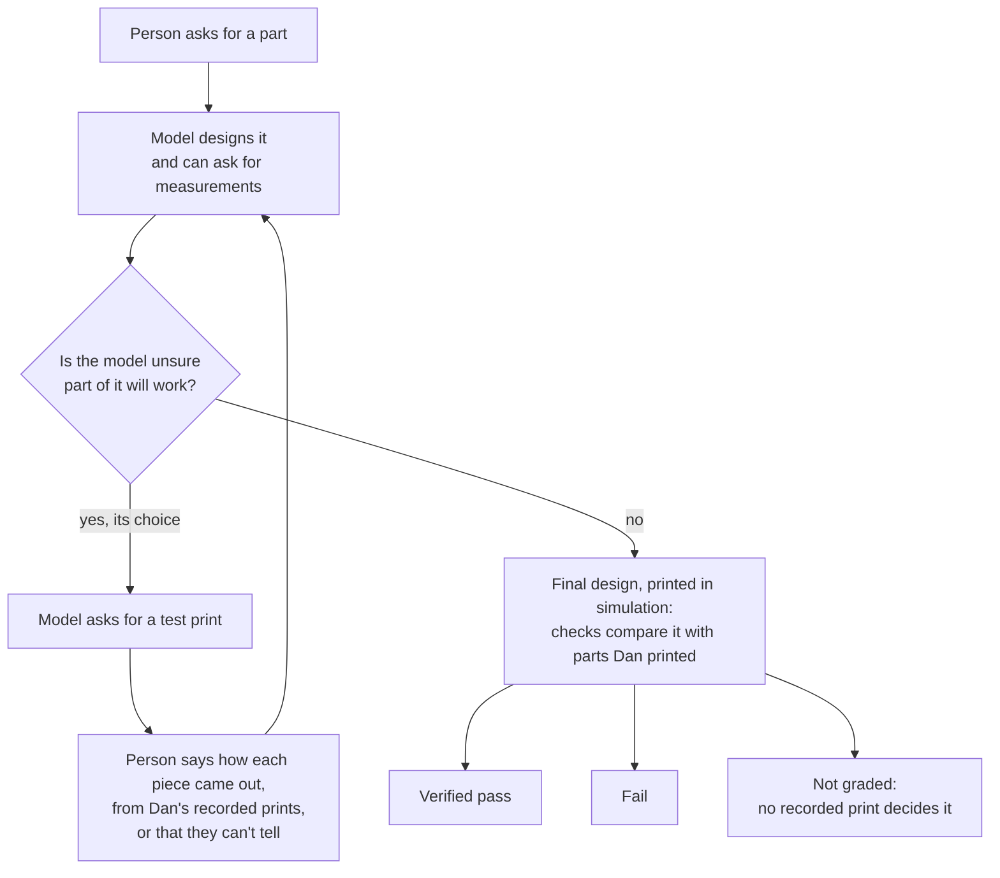

A trial where the model asked for a test print before its final design (Sonnet 5.5's M3 knob):

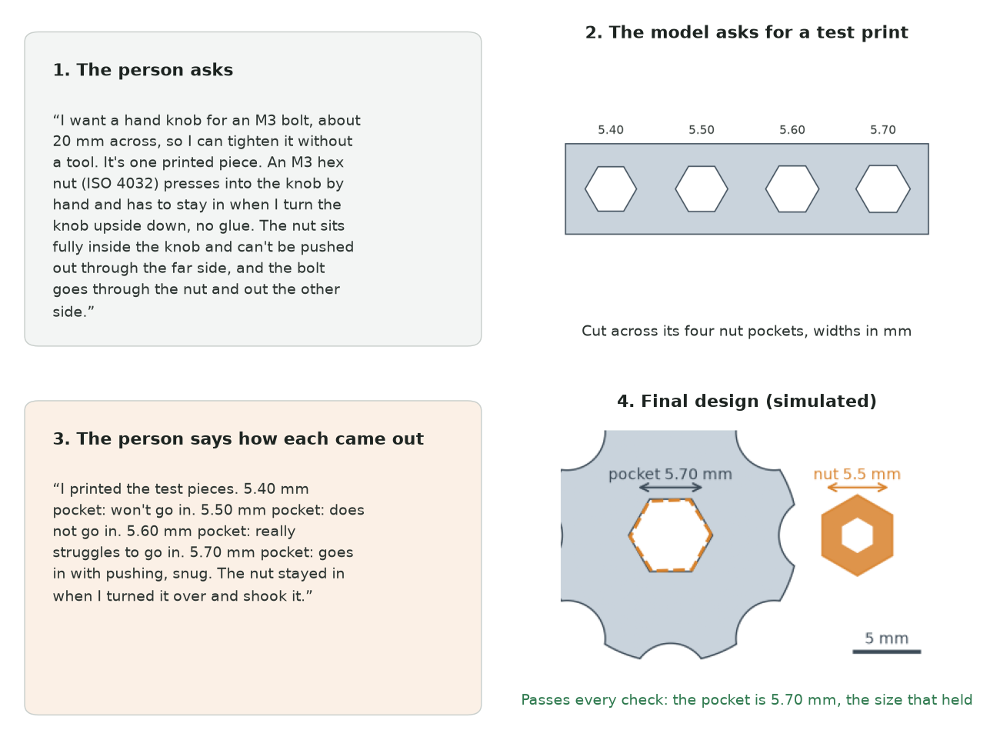

In each trial, nothing actually gets printed. We have checks, run by code, that simulate the model's parts and compare them with the results of my test prints to see if they would print successfully. Here's an example of a trial that failed and then succeeded after we gave the model feedback about what failed (Gemini 4 Argon on the Estoa light, from the earlier loop, where the feedback came after its first print):

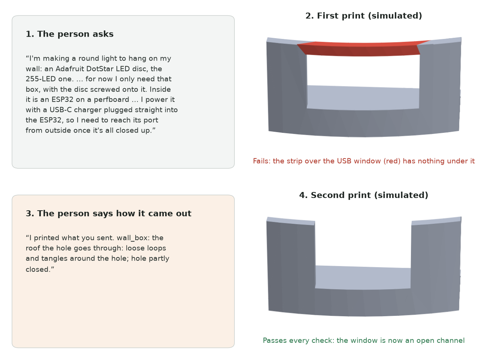

## Constraints

* The print shouldn't require any supports
* The model has up to 12 turns
* We are currently restricting to high-speed PLA.

## What the eval tests: failure classes

Every one of our checks comes from failures that happened on my real builds. We used AI to scrape my existing sessions, found 57 failures, and categorized them into 10 classes ([every check](docs/reference.md#the-failure-classes-the-tasks-test)). Six of the classes were tested in these trials.

| Class | From Dan's builds | A real failure | How the code checks it |
|---|---|---|---|
| **C1** Designing from unmeasured dimensions |  | The Estoa battery bay was drawn from a guessed 154 mm length; the battery didn't fit. | The person's measurements are only given if the model asks. The checks compare the design against the real ones, such as the bolt head's real size in the tripod plate's recess. |
| **C2** Fit clearance wrong for the printer |  | Nut pockets 0.3 mm over the nut; every nut fell out. | It measures the nut pocket or bearing seat in the built part and looks that size up in the recorded test prints: went in and held, fell out, or wouldn't go in. |
| **C3** Fastener stack-up |  | Estoa's posts for the heat-set inserts (brass threaded sleeves melted into the plastic) were too thin; they bent and the inserts sat crooked. | It adds up each bolt's path from the part and the catalog's real thread lengths: does the bolt reach the camera, pass through the nut, or bottom out before it tightens; is there enough plastic around each insert. |
| **C5** Mating-part envelopes |  | Estoa's USB opening fit the port, but a real plug's head is wider than the hole. | It places the real hardware against the part (the clamp's jaws, both bearings, the perfboard, a USB-C plug) and checks each one fits. |
| **C6** Printability in the orientation printed |  | The bottom of the camera plate: the plastic printed over the bolt's recess collapsed into loose strands. | It cuts the part into layers as printed and lays strands across every overhang. If too few land on solid at both ends, the roof fails. Each part must also be one piece and fit the bed. |
| **C7** Works in the orientation it's used | no photo | Estoa's keyhole slots ran down, so it couldn't hang on its screws. | It reads which way is up from the design and checks each keyhole's slot runs up from its entry. |

<details>
<summary>How two of the checks use my test prints, in pseudocode</summary>

**C2, does the nut fit its pocket** (`pbe/graders/nuts.py`), against the nut-pocket test print:

```text
recorded = my nut-pocket test print: for each nut size, each pocket's clearance and what the nut did
           (won't go in / snug, holds upside down / falls out)

for each layer of the model's part, from the bed up:
    find a hexagonal hole about the size of the nut
pocket = the widest across-flats of that hole
if the pocket has ribs, clips or a lip:  compare it with round 3's pocket of the same shape and bite;
                                          not graded if none is close
clearance = pocket - the nut's across-flats size (ISO table)

if a recorded pocket is within 0.01 mm of clearance:  use what that nut did
elif clearance is between two recorded pockets that did the same thing:  use that
elif it's tighter than one that wouldn't go in, or looser than one that fell out:  use that
else:  not graded  (no print says)
pass only if the nut goes in by hand and holds upside down
```

**C6, does a roof print over air** (`pbe/graders/bridges.py`), against the roof test prints:

```text
longest_clean_span = the longest roof my test prints bridged cleanly (50 mm)

slice the part into 0.2 mm layers, from the bed up
for each layer:
    unsupported = this layer minus the layer below
    skip anything within a short overhang of the layer below
    for each unsupported region:
        for strand directions every few degrees:
            lay strands 0.4 mm apart across the region
            a strand is good if both ends land on the layer below, within longest_clean_span
        if some direction has (nearly) every strand good:  the roof prints
if no direction works:  fail  (a hole cut through a roof always fails: strands end at the hole)
a ledge narrower than any that tangled in a test print:  not graded
```

</details>

Not tested yet: C4 tool and hand access, C8 test-plan coverage, C9 manual correctness, C10 print settings.

*Every failure has a test case. For example, C6's photo above is a failed first attempt at printing a tripod's Arca plate, as designed by a model. The roof over where the bolt's head goes printed as tangled strands. The command shown below runs the checks again on both the original design and the fixed one. The test fails the original design, just like it happened in real life, but the fixed design passes.*

```bash
uv run python -m pbe.run examples/arca-plate/original.yaml examples/arca-plate/fix.yaml
```

*Expected: the original fails `bridges` and the fix passes every check.*

## The test prints behind the checks

The hackathon started on Oct 30, but I was flying away from home that day and would be away from my 3D printer for the whole hackathon. So on Oct 28, I began creating test prints that could provide the ground truth for parts of the 3D printing simulation, shown below.

Each print tests the ground truth of one thing. For example, if there's a roof over a hole, will it print successfully? We printed nut pockets at different sizes, using different techniques, to see which size a nut would fit into snugly without falling out.

What each print tests, why we printed it, and what happened, from the test-print code (`coupons/coupons.py`) and the records of both rounds with my notes (`results/predictions/`):

| Round one, printing | Round two, printing |
|---|---|
|  |  |

| The print | What it tests | Why we printed it | What happened |
|---|---|---|---|
|  | **Nut pockets.** I wanted to find the actual best size to print the opening so it holds the nut. I took nuts of different sizes (M3, M5, M8 and 1/4-20), pressed them into pockets from exactly the nut's size to 0.3 mm over, and saw which one was the most snug while still realistic to push in (Oct 29, at 2.5 times speed) | In the past, I'd had nuts that wouldn't fit snugly into an opening in a 3D print, and when you turned the part a certain way, the nut would fall out | M3 needs 0.2 mm over ("goes in with pushing, snug"); at 0.1 it "really struggles". M5 holds at 0 and 0.1 mm over, and is loose at 0.2. M8 and 1/4-20 hold only at the nut's exact size |
|   | **Bridges and overhangs.** I wanted to test different scenarios to see what kind of overhang prints work and which ones fail and result in strands: roofs over pockets 20 to 50 mm wide with walls on all four sides, one with a hole cut through it, and tunnels open at their ends | I've had a bunch of successes and failures when printing with overhangs and bridges | When there are no walls on one side, it fails, as you can see here in both attempts, but if there are walls on four sides, it seems to be pretty successful, even when you get pretty wide. The roofs with four walls printed clean up to 50 mm (the 40 mm one sagged in round one and printed clean in round two); the roof with a hole through it tangled; the tunnels printed as strands both times |
| | **Bearing seats.** 608 bearing seats from 22.0 to 22.3 mm, and 8 mm pegs for the bearing's bore | The closet-door wheel task: does a bearing press in and stay in, and at what size? | The 22.0 mm seat wouldn't take the bearing; 22.1, 22.2 and 22.3 took it and held it upside down. Only the tightest 8 mm peg was snug |

## The tasks

Each task is based on a realistic prompt that a person would write. The **reference solution** is one I made by hand that I know passes all the checks, to show the task can realistically be done. The other pictures show the designs the models came up with.

### Tripod plate

> "I borrowed my friend's tripod, and I can't seem to find the part that connects the camera to the tripod. How hard would it be to 3D print it, both the flat part and the part that screws in? Just as a temporary thing until I find the real one. I know it's metal normally."

| Reference solution | Pass | Fail: dovetail upside down | Fail: roof over the bolt's hole |
|---|---|---|---|
| 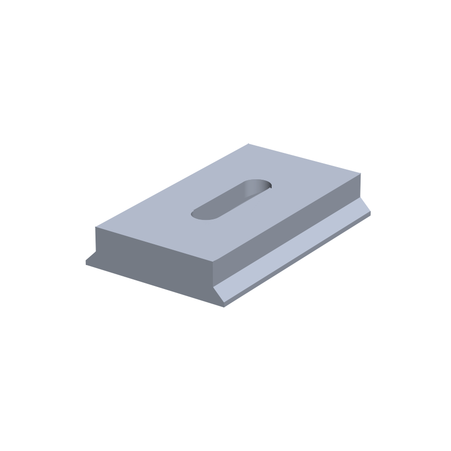 | 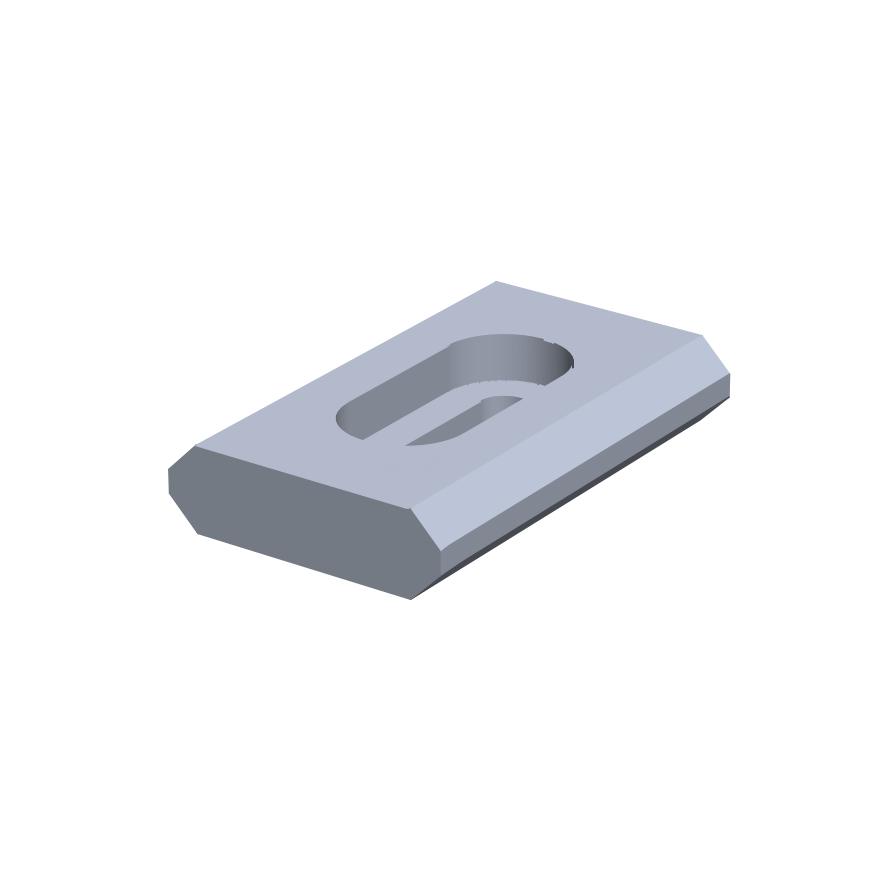 | 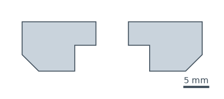 | 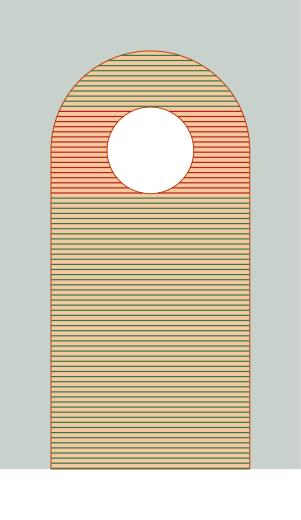 |
| Hand-written, after the plate Dan printed | Opus 5.5, trial 5 | Sonnet 5.5, trial 1, cut end-on: the plate narrows toward the tripod, the opposite of what the clamp's angled jaws hook over. Flipped to fit, the bolt head ends up on the camera's side | GPT-6 Luna, trial 1, the bolt's recess seen from below: the hole is cut through the roof, so the red strands end in mid-air; only 66% land on plastic at both ends |

More from the saved trials: four passes and four failures, failures seen from below with the failing roof or ledge in red.

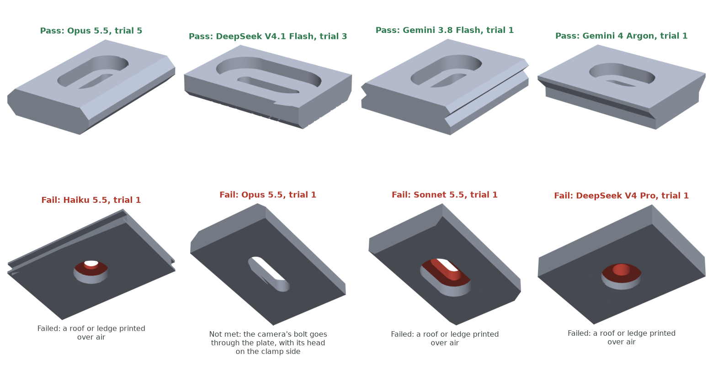

### Closet door wheel

> "The roller wheel on my sliding closet door snapped. I've got two 608 skateboard bearings and an M8 bolt I could use. Could I 3D print a new wheel that spins on the bolt? The old one was about 50 mm across and about 16 mm wide."

| Reference solution | Pass: a cone roof | Fail: a flat roof | Fail since round 3: a narrow ledge |
|---|---|---|---|
| 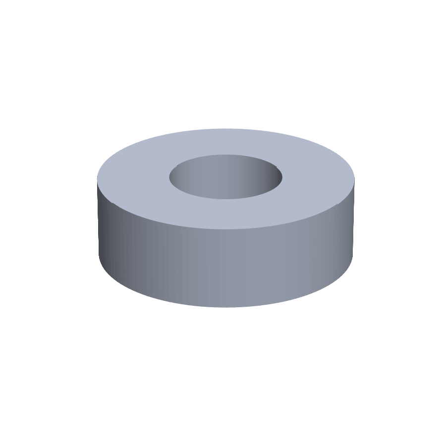 | 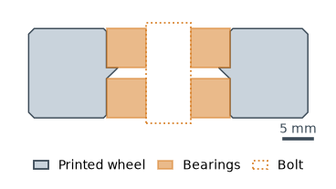 | 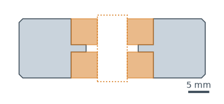 |  |
| Seats for both bearings | Opus 5.5, trial 1: the ledge between the bearings steps inward each layer, so nothing is printed over air | Sonnet 5.5, trial 1: a flat ledge over the empty lower bearing seat; only 22% of strands land on plastic at both ends, so it would sag | Sonnet 5.5, trial 3: a ledge about 2.5 mm wide. It wasn't graded until round 3's ring roofs, where a 2 mm ledge round a bolt hole tangled; now it fails |

More from the saved trials: four passes and four failures, failures seen from below with the failing roof or ledge in red.

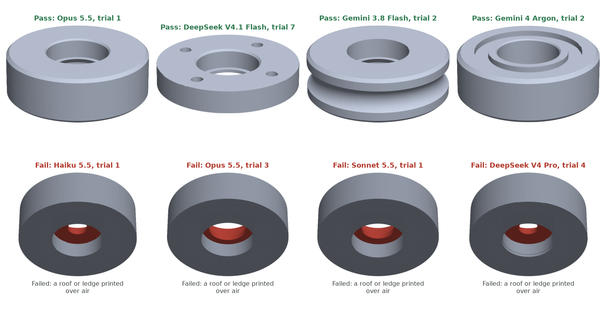

### Hand knob (M3 and M5)

> "I want a hand knob for an M3 bolt, about 20 mm across, so I can tighten it without a tool. It's one printed piece. An M3 hex nut (ISO 4032) presses into the knob by hand and has to stay in when I turn the knob upside down, no glue."

| Reference solution | Pass | Fail: no clearance | Pass since round 3: crush ribs |
|---|---|---|---|
| 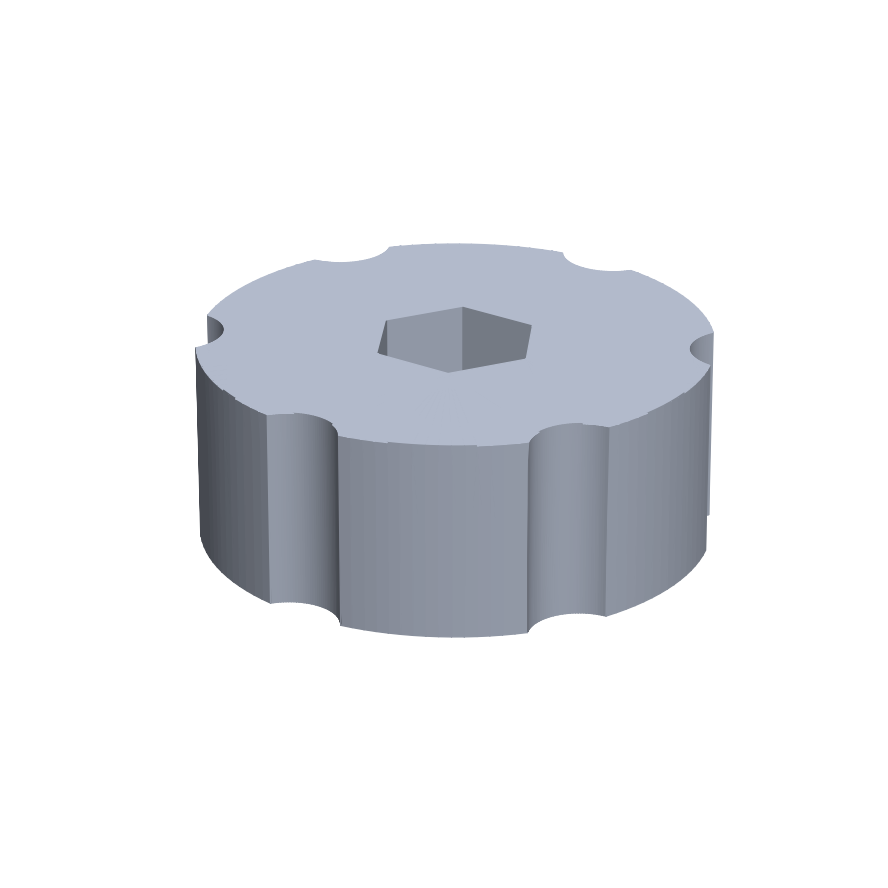 | 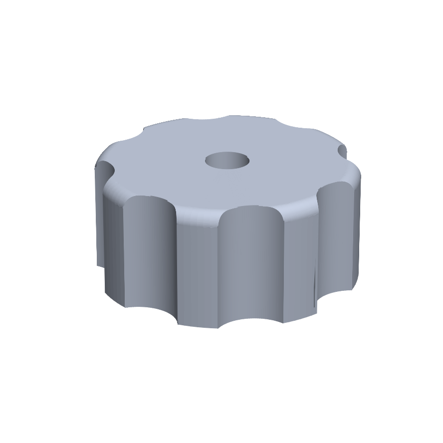 | 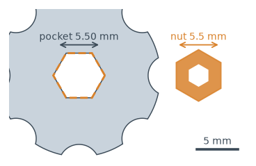 | 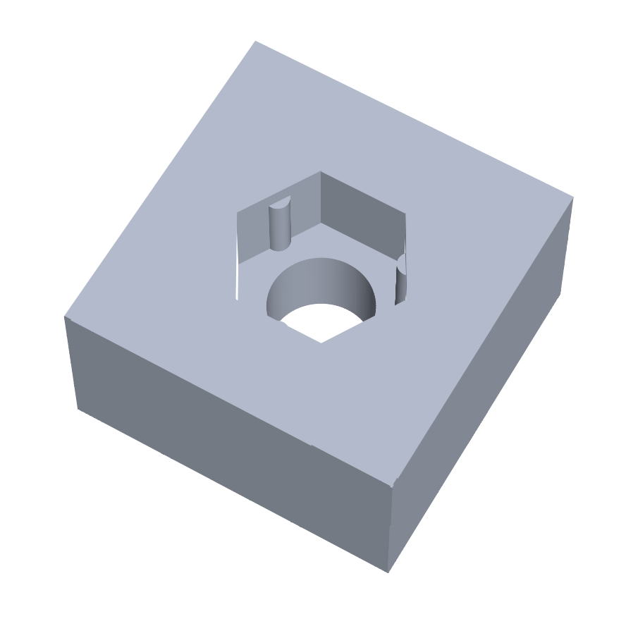 |
| Pocket at a size the test print held | Sonnet 5.5, M3, trial 2 with test prints: it asked for a test print of four pocket sizes and heard 5.40 and 5.50 mm won't go in, 5.60 mm really struggles, and 5.70 mm goes in snug and stays upside down. Its knob uses 5.70 mm | Sonnet 5.5, M3 trial 1, cut across: the pocket is exactly as wide as the nut, with no gap. Dan's test print at that size wouldn't take the nut | Opus 5.5, M5 trial 2: the small round ridges on the pocket's walls are meant to grip the nut. No test print had ribs until round 3, where a pocket with three round ribs took an M5 pressed in on a bolt and held it upside down. These ribs are within 0.2 mm of that one, so the check passes them, saying which print it assumed from |

More from the saved trials: four passes and four failures, failures seen from below with the failing roof or ledge in red.

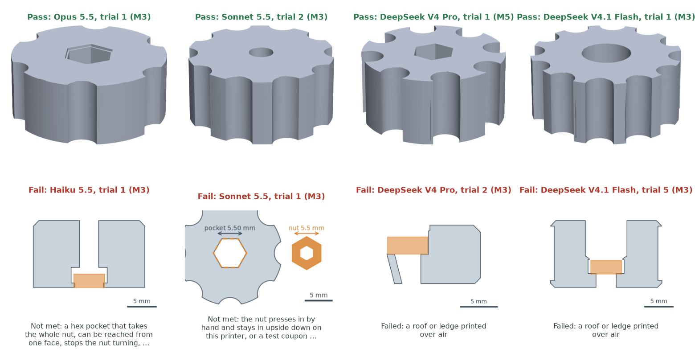

### Estoa light box (harder task)

> "I'm making a round light to hang on my wall: an Adafruit DotStar LED disc, the 255-LED one. … for now I only need that box, with the disc screwed onto it."

| Reference solution | The real one |
|---|---|
| 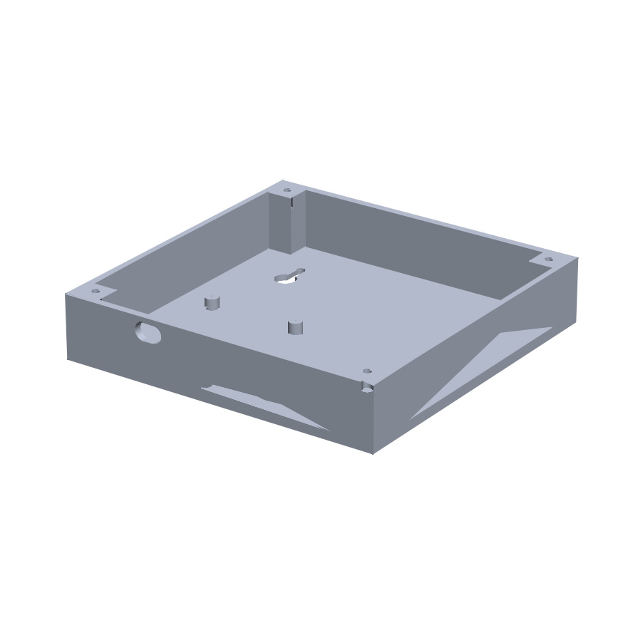 |  |
| A box the disc screws onto; any shape that passes the checks works | Dan's build |

We ran out of time to make the test-print loop work on this task. Some example failures:

| A roof over air | A keyhole that runs down | A perfboard with no wall on one side |
|---|---|---|
| 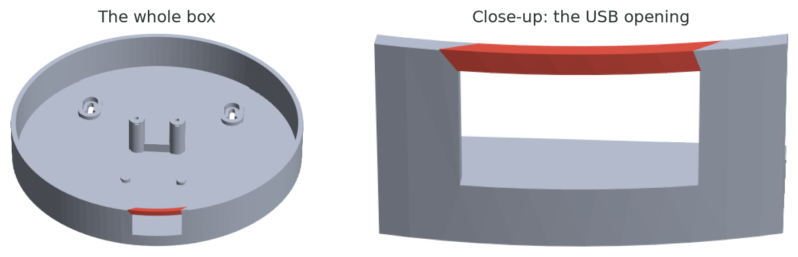 | 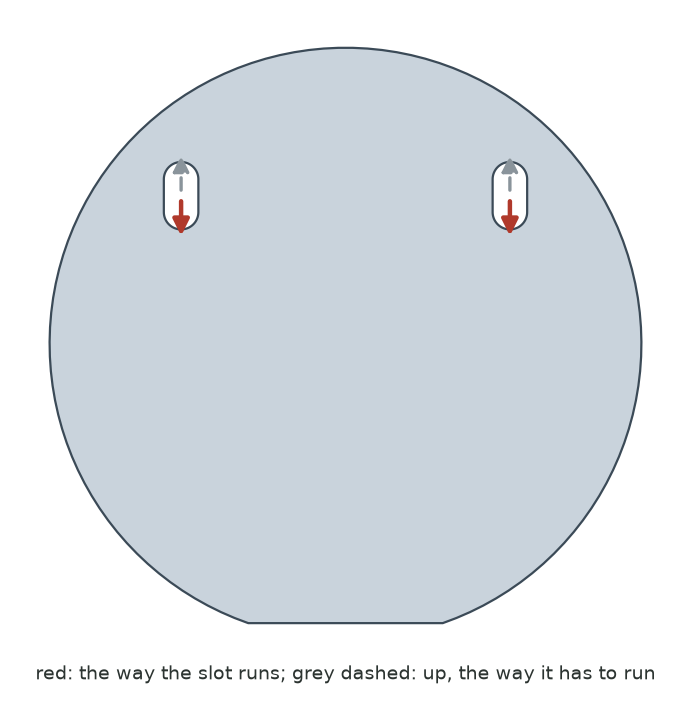 | 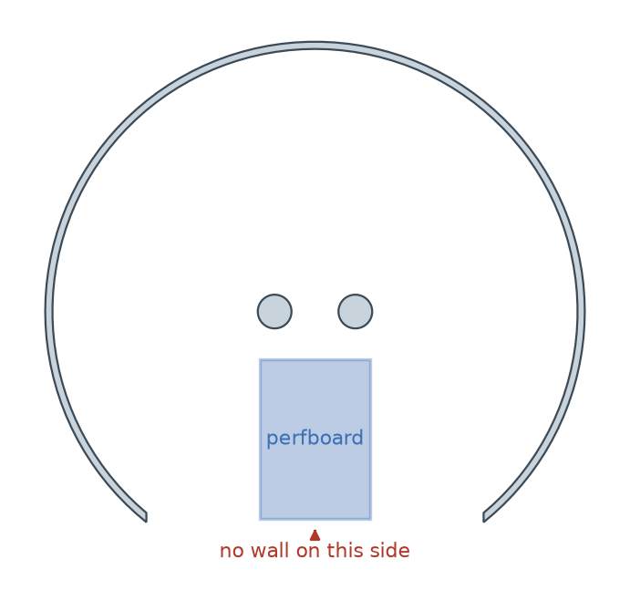 |
| Gemini 4 Argon, trial 2: the top edge of the USB opening (red) spans thin air and would sag | Opus 5.5, trial 2 with test prints: both slots run down from their entries, so the box can't drop onto the wall screws | GPT-6.1 Sol, trial 3 with test prints: the wall stops short of the perfboard's side, so the board isn't inside the box |

## Results

<!-- scorecard:start (written by scripts/scorecard.py; don't edit by hand) -->
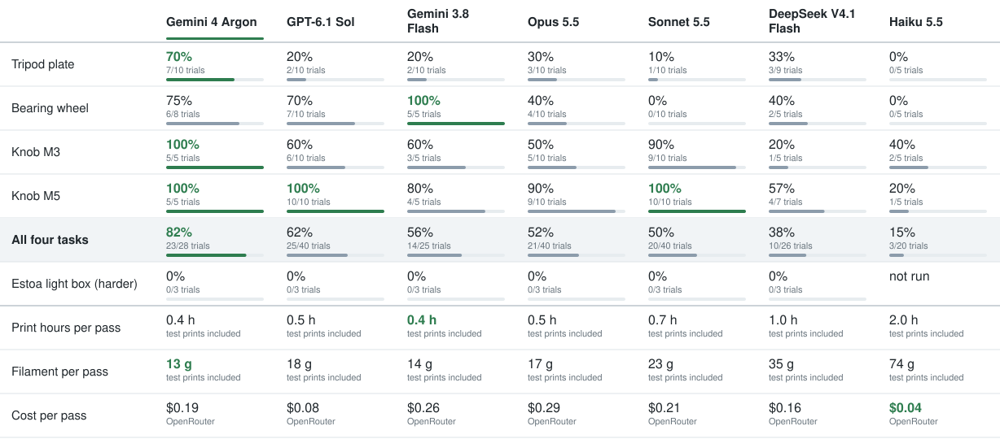

In these results the model can ask for test prints before its final design, as in [How a trial runs](#how-a-trial-runs). Each column is a model, best first; the best in each row is in green. A pass means every check passes on my recorded test prints. Time, filament and cost per pass count everything the model printed, test prints included, divided by the parts that work.

**Best to worst, when the model can ask for test prints** (7 models, 5 or more trials on each of the four tasks):

1. **Gemini 4 Argon**, 82% of trials pass (23/28): $0.19 and 0.4 print hours per working part
2. **GPT-6.1 Sol**, 62% of trials pass (25/40): $0.08 and 0.5 print hours per working part
3. **Gemini 3.8 Flash**, 56% of trials pass (14/25): $0.26 and 0.4 print hours per working part
4. **Opus 5.5**, 52% of trials pass (21/40): $0.29 and 0.5 print hours per working part
5. **Sonnet 5.5**, 50% of trials pass (20/40): $0.21 and 0.7 print hours per working part
6. **DeepSeek V4.1 Flash**, 38% of trials pass (10/26): $0.16 and 1.0 print hours per working part
7. **Haiku 5.5**, 15% of trials pass (3/20): $0.04 and 2.0 print hours per working part

Not run with test prints, ranked by their first print without them: GLM 5.3 Flash 22%, GPT-6 Luna 8%, DeepSeek V4 Pro 5%, Qwen 3.8 Flash 3%. Grok 4.7 was left out because it was too expensive to run 10 trials on.

**What asking for test prints changed.** Across these 7 models, 37% of first prints pass without test prints, and 53% pass when the model can ask for test prints before its final design.

| Model | First print, no test prints | Second print, after hearing how the first came out | Asking for test prints first | Change from the first print |
|---|---|---|---|---|
| Gemini 4 Argon | 50% (20/40) | 80% | 82% (23/28) | +32 points |
| GPT-6.1 Sol | 50% (20/40) | 52% | 62% (25/40) | +12 points |
| Gemini 3.8 Flash | 45% (18/40) | 62% | 56% (14/25) | +11 points |
| Opus 5.5 | 40% (16/40) | 68% | 52% (21/40) | +12 points |
| Sonnet 5.5 | 35% (14/40) | 50% | 50% (20/40) | +15 points |
| DeepSeek V4.1 Flash | 39% (16/41) | 61% | 38% (10/26) | -1 points |
| Haiku 5.5 | 2% (1/40) | not replayed | 15% (3/20) | +12 points |

In 155 of these 219 trials the person answered at least one test piece with "I can't tell you how that one came out", for a size my test prints never tried. 78 of the 116 passes came after such an answer, so some may owe part of the pass to moving to a size I did print (see Limits).
<!-- scorecard:end --> 

<!-- scorecard-note:start (written by scripts/scorecard.py; don't edit by hand) -->
Some of the gain after feedback comes from a gap in the simulation, not from what a builder would say. When no recorded print decides a part, such as a ribbed nut pocket, the person can only answer "I can't tell you how that one came out", and a model can then switch to a shape the test prints cover, which passes. The final design is verified, but a real builder would have said whether the part worked. New passes that came this way: Sonnet 5.5 1 of its 6. Gemini 4 Argon, Opus 5.5, Gemini 3.8 Flash, DeepSeek V4.1 Flash and GPT-6.1 Sol had none.

**The Estoa light box**, the harder task, isn't in the four-task total: 6 models, 30 trials. 1 of 30 designs pass on the first print. After the person says how the box came out, 1 of the 26 failures replayed passes. Asking for test prints first, 0 of 18 pass (its row in the table). We ran out of time to make the test-print loop work on this task ([the Estoa section](#estoa-light-box-harder-task)).
<!-- scorecard-note:end -->

### Where models fail

The models design a print without really understanding the constraints of 3D printing. A lot of them design roofs over open space that can't print without supports. They design a place to slot in a nut without any kind of gap, so the nut won't go in. The models do make test prints, but they test the wrong thing. On the wheel they tested if the bearing fits, and mostly got that right. Then the wheel failed on stuff they never tested, like not leaving room for both bearings, the bolt not fitting through, or a roof printed over air.

### The takeaway

With 3D printing, there's a lot of things people can now do. It's getting more accessible, but you still need to have some knowledge of how it works. You want the model to be able to do some testing with you to test what it knows, so it can know what it doesn't know. It's the same as unit testing, except you're printing a small piece of material. The test print isn't that great, actually. It's almost like it's writing a unit test, but the unit test isn't testing the edge cases or the risky part.

Designing a 3D model with AI reveals similar issues as when you write code. It can appear visually correct, but there can be all these internal issues that come up without a human experienced in 3D printing knowing the errors, that occurred due to a lack of testing before delivering the final version.

Sending the 3D model to the slicer is like compilation: it tells you how long and expensive it will be to print.

A test print is like a unit test of code. An experienced 3D print designer would know the edge cases of what can go wrong, and would make a test that minimally tests a specific error. A good test print, like a good unit test, tests just one thing, and can save loads of time when printing the final result.

The final print is like deploying a release, except the consequences of being wrong are more expensive than in software, in both time and material.

Another takeaway is that all these failures that we are now able to predict would be great to use on their own. This can be like a suite that I could use in the future when I'm doing my 3D modeling, because I can catch errors that I know are going to happen.

With more test prints around all these designs that the model makes, I can really have a better ground truth, and even skip doing a physical test print, because I know if it's going to fail or not.

## What we couldn't grade

During the hackathon I was away from my 3D printer, so the first results left every design no test print covered as **not graded**: crush ribs to hold a nut, narrow roof ledges, bolt holes and bearing seats between the sizes I'd printed, the USB-C plug's head. Not graded is never a pass, because we don't know the truth.

Back at the printer on 2026-11-11 and 12, I printed a third round of test prints aimed at those gaps, and six roofs cut straight out of the models' own Estoa designs, and measured my USB-C plug. The checks now read those records, and every saved trial was regraded (`CHANGELOG.md`, 2026-11-12, has each rule and its evidence). 127 trial results moved from what was published before: 64 nut knobs and 3 bearing wheels that were not graded now pass, and 40 not graded now fail; 10 knobs that passed now fail, because their pockets are tighter than round 3's tightest that took a nut. Five of the six roof crops failed as the bridge check predicted, and the sixth, a short-span roof, printed clean, so roofs whose strands are all 6.8 mm or shorter now pass. The Estoa light box stays at 1 pass in 48: its other failures, mostly keyholes and roofs that really tangle, still stand.

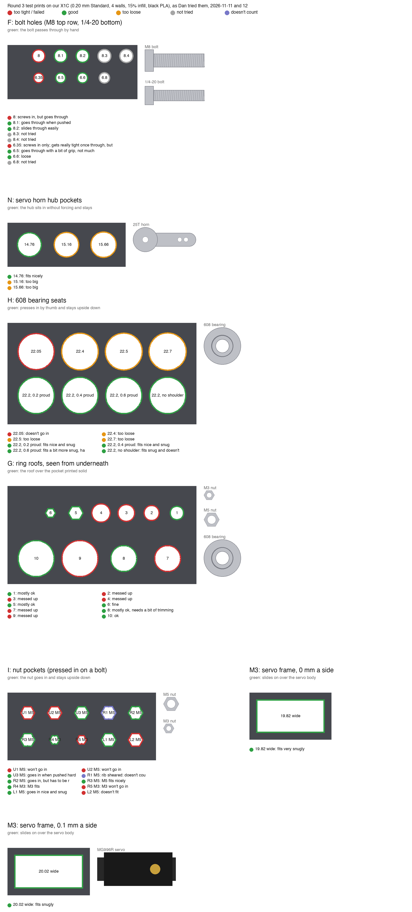

| Bridges and roofs cut from the models' designs | GPT's roof, the one that printed clean | Ring roofs: stepped clean, plain tangled | A tightened M5 nut on the 1.3 mm ledge |
|---|---|---|---|
|  |  |  |  |
| All strung: the bridge check failed each of these, and the 50 mm span limit stands | Its longest unsupported strand is 6.8 mm, so short-strand roofs now pass | 9 of 10 cells came out as the bridge check predicted | It holds, just not flush: the miss the short-strand rule fixes |

What's still not graded, how many trials produced each, and the print that would settle it:

<!-- not-graded:start (written by scripts/failure_tables.py; don't edit by hand) -->
| Not graded because | Example | Trials | The print that would settle it |
|---|---|---|---|
| A tripod head recess under 5 mm deep | 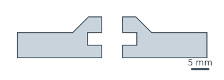<br><sub>Haiku 5.5, tripod plate, trial 3</sub> | 33 | Recesses 3, 4 and 4.5 mm deep for the 5 mm head |
| A nut pocket with ribs, clips or a lip unlike any printed | 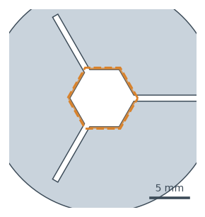<br><sub>Haiku 5.5, knob M5, trial 1</sub> | 29 | That rib shape and bite. Round 3 printed 3 and 6 round ribs, 6 flat ribs and two lips; each model's ribs differ, so one print settles only designs like it |
| A nut pocket no recorded print settles | 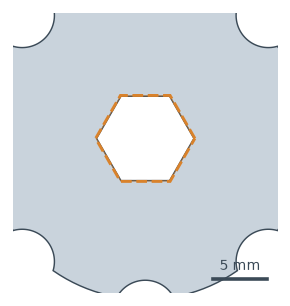<br><sub>DeepSeek V4.1 Flash, knob M5, trial 6</sub> | 12 | A print of that pocket |
| A roof ledge 1.5 to 2 mm wide | 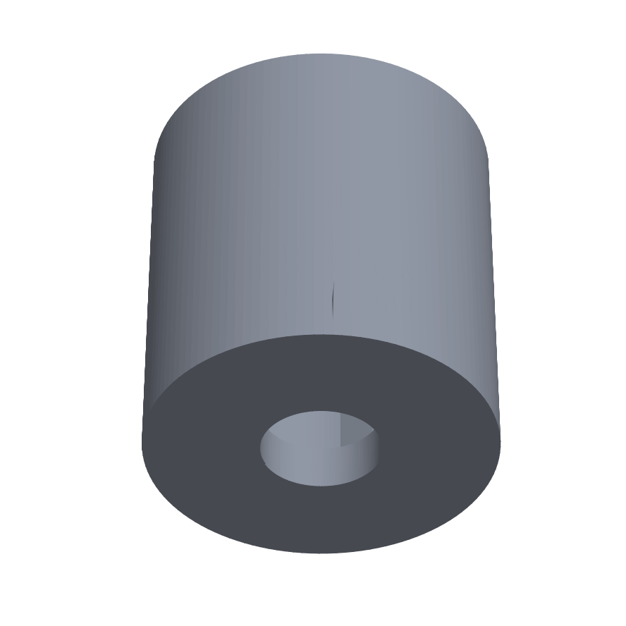<br><sub>Qwen 3.8 Flash, knob M3, trial 10</sub> | 11 | Ring roofs 1.6 to 1.9 mm wide: round 3's 1.5 mm ledge printed and its 2 mm ledge tangled |
| A plate width outside 37 to 39 mm | 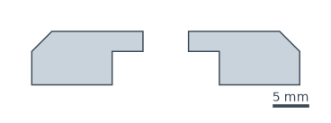<br><sub>DeepSeek V4.1 Flash, tripod plate, trial 2</sub> | 11 | Dovetail plates from 34 to 45 mm tried in the clamp |
| A pocket shape the checker can't read | 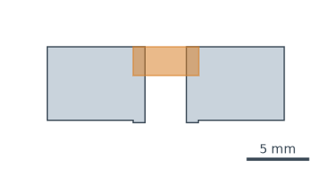<br><sub>GPT-6 Luna, knob M3, trial 1</sub> | 2 | None: the checker needs fixing |
| A test print whose pockets are ribbed or unsettled | 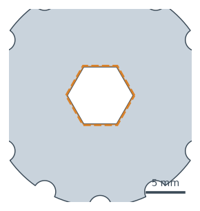<br><sub>Sonnet 5.5, knob M3, trial 5</sub> | 2 | The ribbed pockets above, and coupon B2's finer steps |
| A bearing seat between printed sizes, or ribbed | 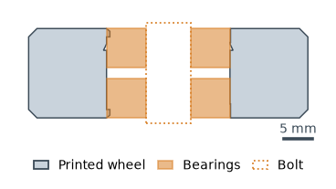<br><sub>GLM 5.3 Flash, bearing wheel, trial 2</sub> | 1 | Seats at 22.1 and 22.3 mm, and lobed seats: 22.05 wouldn't take a 608, 22.2 held, 22.4 fell out |
<!-- not-graded:end -->

## Run it

From the unzipped folder, with [uv](https://docs.astral.sh/uv/) installed and no API key:

```bash
uv sync
```

```bash
uv run python scripts/scorecard.py
```

```bash
scripts/reproduce.sh
```

The scorecard prints the table above from the saved runs. `reproduce.sh` checks everything end to end: tests, a regrade of every saved trial, the results page and the README's tables (about 30 minutes). Building model-written parts needs a sandbox: macOS has one built in, and on Linux install `bubblewrap`. [The reference](docs/reference.md#run-it) has every step, the Linux setup and how to run new trials.

**Run a trial yourself** (needs an [OpenRouter](https://openrouter.ai) key: make an account, add credits and create a key in its settings; one trial costs a few cents):

```bash
OPENROUTER_API_KEY=... uv run python -m pbe.eval --run mine --condition can_test --task nut-knob/M3 --model anthropic/claude-sonnet-5.5 --budget 0.50
```

`--condition can_test` is the mode in the results: the model can ask for test prints before its final design. `can_ask` has no test prints.

It saves the conversation, the design and every check's result under `results/runs/mine/`. The tasks are `tripod-plate`, `bearing-wheel`, `nut-knob/M3`, `nut-knob/M5` and `estoa-light`, and `--model` takes any OpenRouter model id.

**Use the agent on a real part** (a live session): the same prompt, tools and hand-in format, but you answer its questions. `measure` and `print_test` come to you at the terminal, or to a file of answers; each test piece is saved as an STL, and printing it is your call. With a measurement the agent may send a sketch with numbered dimensions, which opens in your browser so you can answer by number.

```bash
OPENROUTER_API_KEY=... uv run python -m pbe.live "I need a clamp that holds a 25 mm tube to the edge of a shelf" --model anthropic/claude-sonnet-5.5 --budget 0.50
```

It saves the transcript, your answers (`session.yaml`), the design and its parts under `results/local/live/`. Pass `--answers` with that `session.yaml` to run the session again with nobody answering.

**Check a design before printing it** (the pre-print check): the eval's checks on the agent's hand-in, or on an STL or STEP file exported from any CAD tool, oriented as it prints with z up.

```bash
uv run python -m pbe.preprint knob.stl --nut M5
```

Each line is a prediction and the recorded print it rests on, or "not graded" where nothing recorded is near. It predicts from the design's geometry and the recorded prints on one printer and filament. It is not a print simulation: warping, bed adhesion, stringing and strength aren't predicted. It exits 1 if a check fails. How these fit Dan's own builds is in [docs/making-system.md](docs/making-system.md).

## Limits

Many designs couldn't be graded without more test prints ([What we couldn't grade](#what-we-couldnt-grade)).

The replies only come from my test prints. For a size I never printed, the person can only say "I can't tell you how that one came out," so models switch to sizes I did print. That wouldn't happen in real life.

In my own 3D printing workflow, I'm constantly adding to a self-learning knowledge base of mistakes that gives the model context and failure cases when 3D modeling. The models in this eval didn't have it, which leads to more failures.

Our test prints were done on my Bambu Lab X1C, only in PLA, with a single print setting. To make the eval broader, we would do test prints in different materials and on different 3D printers.

I worked with Opus 5.5 to go through and decide on assumptions about results that would enable us to grade some of the unknowns.  These are captured in [the reference](docs/reference.md#assumptions-calls-and-known-limits).

## Prior work and comparable evals

| Eval | What it tests | How this one differs |
|---|---|---|
| BenchCAD | CadQuery code from images and text, across 106 part families | Grades whether a part works with real hardware on a real printer, not whether it matches a reference shape |
| CADEngBench | Parametric parts graded on valid solids and design-for-manufacturing checks | Fit limits come from test prints on one printer, and the model can ask for measurements and hear how a print came out |
| Hephaestus-CCX | Requirements written as typed checks | Borrowed: each task's requirements are typed checks (`requirements.yaml`) |

Code from BenchCAD (MIT) is used for its CadQuery sandbox; CADEngBench has no licence, so its layered grading is reimplemented and cited. [Prior art](docs/reference.md#prior-art) has the full list.

## Tools used

- **Models**: tested through [OpenRouter](https://openrouter.ai)'s API.
- **Building and checking parts**: CadQuery (the models write their parts in it), trimesh, manifold3d and shapely for the geometry, bubblewrap or `sandbox-exec` to run model code in a sandbox.
- **Print time and filament**: Bambu Studio's slicer, offline.
- **Test prints**: a Bambu Lab X1C, PLA.
- **Writing the code**: Claude Code (Opus 5.5), with reviews by Codex.
- **README**: Pangram to check which parts read as AI-written.

## How we used AI

* Claude Code and Opus 5.5 wrote pretty much all the code, did the refactoring, wrote all the checks and the test cases, and helped me edit the docs.
* It also ran all the evals, set up the connection to OpenRouter, and helped me scrape my old printing sessions for failures.
* I was able to use AI to run a suite of evals in the cloud while I was away from my computer.
* I used Codex to review the code Opus 5.5 generated.
* I also had Opus 5.5 generate sample renders and pages so I could review how the evals ran and give human feedback on how they were being scored.
* I wrote or dictated most of the README's text myself. Claude wrote the generated tables, the failure-class table and some captions, and edited the rest.

## More

The version submitted to the hackathon is the tag [`hackathon-submission`](https://github.com/oveddan/functional-print-eval/tree/hackathon-submission). Work after it, such as the live mode and the pre-print check, is not part of what was submitted.

The full results, every check, what went wrong task by task and the prior art are in [docs/reference.md](docs/reference.md). MIT licence, in `LICENSE`. `docs/context/` is my private material, isn't covered, and is left out of the submission ZIP.
