# Print-and-Build Eval: reference

Everything behind the [README](../README.md): the failure classes, how to run each step, the tasks, how grading works, the full results, what went wrong, the assumptions and the known limits.

## The failure classes the tasks test

<!-- failure-classes:start (written by report/atlas/build.py --readme; don't edit by hand) -->
57 failures from real builds with an AI agent, each traced to its session (`seeds/`) and sorted into one of 10 classes that don't depend on the object (`seeds/classes.yaml`). They came from: Tripod and phone stand (12), Estoa light piece (34), Lamp mount and organizer (8), The eval's own test prints (3). The graded tasks test 6 of the classes; each is below with the requirements that test it, one real failure, and photos, which are hosted rather than committed.

#### C1: Printed the wrong size for the item it holds

13 failures in the builds. Tested by:

- `tripod-plate` R4, the bolt's head fits in its recess
- `estoa-light` R1, a screw through each of the disk's two holes goes into the box

**From the builds** (Estoa light piece): Modeled the power-bank bay from a guessed 154 mm length and a guessed cable exit, without asking for measurements. Found by: skeleton test print; the battery didn't fit and the cable would be crushed against the breakout.

|  |  |
|---|---|
| Estoa's back-box skeleton, Oct 3, with the real power bank on it. The bay was drawn from a guessed 154 mm battery and a guessed cable exit; the power bank didn't fit. *Dan's photo* | Half an hour later, the fix. A 1:1 paper floor plan with the real power bank, USB-C breakout and cable laid on it, before anything else was printed. *Dan's photo* |

#### C2: Pocket the wrong size for a snug fit

4 failures in the builds. Tested by:

- `tripod-plate` R3, the camera's bolt goes through the plate, with its head on the clamp side
- `nut-knob` R4, the nut presses in by hand and stays in upside down on this printer, or a test print would have found a size that does
- `bearing-wheel` R3, the bearings press in and stay in on this printer, or a test print would find a size where they do

**From the builds** (Tripod and phone stand): Nut pockets at af+0.3 mm; every nut fell out. Found by: three rounds of test prints.

#### C3: Fasteners don't properly connect to each other

6 failures in the builds. Tested by:

- `tripod-plate` R5, the bolt reaches into the camera
- `nut-knob` R5, the bolt passes through the nut and out the other side (at least ISO 273's fine clearance hole)
- `bearing-wheel` R4, the M8 bolt goes through
- `estoa-light` R2, the disk's screws hold, don't bottom out, and don't reach the electronics or the wall
- `estoa-light` R4, every heat-set insert sits in a hole sized for one (posts pass for now, Dan 2026-11-13)

**From the builds** (Estoa light piece): Lid-screw posts about 8 mm across and 26 mm tall, freestanding, with 4.3 mm holes for 5 mm inserts; they softened, bent and flared, and inserts sat off-centre. Dan followed the instructed technique. Found by: assembly.

|  |  |
|---|---|
| A lid-screw post after its heat-set insert went in, Oct 5. The post was too thin and tall for a 5 mm insert, so its walls flared and the insert sat off-centre. *Dan's photo* | The tripod's phone clamp, Oct 24. The design treated an M5x50 as fully threaded; it's threaded only at the far end, so the lock nut couldn't reach the end wall. *Dan's photo* |

#### C5: A cable can't reach the port it plugs into

6 failures in the builds. Tested by:

- `tripod-plate` R1, there's a printed plate
- `tripod-plate` R2, the plate fits the tripod's clamp
- `nut-knob` R3, a hex pocket that takes the whole nut, can be reached from one face, stops the nut turning, and stops it going out the far side
- `bearing-wheel` R1, about the size of the old wheel
- `bearing-wheel` R2, there's room for both bearings
- `estoa-light` R3, a USB-C plug reaches the ESP32's port from outside the box
- `estoa-light` R5, the perfboard is inside the box, and the ESP32 on it has room
- `estoa-light` R7, no screw stands out of the back

**From the builds** (Estoa light piece): Dan asked for the ESP32's USB opening to be "more to the right, and narrower" after a test print; the agent chose 11.5 mm (about 0.4 mm each side of the receptacle) at the end of a 9 mm recess, without saying plug heads need more; ordinary plug heads couldn't reach the port. Found by: use after the build.

|  |
|---|
| The ESP32's USB-C opening in Estoa's back box. Sized to the port, not the plug, at the end of a 9 mm recess; ordinary plug heads couldn't reach. *Dan's photo* |

#### C6: Can't print the way it's oriented

11 failures in the builds. Tested by:

- `nut-knob` R1, one printed part (a test print doesn't count)
- every task: `bridges`, one connected body, fits the bed

**From the builds** (Tripod and phone stand): The roof over the head recess was a plain bridge with the bolt slot cut through it, with no stepped layers, though the repo already used that technique. Found by: first print; the roof came out stringy and messy.

|  |  |  |
|---|---|---|
| The underside of the tripod's Arca plate, Oct 12, the project's first print. The roof over the bolt-head recess was a plain bridge with a slot cut through it, and it printed as a tangle. *Dan's photo* | Estoa's test wall, Oct 1. A screw hole through a bridged pocket roof printed as loose strands and closed up; the slicer had warned of a floating cantilever. *Dan's photo* | The fix, already used in Estoa a week earlier. Each pair of layers bridges onto the last, so the hole has a solid edge to print on. *Diagram from the Estoa repo* |

#### C7: Doesn't work the way it's mounted

3 failures in the builds. Tested by:

- `estoa-light` R6, the box hangs on common nails or screws through keyholes whose slots run the same way

**From the builds** (Estoa light piece): The lid's keyhole slots ran down from the entry hole, so the piece couldn't drop onto the wall screws. Found by: agent review before printing.

**Recorded but not tested by any task yet:** C4 can't reach it with the tool (3); C8 tested the wrong thing (3); C9 wrong assembly instructions (5); C10 wrong print settings (3).
<!-- failure-classes:end -->

## What existed before the hackathon

I was going to be away from home, flying on Oct 30 and only returning on Nov 9, so for the whole hackathon I'd be away from my 3D printer. I wanted to be sure I could print what was needed before Oct 30, so I did the minimum to prove that: I gathered and categorized real failure cases to work out which test prints I needed, then made those prints to define the ground truth, along with the plan and supporting code, including the first checks. None of the evals were built or run by the time the hackathon started.

## Run it

Everything in this section runs from a clean clone with **no API key and no model calls**. It was tested on a fresh clone in a clean Ubuntu 24.04 container (4 cores); the times below are from that run. macOS wasn't tested on a clean machine, and neither was Docker for `can_run_code`.

### Install

You need:
- [uv](https://docs.astral.sh/uv/), which installs Python 3.12 and every Python dependency from `uv.lock` on first use;
- git;
- a sandbox for building model-written parts: **bubblewrap** (`bwrap`) on Linux, or `sandbox-exec`, which ships with macOS. Without one, parts don't build unless you set `PBE_NO_SANDBOX=1`, which is only for a throwaway container or VM;
- on Linux, `libgl1` for CadQuery's kernel, and `fontconfig` with a font for parts with text.
- optional: [Bambu Studio](https://bambulab.com/en/download/studio), only for print-time and filament estimates (`scripts/slice_estimates.py <run>...`). The checks and the eval don't need it. The script looks for the macOS app at `/Applications/BambuStudio.app`; elsewhere, set `BAMBU_STUDIO` to the program and, if its presets aren't found beside it, `BAMBU_STUDIO_PROFILES` to its `profiles/BBL` folder. `docs/slice-estimates.md` has the method and its limits.

On Ubuntu 24.04:

```bash
sudo apt-get install -y git curl bubblewrap libgl1 fontconfig fonts-dejavu-core
```

```bash
curl -LsSf https://astral.sh/uv/install.sh | sh
```

Ubuntu 24.04 stops unprivileged programs from making the namespaces bubblewrap needs. On a machine you can throw away (a VM or CI runner, as CI does), allow them:

```bash
sudo sysctl -w kernel.apparmor_restrict_unprivileged_userns=0
```

Then:

```bash
git clone https://github.com/oveddan/functional-print-eval.git
```

```bash
cd functional-print-eval && uv sync
```

### Everything at once

```bash
scripts/reproduce.sh
```

It runs the six steps below in order and stops at the first one that fails. Expected: every step passes, ending with `done`. It took 29 minutes on the clean run.

### Step by step

| Step | Command | Expected | Time on the clean run |
|---|---|---|---|
| 1. Install | `uv sync` | Python 3.12 and the locked dependencies installed | 7 s, with a fast network |
| 2. Tests | `uv run pytest` | all pass; the three Bambu Studio tests skip where it isn't installed. Sandbox tests run in the sandbox a trial would use here; `--all-sandboxes` runs them in Docker too | 509 passed, 3 skipped (Linux cloud session, `-n 4`) |
| 3. Every reference | `uv run python -m pbe.eval --reference --task tripod-plate` (and `m5-spacer`, `bearing-wheel`, `nut-knob/M3`, `nut-knob/M5`, `nut-knob/M8`) | each task's reference design passes every check; exit code 0 | 29 s for all six |
| 4. Regrade every saved trial, on a copy | see below | every run's `summary.csv` unchanged | 16 min 35 s for all 13 runs (151 trials), on an earlier clean run; there are more runs now |
| 5. Results page | `uv run python scripts/results_page.py` | `results/local/results-page/index.html`: the `can_ask` and `all_given` trials on the knob, wheel and tripod (120 on an earlier clean run; the public results site, `scripts/results_site.py`, has every condition), each with its parts in 3D and every check. It leaves out the spacer and the `can_run_code` runs | 8 min 10 s, most of it rebuilding parts |
| 6. README results | `uv run python scripts/results_table.py --check` | "README.md's results and assumptions match results/runs/" | under 1 s |

Regrading reads each saved design and grades it again with today's checks, without calling a model. Point it at a copy so `results/` isn't touched:

```bash
cp -r results/runs /tmp/runs
```

```bash
uv run python -m pbe.eval --regrade --runs-dir /tmp/runs --run pilot-tripod --task tripod-plate
```

```bash
diff results/runs/pilot-tripod/summary.csv /tmp/runs/pilot-tripod/summary.csv
```

No output from `diff` means every verdict in the run reproduced. When anything that decides a verdict changes, including a check's detail text, the trial's `grades.json` is rewritten with the earlier reading kept under `regrades`. On Linux, a few `bridges` details come out with the strand angle mirrored (the saved runs were mostly graded on macOS), so those trials' `grades.json` change while their verdicts don't. Runs that aren't model trials (`crash-replay`, `loop-sample`, `loop-sample-2`) keep their own `summary.csv`, which a regrade leaves alone.

One design by hand, with the generic checks only (the Arca plate as first drawn, and as fixed after its first print):

```bash
uv run python -m pbe.run examples/arca-plate/original.yaml examples/arca-plate/fix.yaml
```

Expected, in 4 s: the original fails `bridges` (its roof tangled when printed) and the fix passes every check, so the command exits 1.

CI runs steps 2 and 3 on every pull request and on `main` (`.github/workflows/ci.yml`), and step 6 as one of the tests.

### Running new trials (needs an API key)

Models are called through [OpenRouter](https://openrouter.ai), by API. Set `OPENROUTER_API_KEY` in your environment (if it's unset, the runner tries the 1Password CLI, which only works on Dan's machine). Never commit it.

```bash
uv run python -m pbe.eval --run my-run --task tripod-plate --model anthropic/claude-haiku-5.5 --trials 1 --budget 0.50
```

- `--condition` is `can_ask` (the default), `all_given`, `can_run_code` or `can_test`. Several `--model`, `--task` and `--condition` flags multiply.
- `--budget` is in US dollars for the whole run. It's checked between trials, so the last trial can run over.
- Each trial saves `transcript.json`, `submission.yaml` and `grades.json` under `results/runs/<run>/<task>/<condition>/<model>/t<n>/`, and the run gets a `summary.csv`. A stopped run resumes where it left off.
- **What it costs:** the Cost column in [Results](#results) is what OpenRouter charged for the saved trials, by task, condition and model. Divide by the Trials column for a trial's cost.
- **Prompt caching:** Claude models ask for OpenRouter's prompt caching; every model gets the same messages and tools, byte for byte (issue 34, `tests/test_caching.py`). Each trial saved since records `settings.prompt_caching`. Trials saved before had no caching, so their Claude costs are full price. `scripts/cost_report.py <run>...` gives cost per trial and per turn by model.
- **`can_run_code`** lets the model run Python before handing in. That code runs in bubblewrap on Linux, or in Docker with the image from `scripts/build_run_python_image.sh`. Docker on macOS hasn't been tested; a Linux cloud machine is the tested route. The saved runs `pilot-code-smoke` (one trial) and `pilot-code` (three per lineup model on the tripod) used it, under bubblewrap (issue 34).

### Print-time and filament estimates (optional, needs Bambu Studio)

```bash
uv run python scripts/slice_estimates.py pilot-estoa loop-estoa
```

A test-print replay such as `loop-estoa` is read arm by arm (`can_ask/feedback`, `can_ask/neutral`). Its first print is the replayed trial's design, so slice that run too, here `pilot-estoa`.

It slices each saved design with Bambu's stock X1C presets, offline, and writes `slice_estimates.csv` (per trial) and `slice_estimates_parts.csv` (per part) beside each run's `summary.csv`. It changes no grade. These are slicer estimates, not timed prints.

### Building the submission ZIP

```bash
uv run python scripts/build_submission.py main
```

It packages the files tracked at that git ref into `../print-build-eval-<commit>.zip`, beside the repo, with this README at the ZIP's root (`--out` picks another path outside the repo). It writes nothing, and lists every reason, if the ZIP would be 50 MB or more, or would hold a video, `docs/context/`, `.git`, a secret, or a machine-local path such as a home folder or a LAN address. Left out on purpose, each with its reason in the script's `LEFT_OUT`: `docs/context/`, the two overnight logs, the failure atlas (`report/atlas/`) and the Estoa datasheet, which is fetched from Adafruit (product 2477) instead.

## The tasks

Each task is a folder in `tasks/`: the person's request (`brief.md`), the facts the person can measure if asked (`hidden_facts.yaml`), the checks (`requirements.yaml`), and a reference design that must pass every check (`reference.yaml`). Every task also gets the generic checks: the code builds, each part is one connected body, it fits the bed, and every overhang can be bridged (`bridges`).

| Task | The request | Graded on | Wording |
|---|---|---|---|
| `tripod-plate` | Dan's real first message: replace the lost plate that joins a camera to a borrowed tripod | a plate exists; it fits the clamp; the bolt goes through, head on the clamp side; the head fits its recess; the bolt reaches into the camera | Dan's own words, approved by him for model runs |
| `nut-knob` (M3, M5, M8) | A hand knob with a hex nut pressed in, which must stay in upside down | one part; about the right size; a pocket that takes the nut, stops it turning and stops it going through; the nut presses in and holds on this printer, or a test print would find a size that does; the bolt passes through | draft, not approved: runs are exploratory. M8 has a reference but no runs |
| `bearing-wheel` | A closet-door roller wheel on two 608 bearings and an M8 bolt | about the old wheel's size; room for both bearings; the bearings press in and stay, or a test print would find a size; the bolt goes through | written by Claude and not reviewed by Dan; the door is invented: runs are exploratory |
| `m5-spacer` | A 20 mm spacer for an M5 bolt, everything stated | one part; size; a clearance hole; round | a control: if models fail it, the harness is broken |
| `estoa-light` | The box behind Dan's Estoa wall light | 7 checks on the assembled box | merged; 30 `can_ask` trials (`pilot-estoa`) and 35 `can_test` trials (`test-first`, 5 per model, counted in the Test prints first total) |
| `phone-stand` | A desk-clamp phone stand | its `requirements.yaml` names checks that were never built | **can't run** |

Why each is hard, and every limit's source, is in its `brief.md`. The fit limits come from test prints made on one Bambu Lab X1C in one PLA, recorded with predictions committed before printing (`results/predictions/`). Photos of those prints are hosted, not committed; `docs/media/photos.md` indexes them.

### Conditions

- **`can_ask`** (the main one): the request and the setup facts. The person's own measurements are withheld, and the model can ask for them with `measure`. The person is a lookup table, not a model: anything not on record gets "I can't measure that".
- **`all_given`**: the same, with every recorded measurement stated up front. Passing only here means the model didn't ask.
- **`can_run_code`**: `can_ask` plus a sandboxed `run_python` tool, and `submit_design` builds every part and sends build errors back.
- **`can_test`** (the `test-first` run, the README's headline): `can_ask` plus an optional `print_test` tool. The prompt says: if you need to know whether something is going to work but you're not sure, ask the person to print a test of it before the final design, so you both save time and filament (Dan's wording). The person prints it at once and says how each piece came out, from the recorded test prints only (the same readings as the test-print loop: a pocket's fit, a seat's fit, a holed roof; anything else gets "I can't tell you how that one came out"). The model can test again, then hands in its final design, which is graded with any test pieces it still lists left out. Its setup also says "Supports: none", which the other conditions' prompt didn't until 2026-11-12; every condition says it now. Up to 12 turns. Print time and filament count every test piece it asked for.

Every condition also has `report_limitation`, which changes nothing and records what the model wanted but couldn't use.

## How grading works

- **Code, not a judge.** Every check is a program reading the built geometry (`pbe/graders/`). No LLM judges anything.
- **Generic checks work on any design**, not just a task's: the code builds, each part is one connected body, it fits the bed, and every overhang can be bridged (`bridges`). `uv run python -m pbe.run <design.yaml>` runs them on a design of your own, as in the Arca plate example under [Step by step](#step-by-step).
- **Task checks are written for one task** from its hardware and the person's measurements (`tasks/<task>/requirements.yaml`): the tripod's dovetail, the knob's nut pocket, the wheel's bearing seat. A new project needs new task checks.
- **Three answers per check:** pass, fail, or not graded. Not graded means the test prints on record can't decide the case. It's never a pass.
- **One verdict per trial:** pass (every counted check passes), fail, not graded, or **declined**: the model handed in no final part, or a final part whose own code stops until a measurement it left blank is filled in (`pbe/graders/declined.py`). Declined is neither a pass nor a fail.
- **Test prints are graded but don't count.** The generic checks run on test prints too, and `summary.csv` lists their failures (`test_print_failed`), but a test print can't fail a trial on its own.
- **Grade the outcome, not the technique.** `bridges` asks whether every overhang will print, so a stepped roof, flipping the part or moving the feature all pass.
- **How the checks are tested** (`tests/`): each reference passes every check; versions of the real failures fail the check aimed at them and no other; simple reward hacks fail; designs unlike the reference pass; and cases between two records come back not graded.

## Full results

The scorecard: every listed model's first print, its print after feedback, and the full set of measures (scripts/scorecard.py).

<!-- scorecard:start (written by scripts/scorecard.py; don't edit by hand) -->
| Model | Tripod plate | Bearing wheel | Knob M3 | Knob M5 | First print | Reprint after feedback | Not graded | pass^10 | Tokens per trial | Cost per pass | Print hours per pass | Filament per pass |
|---|---|---|---|---|---|---|---|---|---|---|---|---|
| Gemini 4 Argon | 3/10 → 10/10 | 7/10 → 7/10 | 1/10 → 5/10 | 9/10 → 10/10 | 50% (20/40) | **80%** (32/40) | 0 | 50% | 21k | $0.19 | 0.4 h | 14 g |
| Opus 5.5 | 1/10 → 7/10 | 1/10 → 6/10 | 4/10 → 4/10 | 10/10 → 10/10 | 40% (16/40) | **68%** (27/40) | 5 | 25% | 22k | $0.36 | 0.6 h | 22 g |
| Gemini 3.8 Flash | 4/10 → 6/10 | 4/10 → 4/10 | 1/10 → 5/10 | 9/10 → 10/10 | 45% (18/40) | **63%** (25/40) | 1 | 25% | 51k | $0.25 | 0.4 h | 15 g |
| DeepSeek V4.1 Flash | 1/10 → 4/10 | 1/10 → 6/10 | 5/10 → 5/10 | 9/11 → 10/11 | 39% (16/41) | **61%** (25/41) | 4 | 0% | 172k | $0.09 | 0.9 h | 29 g |
| GPT-6.1 Sol | 1/10 → 1/10 | 8/10 → 9/10 | 2/10 → 2/10 | 9/10 → 9/10 | 50% (20/40) | **53%** (21/40) | 5 | 0% | 27k | $0.17 | 0.6 h | 19 g |
| Sonnet 5.5 | 0/10 → 2/10 | 0/10 → 2/10 | 5/10 → 6/10 | 9/10 → 10/10 | 35% (14/40) | **50%** (20/40) | 4 | 25% | 25k | $0.29 | 0.9 h | 31 g |
| GLM 5.3 Flash | 0/10 | 0/10 | 4/10 | 5/10 | **23% (9/40)** | not run | 2 | 0% | 246k | $0.17 | 0.9 h | 29 g |
| GPT-6 Luna | 0/10 | 0/10 | 0/10 | 3/10 | **8% (3/40)** | not run | 1 | 0% | 26k | $0.06 | 2.6 h | 91 g |
| DeepSeek V4 Pro | 0/10 | 1/10 | 1/10 | 0/10 | **5% (2/40)** | not run | 4 | 0% | 70k | $2.75 | 3.1 h | 104 g |
| Qwen 3.8 Flash | 0/10 | 1/10 | 0/10 | 0/5 | **3% (1/35)** | not run | 1 | 0% | 299k | $1.77 | 6.9 h | 235 g |
| Haiku 5.5 | 0/10 | 0/10 | 0/10 | 1/10 | **3% (1/40)** | not run | 3 | 0% | 34k | $0.22 | 6.9 h | 260 g |

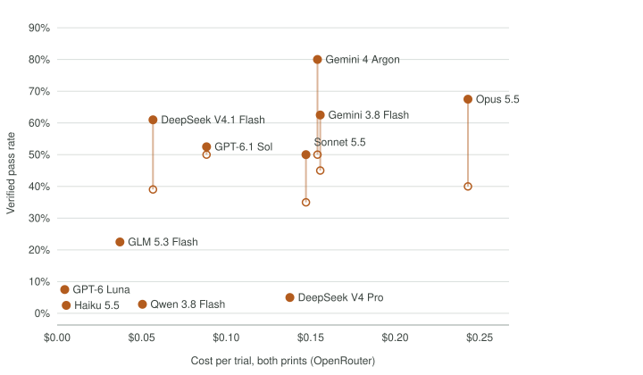
<!-- scorecard:end -->

<!-- results:start (written by scripts/results_table.py; don't edit by hand) -->
867 trials of 13 models, from the saved runs in `results/runs/` (smoke tests left out). Each model ran 1 to 12 times per task and condition, so these are pilots: raw counts, not pass rates, and no ranking. Other is a trial with no submission or an infrastructure error. Cost is what OpenRouter charged.

| Condition | Trials | Pass | Fail | Not graded | Declined | Other | Cost |
|---|---|---|---|---|---|---|---|
| `all_given` | 10 | 1 | 7 | 1 | 1 | 0 | $1.11 |
| `can_ask` | 525 | 180 | 287 | 40 | 10 | 8 | $47.07 |
| `can_run_code` | 19 | 3 | 11 | 0 | 5 | 0 | $2.55 |
| `can_test` | 313 | 153 | 130 | 23 | 3 | 4 | $43.13 |
| **all** | **867** | 337 | 435 | 64 | 19 | 12 | $93.87 |

### `bearing-wheel` (draft by Claude, not reviewed by Dan: exploratory)

| Condition | Model | Trials | Pass | Fail | Not graded | Declined | Other | Cost |
|---|---|---|---|---|---|---|---|---|
| `can_ask` | anthropic/claude-haiku-5.5 | 10 | 0 | 10 | 0 | 0 | 0 | $0.07 |
| `can_ask` | anthropic/claude-opus-5.5 | 10 | 1 | 7 | 2 | 0 | 0 | $1.76 |
| `can_ask` | anthropic/claude-sonnet-5.5 | 10 | 0 | 10 | 0 | 0 | 0 | $1.09 |
| `can_ask` | deepseek/deepseek-v4-pro-0813 | 10 | 1 | 9 | 0 | 0 | 0 | $0.78 |
| `can_ask` | deepseek/deepseek-v4.1-flash | 10 | 1 | 9 | 0 | 0 | 0 | $0.63 |
| `can_ask` | google/gemini-3.8-flash | 10 | 4 | 6 | 0 | 0 | 0 | $1.11 |
| `can_ask` | google/gemini-4-argon | 10 | 7 | 3 | 0 | 0 | 0 | $1.47 |
| `can_ask` | openai/gpt-6-luna | 10 | 0 | 10 | 0 | 0 | 0 | $0.04 |
| `can_ask` | openai/gpt-6.1-sol | 10 | 8 | 2 | 0 | 0 | 0 | $0.90 |
| `can_ask` | qwen/qwen3.8-flash | 10 | 1 | 9 | 0 | 0 | 0 | $0.51 |
| `can_ask` | z-ai/glm-5.3-flash | 10 | 0 | 8 | 1 | 0 | 1 | $0.37 |
| `can_test` | anthropic/claude-haiku-5.5 | 5 | 0 | 5 | 0 | 0 | 0 | $0.04 |
| `can_test` | anthropic/claude-opus-5.5 | 12 | 4 | 8 | 0 | 0 | 0 | $2.32 |
| `can_test` | anthropic/claude-sonnet-5.5 | 12 | 0 | 12 | 0 | 0 | 0 | $1.21 |
| `can_test` | deepseek/deepseek-v4.1-flash | 11 | 5 | 6 | 0 | 0 | 0 | $0.65 |
| `can_test` | google/gemini-3.8-flash | 11 | 8 | 3 | 0 | 0 | 0 | $1.46 |
| `can_test` | google/gemini-4-argon | 11 | 6 | 3 | 2 | 0 | 0 | $1.77 |
| `can_test` | openai/gpt-6.1-sol | 12 | 9 | 1 | 2 | 0 | 0 | $0.80 |

### `estoa-light` (drafted from Dan's answers, approved by Dan)

| Condition | Model | Trials | Pass | Fail | Not graded | Declined | Other | Cost |
|---|---|---|---|---|---|---|---|---|
| `can_ask` | anthropic/claude-haiku-5.5 | 5 | 0 | 4 | 1 | 0 | 0 | $0.16 |
| `can_ask` | anthropic/claude-opus-5.5 | 5 | 3 | 2 | 0 | 0 | 0 | $2.54 |
| `can_ask` | anthropic/claude-sonnet-5.5 | 5 | 1 | 1 | 3 | 0 | 0 | $2.26 |
| `can_ask` | deepseek/deepseek-v4-pro-0813 | 5 | 0 | 4 | 1 | 0 | 0 | $0.58 |
| `can_ask` | google/gemini-4-argon | 5 | 0 | 5 | 0 | 0 | 0 | $4.33 |
| `can_ask` | google/gemini-4-carbon | 1 | 0 | 0 | 0 | 0 | 1 | $1.50 |
| `can_ask` | openai/gpt-6.1-sol | 5 | 1 | 3 | 0 | 0 | 1 | $0.87 |
| `can_test` | anthropic/claude-haiku-5.5 | 5 | 0 | 5 | 0 | 0 | 0 | $0.23 |
| `can_test` | anthropic/claude-opus-5.5 | 5 | 0 | 3 | 2 | 0 | 0 | $2.76 |
| `can_test` | anthropic/claude-sonnet-5.5 | 5 | 1 | 4 | 0 | 0 | 0 | $3.05 |
| `can_test` | deepseek/deepseek-v4.1-flash | 5 | 1 | 4 | 0 | 0 | 0 | $0.34 |
| `can_test` | google/gemini-3.8-flash | 5 | 0 | 2 | 1 | 0 | 2 | $0.96 |
| `can_test` | google/gemini-4-argon | 5 | 0 | 3 | 1 | 0 | 1 | $7.05 |
| `can_test` | openai/gpt-6.1-sol | 5 | 3 | 1 | 1 | 0 | 0 | $0.95 |

Each check across the 49 graded designs (one verdict per design), on the records alone and then with the assumptions below (`python -m pbe.assumptions`). A check the records decide never changes.

| Check | Pass | Fail | Not graded | With assumptions: pass | fail | not graded |
|---|---|---|---|---|---|---|
| builds | 47 | 2 | 0 | 47 | 2 | 0 |
| connected_bodies | 46 | 1 | 0 | 46 | 1 | 0 |
| bed_fit | 47 | 0 | 0 | 47 | 0 | 0 |
| bridges | 21 | 26 | 0 | 21 | 26 | 0 |
| R1 | 25 | 3 | 21 | 42 | 3 | 4 |
| R2 | 32 | 7 | 10 | 32 | 7 | 10 |
| R3 | 34 | 8 | 7 | 34 | 8 | 7 |
| R4 | 47 | 0 | 2 | 47 | 0 | 2 |
| R5 | 35 | 6 | 8 | 35 | 6 | 8 |
| R6 | 42 | 2 | 5 | 42 | 2 | 5 |
| R7 | 46 | 1 | 2 | 46 | 1 | 2 |

Verdicts with the assumptions, of 49 graded designs: 10 pass, 37 fail, 2 not graded.

### `m5-spacer` (control, draft wording: exploratory)

| Condition | Model | Trials | Pass | Fail | Not graded | Declined | Other | Cost |
|---|---|---|---|---|---|---|---|---|
| `can_ask` | anthropic/claude-haiku-5.5 | 5 | 5 | 0 | 0 | 0 | 0 | $0.01 |
| `can_ask` | anthropic/claude-opus-5.5 | 5 | 5 | 0 | 0 | 0 | 0 | $0.29 |
| `can_ask` | anthropic/claude-sonnet-5.5 | 5 | 5 | 0 | 0 | 0 | 0 | $0.15 |
| `can_ask` | deepseek/deepseek-v4-pro-0813 | 5 | 5 | 0 | 0 | 0 | 0 | $0.06 |
| `can_ask` | deepseek/deepseek-v4.1-flash | 5 | 5 | 0 | 0 | 0 | 0 | $0.03 |
| `can_ask` | google/gemini-3.8-flash | 5 | 5 | 0 | 0 | 0 | 0 | $0.13 |
| `can_ask` | google/gemini-4-argon | 5 | 5 | 0 | 0 | 0 | 0 | $0.11 |
| `can_ask` | openai/gpt-6-luna | 5 | 5 | 0 | 0 | 0 | 0 | $0.00 |
| `can_ask` | openai/gpt-6.1-sol | 5 | 5 | 0 | 0 | 0 | 0 | $0.11 |
| `can_ask` | qwen/qwen3.8-flash | 5 | 3 | 2 | 0 | 0 | 0 | $0.04 |
| `can_ask` | x-ai/grok-4.7 | 1 | 1 | 0 | 0 | 0 | 0 | $0.06 |
| `can_ask` | z-ai/glm-5.3-flash | 5 | 5 | 0 | 0 | 0 | 0 | $0.02 |
| `can_run_code` | anthropic/claude-haiku-5.5 | 1 | 1 | 0 | 0 | 0 | 0 | $0.00 |

### `nut-knob/M3` (draft, not approved by Dan: exploratory)

| Condition | Model | Trials | Pass | Fail | Not graded | Declined | Other | Cost |
|---|---|---|---|---|---|---|---|---|
| `can_ask` | anthropic/claude-haiku-5.5 | 10 | 0 | 7 | 3 | 0 | 0 | $0.04 |
| `can_ask` | anthropic/claude-opus-5.5 | 10 | 4 | 5 | 1 | 0 | 0 | $1.26 |
| `can_ask` | anthropic/claude-sonnet-5.5 | 10 | 5 | 3 | 2 | 0 | 0 | $0.68 |
| `can_ask` | deepseek/deepseek-v4-pro-0813 | 10 | 1 | 7 | 2 | 0 | 0 | $1.76 |
| `can_ask` | deepseek/deepseek-v4.1-flash | 10 | 5 | 1 | 4 | 0 | 0 | $0.52 |
| `can_ask` | google/gemini-3.8-flash | 10 | 1 | 6 | 3 | 0 | 0 | $1.08 |
| `can_ask` | google/gemini-4-argon | 10 | 1 | 5 | 4 | 0 | 0 | $0.88 |
| `can_ask` | openai/gpt-6-luna | 10 | 0 | 9 | 1 | 0 | 0 | $0.03 |
| `can_ask` | openai/gpt-6.1-sol | 10 | 2 | 4 | 4 | 0 | 0 | $0.68 |
| `can_ask` | qwen/qwen3.8-flash | 10 | 0 | 10 | 0 | 0 | 0 | $0.52 |
| `can_ask` | z-ai/glm-5.3-flash | 10 | 4 | 5 | 1 | 0 | 0 | $0.14 |
| `can_test` | anthropic/claude-haiku-5.5 | 5 | 2 | 0 | 3 | 0 | 0 | $0.03 |
| `can_test` | anthropic/claude-opus-5.5 | 12 | 6 | 2 | 4 | 0 | 0 | $1.80 |
| `can_test` | anthropic/claude-sonnet-5.5 | 12 | 11 | 1 | 0 | 0 | 0 | $0.96 |
| `can_test` | deepseek/deepseek-v4.1-flash | 11 | 2 | 5 | 4 | 0 | 0 | $0.72 |
| `can_test` | google/gemini-3.8-flash | 11 | 8 | 3 | 0 | 0 | 0 | $1.00 |
| `can_test` | google/gemini-4-argon | 11 | 7 | 2 | 2 | 0 | 0 | $1.22 |
| `can_test` | openai/gpt-6.1-sol | 12 | 7 | 5 | 0 | 0 | 0 | $0.51 |

### `nut-knob/M5` (draft, not approved by Dan: exploratory)

| Condition | Model | Trials | Pass | Fail | Not graded | Declined | Other | Cost |
|---|---|---|---|---|---|---|---|---|
| `can_ask` | anthropic/claude-haiku-5.5 | 10 | 1 | 9 | 0 | 0 | 0 | $0.04 |
| `can_ask` | anthropic/claude-opus-5.5 | 10 | 10 | 0 | 0 | 0 | 0 | $1.43 |
| `can_ask` | anthropic/claude-sonnet-5.5 | 10 | 9 | 0 | 1 | 0 | 0 | $0.75 |
| `can_ask` | deepseek/deepseek-v4-pro-0813 | 10 | 0 | 10 | 0 | 0 | 0 | $1.54 |
| `can_ask` | deepseek/deepseek-v4.1-flash | 11 | 9 | 1 | 1 | 0 | 0 | $0.35 |
| `can_ask` | google/gemini-3.8-flash | 10 | 9 | 1 | 0 | 0 | 0 | $1.07 |
| `can_ask` | google/gemini-4-argon | 10 | 9 | 1 | 0 | 0 | 0 | $0.79 |
| `can_ask` | openai/gpt-6-luna | 10 | 3 | 7 | 0 | 0 | 0 | $0.04 |
| `can_ask` | openai/gpt-6.1-sol | 10 | 9 | 0 | 1 | 0 | 0 | $0.66 |
| `can_ask` | qwen/qwen3.8-flash | 5 | 0 | 3 | 1 | 0 | 1 | $0.26 |
| `can_ask` | x-ai/grok-4.7 | 1 | 0 | 0 | 1 | 0 | 0 | $0.48 |
| `can_ask` | z-ai/glm-5.3-flash | 10 | 5 | 4 | 0 | 0 | 1 | $0.46 |
| `can_test` | anthropic/claude-haiku-5.5 | 5 | 1 | 4 | 0 | 0 | 0 | $0.03 |
| `can_test` | anthropic/claude-opus-5.5 | 10 | 9 | 1 | 0 | 0 | 0 | $1.14 |
| `can_test` | anthropic/claude-sonnet-5.5 | 10 | 10 | 0 | 0 | 0 | 0 | $0.87 |
| `can_test` | deepseek/deepseek-v4.1-flash | 10 | 6 | 4 | 0 | 0 | 0 | $0.57 |
| `can_test` | google/gemini-3.8-flash | 10 | 9 | 1 | 0 | 0 | 0 | $1.03 |
| `can_test` | google/gemini-4-argon | 10 | 10 | 0 | 0 | 0 | 0 | $1.10 |
| `can_test` | openai/gpt-6.1-sol | 10 | 10 | 0 | 0 | 0 | 0 | $0.34 |

### `tripod-plate` (Dan's own words, approved by Dan)

| Condition | Model | Trials | Pass | Fail | Not graded | Declined | Other | Cost |
|---|---|---|---|---|---|---|---|---|
| `all_given` | anthropic/claude-haiku-5.5 | 1 | 0 | 1 | 0 | 0 | 0 | $0.00 |
| `all_given` | anthropic/claude-opus-5.5 | 1 | 0 | 1 | 0 | 0 | 0 | $0.25 |
| `all_given` | anthropic/claude-sonnet-5.5 | 1 | 0 | 0 | 1 | 0 | 0 | $0.13 |
| `all_given` | deepseek/deepseek-v4.1-flash | 1 | 0 | 1 | 0 | 0 | 0 | $0.11 |
| `all_given` | google/gemini-3.8-flash | 1 | 0 | 1 | 0 | 0 | 0 | $0.14 |
| `all_given` | google/gemini-4-argon | 1 | 1 | 0 | 0 | 0 | 0 | $0.22 |
| `all_given` | openai/gpt-6-luna | 1 | 0 | 1 | 0 | 0 | 0 | $0.01 |
| `all_given` | openai/gpt-6.1-sol | 1 | 0 | 0 | 0 | 1 | 0 | $0.14 |
| `all_given` | qwen/qwen3.8-flash | 1 | 0 | 1 | 0 | 0 | 0 | $0.05 |
| `all_given` | z-ai/glm-5.3-flash | 1 | 0 | 1 | 0 | 0 | 0 | $0.05 |
| `can_ask` | anthropic/claude-haiku-5.5 | 10 | 0 | 10 | 0 | 0 | 0 | $0.06 |
| `can_ask` | anthropic/claude-opus-5.5 | 10 | 1 | 9 | 0 | 0 | 0 | $1.89 |
| `can_ask` | anthropic/claude-sonnet-5.5 | 10 | 0 | 10 | 0 | 0 | 0 | $1.20 |
| `can_ask` | deepseek/deepseek-v4-pro-0813 | 10 | 0 | 8 | 2 | 0 | 0 | $1.43 |
| `can_ask` | deepseek/deepseek-v4.1-flash | 10 | 1 | 9 | 0 | 0 | 0 | $0.26 |
| `can_ask` | google/gemini-3.8-flash | 10 | 4 | 4 | 0 | 0 | 2 | $1.63 |
| `can_ask` | google/gemini-4-argon | 10 | 3 | 7 | 0 | 0 | 0 | $1.16 |
| `can_ask` | openai/gpt-6-luna | 10 | 0 | 9 | 0 | 1 | 0 | $0.06 |
| `can_ask` | openai/gpt-6.1-sol | 10 | 1 | 0 | 0 | 9 | 0 | $0.50 |
| `can_ask` | qwen/qwen3.8-flash | 10 | 0 | 10 | 0 | 0 | 0 | $0.47 |
| `can_ask` | x-ai/grok-4.7 | 1 | 1 | 0 | 0 | 0 | 0 | $0.46 |
| `can_ask` | z-ai/glm-5.3-flash | 10 | 0 | 9 | 0 | 0 | 1 | $0.50 |
| `can_run_code` | anthropic/claude-haiku-5.5 | 3 | 0 | 1 | 0 | 2 | 0 | $0.01 |
| `can_run_code` | anthropic/claude-opus-5.5 | 3 | 1 | 2 | 0 | 0 | 0 | $0.57 |
| `can_run_code` | anthropic/claude-sonnet-5.5 | 3 | 0 | 3 | 0 | 0 | 0 | $0.38 |
| `can_run_code` | deepseek/deepseek-v4-pro-0813 | 3 | 0 | 3 | 0 | 0 | 0 | $0.52 |
| `can_run_code` | google/gemini-4-argon | 3 | 1 | 2 | 0 | 0 | 0 | $0.91 |
| `can_run_code` | openai/gpt-6.1-sol | 3 | 0 | 0 | 0 | 3 | 0 | $0.17 |
| `can_test` | anthropic/claude-haiku-5.5 | 5 | 0 | 5 | 0 | 0 | 0 | $0.03 |
| `can_test` | anthropic/claude-opus-5.5 | 10 | 3 | 6 | 1 | 0 | 0 | $1.60 |
| `can_test` | anthropic/claude-sonnet-5.5 | 10 | 1 | 9 | 0 | 0 | 0 | $1.53 |
| `can_test` | deepseek/deepseek-v4.1-flash | 10 | 3 | 7 | 0 | 0 | 0 | $0.70 |
| `can_test` | google/gemini-3.8-flash | 10 | 2 | 7 | 0 | 0 | 1 | $2.07 |
| `can_test` | google/gemini-4-argon | 10 | 7 | 3 | 0 | 0 | 0 | $1.74 |
| `can_test` | openai/gpt-6.1-sol | 10 | 2 | 5 | 0 | 3 | 0 | $0.54 |
<!-- results:end -->

Every trial's transcript, design and grades are in `results/runs/`; the results page (step 5) shows each one with its parts in 3D. `scripts/digest.py <run> --why` prints each failure's evidence.

Follow-up experiments on saved trials, each with its own write-up:
- **Telling the model how its test print came out** (`docs/coupon-loop.md`, run `loop-sample` and `loop-sample-2`): one more turn after a reply built from the recorded prints, against a neutral "take another look". In each of two samples of 12 trials, the reply's arm passed 3 and the neutral arm 1. That's a small sample, and the 2 extra passes both rest on the M3 +0.1 mm print.
- **Printing the tripod plate and saying how its roof came out** (same write-up, run `loop-tripod`): the 24 saved plates that fail on a holed roof, each told "loose loops and tangles around the hole; hole partly closed" and nothing about why. 14 of 24 fixed the roof, against 2 of 24 after a neutral second look. 8 flipped the plate, 3 used a cone, 2 the stepped bridge and 1 a skin to push out. Most still fail elsewhere, so 3 pass every check (4 with the R3 fix that came after the run).
- **Sending a build error back once** (`docs/crash-replay.md`, run `crash-replay`): each saved crash replayed with its error.

**Letting the model run code** (`can_run_code`, run `pilot-code`): three tripod trials per lineup model. 2 of 18 pass, against 3 of 23 for the same models without code (`can_ask` t1 to t3 and `all_given`; `can_ask` t4 and t5 came after the person started giving the clamp's width, so they're left out). Fewer designs fail on a roof with the bolt's hole cut through it: 4 of 13 against 12 of 19. No design was sent back for a build error. That's a small sample, and Sonnet's three plates all have the dovetail upside down instead.

## What went wrong, task by task

Counts are trials, from the saved runs; a trial can fail more than one way. The pictures are cuts through saved designs, made by `scripts/failure_figures.py`, with the hardware drawn in orange where it has to go. None of these designs was printed.

<!-- wrong-tripod-plate:start (written by scripts/failure_tables.py; don't edit by hand) -->
### `tripod-plate`: 204 trials

| What went wrong | Trials |
|---|---|
| A roof with the bolt's hole cut through it (`bridges`) | 80 |
| Dovetail upside down: the bolt head's recess is on the camera's side | 28 |
| Straight sides, nothing for the clamp's lips to grip | 28 |
| No usable bolt hole | 24 |
| Declined: handed in only a test print, because the clamp's size isn't known | 19 |
| A roof or ledge too wide to bridge, with no hole through it | 10 |
| Code didn't run | 10 |
| Bolt doesn't reach far enough into the camera | 9 |
| A part in pieces | 7 |
| Head recess too small for the bolt's head | 4 |
| No design handed in | 4 |
| A broken shape | 1 |
<!-- wrong-tripod-plate:end -->

`can_ask` trials from t4 on ran after the person started giving the clamp's width as 38 mm, so they aren't comparable with t1 to t3 on the clamp's fit or on declining.

| The plate Dan printed | Dovetail upside down | Straight sides |
|---|---|---|
| 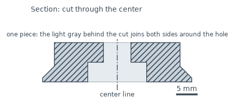 | 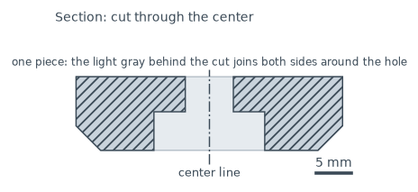 | 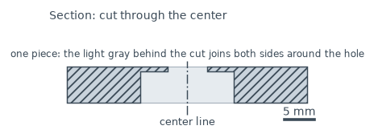 |
| The reference, cut across its length. The bevels the clamp grips widen toward the bed. | Sonnet 5.5, `pilot-tripod` t1. 38 mm wide with bevels, but the recess opens on the narrow face. | Haiku 5.5, `pilot-tripod` t2. It "narrows by only 0.00 mm on both edges". |

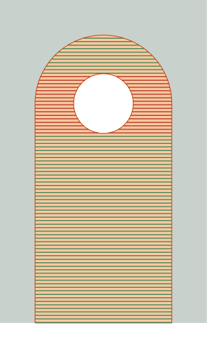

The bridge check's picture of GPT-6 Luna's roof (`pilot-tripod` t1, 449 mm² at 5.4 mm): green strands land on solid at both ends, red ones don't. In the best direction only 66% are anchored, because the bolt's hole is cut through the middle of the roof. Dan's first plate tangled on this shape.

<!-- wrong-bearing-wheel:start (written by scripts/failure_tables.py; don't edit by hand) -->
### `bearing-wheel`: 184 trials

| What went wrong | Trials |
|---|---|
| A roof with the bolt's hole cut through it (`bridges`), over the seat that opens at the bed | 76 |
| Bearing seat a size the prints don't take | 34 |
| Other wheel geometry | 17 |
| Code didn't run | 15 |
| A part in pieces | 9 |
| No design handed in | 1 |
<!-- wrong-bearing-wheel:end -->

| Fails: a flat roof | Fails since round 3: a narrow ledge | Passes: a cone |
|---|---|---|
| 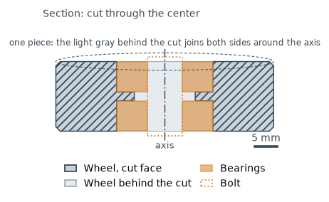 |  | 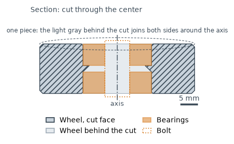 |
| Sonnet 5.5 t1. A flat ring of 230 mm² over the lower bearing; 22% of strands anchored. | Sonnet 5.5 t3. A 157 mm² ledge, about 2.5 mm wide. It wasn't graded until round 3, where a 2 mm ledge round a bolt hole tangled; now it fails. | Opus 5.5 t1. The roof is a cone stepping in about 0.2 mm a layer, so nothing has to bridge. |

<!-- wrong-nut-knob:start (written by scripts/failure_tables.py; don't edit by hand) -->
### `nut-knob` (M3 and M5): 356 trials

| What went wrong | Trials |
|---|---|
| Nut pocket a size the prints don't take | 78 |
| The pocket is closed, so the nut can't be pressed in | 32 |
| Code didn't run | 17 |
| A roof with the bolt's hole cut through it | 6 |
| A part in pieces | 4 |
| A roof or ledge too wide to bridge, with no hole through it | 2 |
| No design handed in | 2 |
| Its test print labelled as a final part | 1 |

Most knob trials that didn't pass weren't failed: 185 pass, 126 fail and 43 are not graded, mostly for the pockets below.
<!-- wrong-nut-knob:end -->

| No clearance | A closed pocket |
|---|---|
| 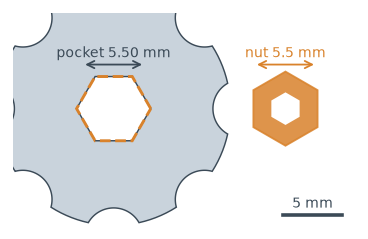 | 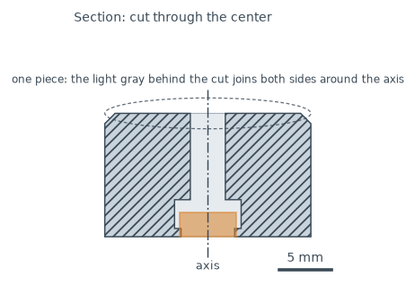 |
| Sonnet 5.5 M3 t1. The pocket is 5.50 mm across flats for a 5.5 mm nut; the print at that size "does not go in". | Haiku 5.5 M3 t1. A lip narrower than the nut closes the pocket's mouth, so a nut "can't be pressed in from either face". |


<!-- wrong-m5-spacer:start (written by scripts/failure_tables.py; don't edit by hand) -->
### `m5-spacer`: 57 trials

The control. 55 of 57 trials pass.
<!-- wrong-m5-spacer:end -->

## The test prints behind the checks

These test prints provide the ground truth for parts of the 3D printing simulation. Each print tests the ground truth of one thing. For example, if there's a roof over a hole, will it print successfully? We printed nut pockets at different sizes, using different techniques, to see which size a nut would fit into snugly without falling out.

What each print tests, why we printed it, and what happened, from the test-print code (`coupons/coupons.py`) and the records of each round with my notes (`results/predictions/`):

| Round one, printing | Round two, printing |
|---|---|
|  |  |

| The print | What it tests | Why we printed it | What happened |
|---|---|---|---|
|  | **Nut pockets.** I wanted to find the actual best size to print the opening so it holds the nut. I took nuts of different sizes (M3, M5, M8 and 1/4-20), pressed them into pockets from exactly the nut's size to 0.3 mm over, and saw which one was the most snug while still realistic to push in (Oct 29, at 2.5 times speed) | In the past, I'd had nuts that wouldn't fit snugly into an opening in a 3D print, and when you turned the part a certain way, the nut would fall out | M3 needs 0.2 mm over ("goes in with pushing, snug"); at 0.1 it "really struggles". M5 holds at 0 and 0.1 mm over, and is loose at 0.2. M8 and 1/4-20 hold only at the nut's exact size |
|   | **Bridges and overhangs.** I wanted to test different scenarios to see what kind of overhang prints work and which ones fail and result in strands: roofs over pockets 20 to 50 mm wide with walls on all four sides, one with a hole cut through it, and tunnels open at their ends | I've had a bunch of successes and failures when printing with overhangs and bridges | When there are no walls on one side, it fails, as you can see here in both attempts, but if there are walls on four sides, it seems to be pretty successful, even when you get pretty wide. The roofs with four walls printed clean up to 50 mm (the 40 mm one sagged in round one and printed clean in round two); the roof with a hole through it tangled; the tunnels printed as strands both times |
| | **Bearing seats.** 608 bearing seats from 22.0 to 22.3 mm, and 8 mm pegs for the bearing's bore | The closet-door wheel task: does a bearing press in and stay in, and at what size? | The 22.0 mm seat wouldn't take the bearing; 22.1, 22.2 and 22.3 took it and held it upside down. Only the tightest 8 mm peg was snug |

**Round three**, on 2026-11-11 and 12, went after the designs the first two rounds couldn't grade: crush-ribbed nut pockets, narrow roof ledges, bolt holes and bearing seats between the sizes I'd printed, and six roofs cut straight out of the models' own Estoa designs. Five of the six roofs strung as the bridge check predicted.

| Bridges and roofs cut from the models' designs | GPT's roof, the one that printed clean | Ring roofs: stepped clean, plain tangled | A tightened M5 nut on the 1.3 mm ledge |
|---|---|---|---|
|  |  |  |  |
| All strung: the bridge check failed each of these, and the 50 mm span limit stands | Its longest unsupported strand is 6.8 mm, so short-strand roofs now pass | 9 of 10 cells came out as the bridge check predicted | It holds, just not flush: the miss the short-strand rule fixes |

## Task galleries

Four passing and four failing designs per task, from the saved trials, each labelled with its model and trial; failures are seen from below with the failing roof or ledge in red.

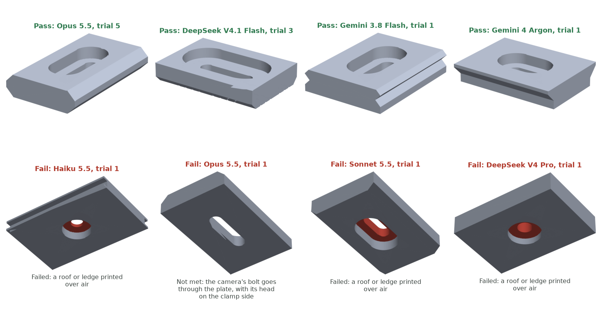

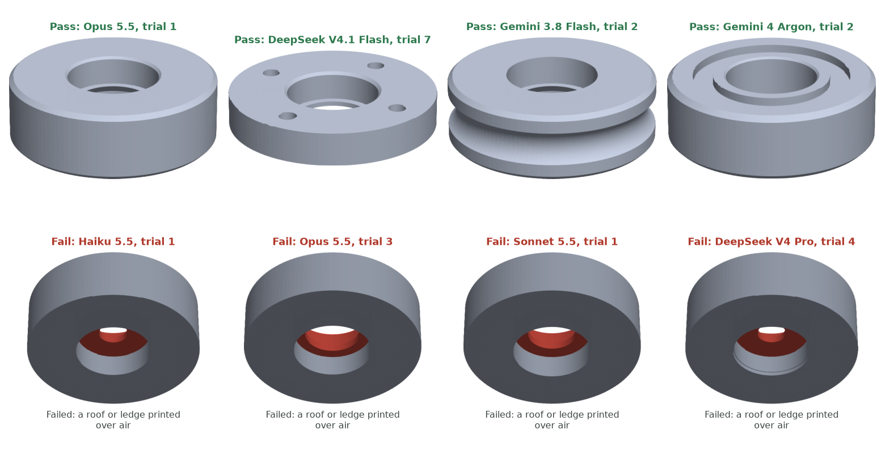

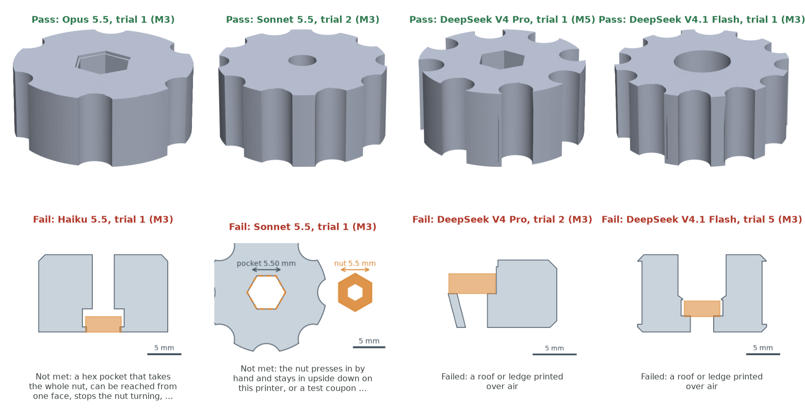

## A trial that passed after feedback

In each trial, nothing actually gets printed. We have checks, run by code, that simulate the model's parts and compare them with the results of my test prints to see if they would print successfully. Here's an example of a trial in the Reprint after feedback condition: it failed, then succeeded after we gave the model feedback about what failed (Gemini 4 Argon on the Estoa light, from the earlier loop, where the feedback came after its first print):

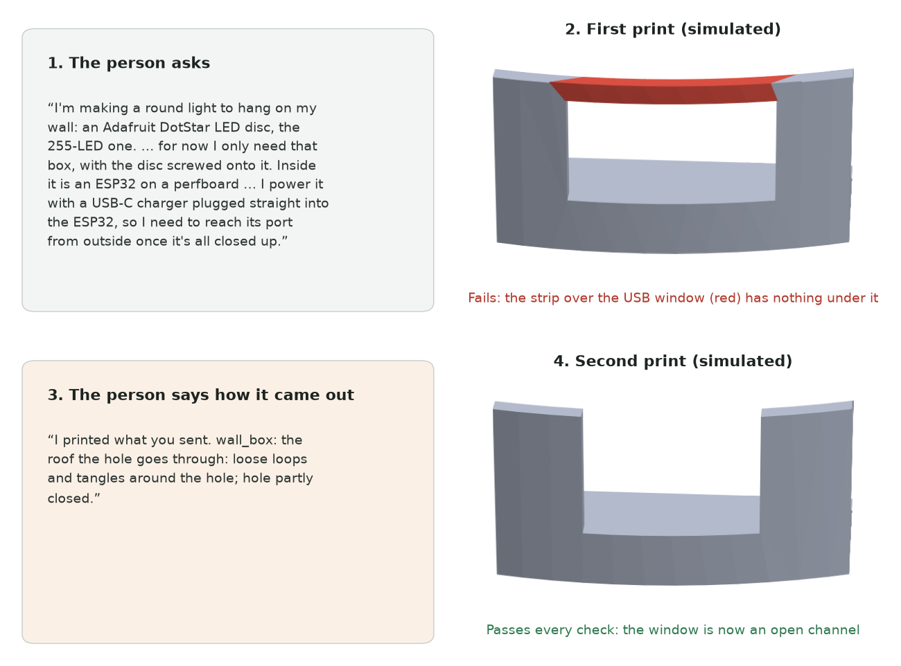

## Reference solutions and more task examples

The hand-made reference solution for each task, which passes every check, and the examples cut from the README's task section.

### Tripod plate

| Reference solution | Fail: dovetail upside down |
|---|---|
| 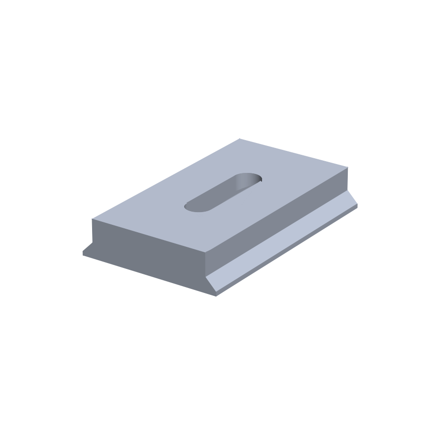 |  |
| Hand-written, after the plate Dan printed | Sonnet 5.5, trial 1, cut end-on: the plate narrows toward the tripod, the opposite of what the clamp's angled jaws hook over. Flipped to fit, the bolt head ends up on the camera's side |

### Closet door wheel

| Reference solution | Fail since round 3: a narrow ledge |
|---|---|
| 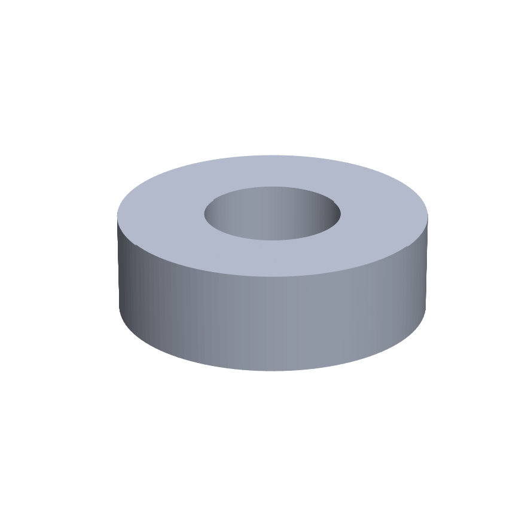 |  |
| Seats for both bearings | Sonnet 5.5, trial 3: a ledge about 2.5 mm wide. It wasn't graded until round 3's ring roofs, where a 2 mm ledge round a bolt hole tangled; now it fails |

### Hand knob (M3 and M5)

| Reference solution | Pass |
|---|---|
| 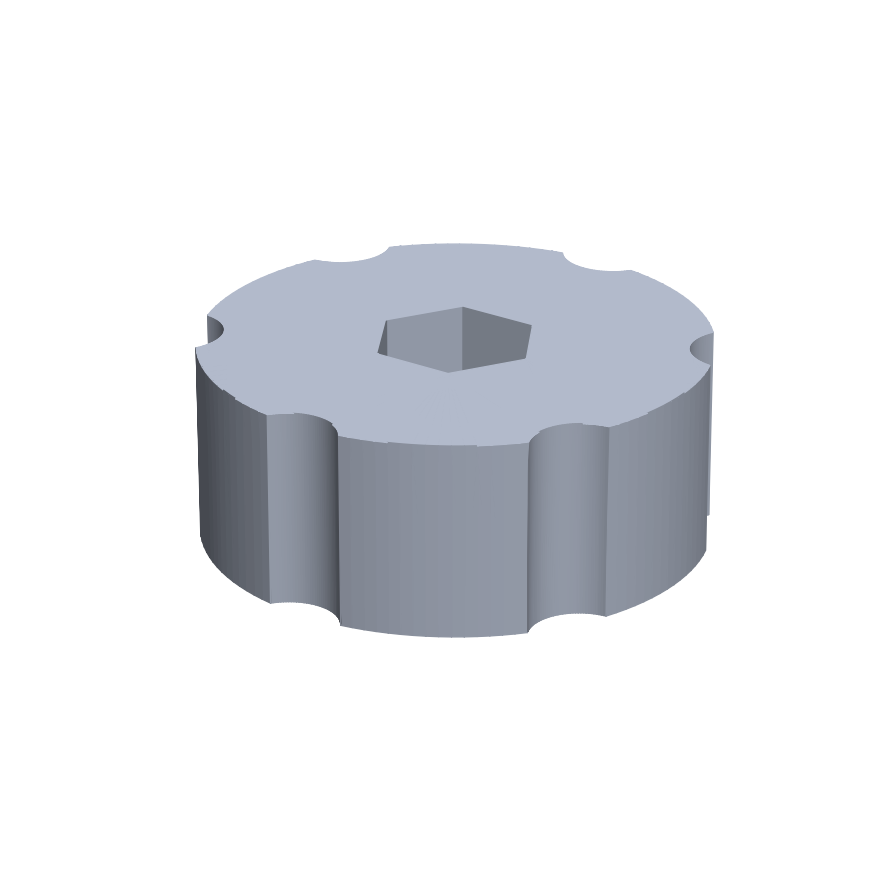 | 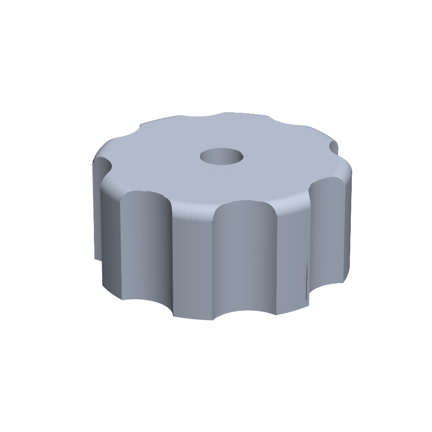 |
| Pocket at a size the test print held | Sonnet 5.5, M3, trial 2 with test prints: it asked for a test print of four pocket sizes and heard 5.40 and 5.50 mm won't go in, 5.60 mm really struggles, and 5.70 mm goes in snug and stays upside down. Its knob uses 5.70 mm |

### Estoa light box

| Reference solution | A perfboard with no wall on one side |
|---|---|
| 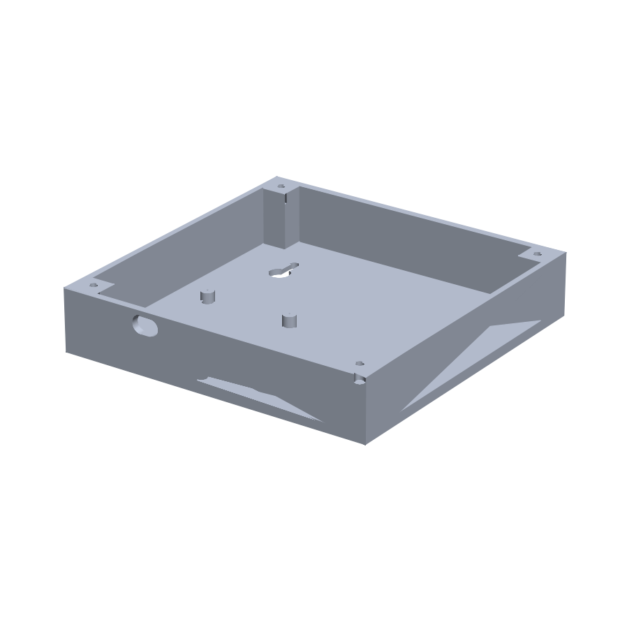 | 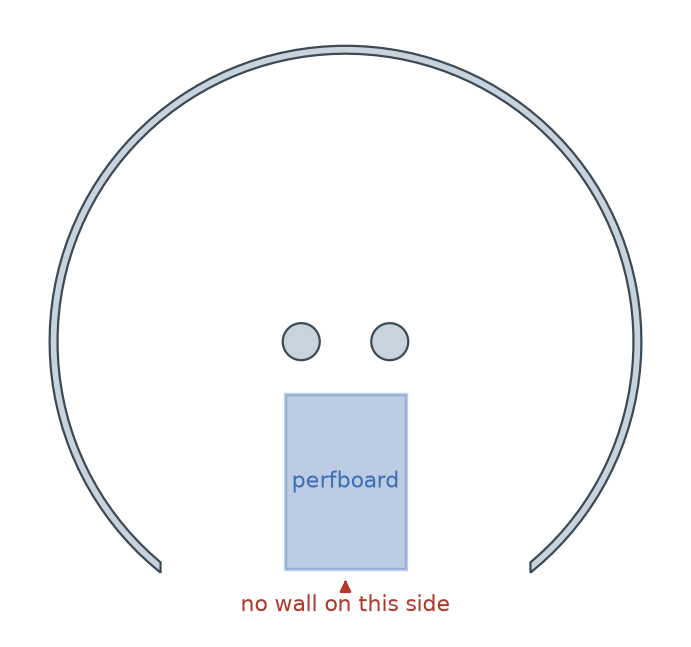 |
| A box the disc screws onto; any shape that passes the checks works | GPT-6.1 Sol, trial 3 with test prints: the wall stops short of the perfboard's side, so the board isn't inside the box |

### The README's task examples

The requests in full, with one pass and one failure per task.

#### Tripod plate

> "I borrowed my friend's tripod, and I can't seem to find the part that connects the camera to the tripod. How hard would it be to 3D print it, both the flat part and the part that screws in? Just as a temporary thing until I find the real one. I know it's metal normally."

| Pass | Fail: roof over the bolt's hole |
|---|---|
| 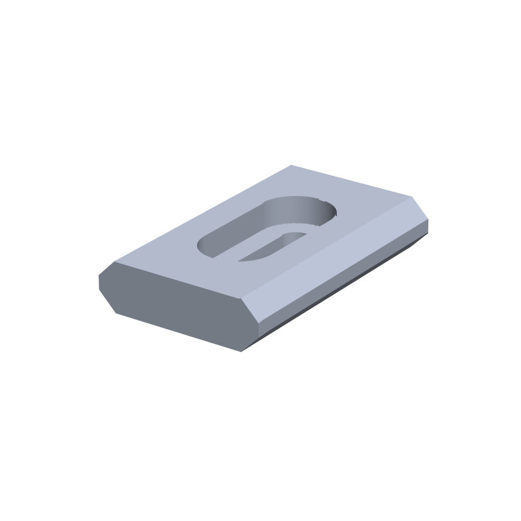 |  |
| Opus 5.5, trial 5 | GPT-6 Luna, trial 1, the bolt's recess seen from below: the hole is cut through the roof, so the red strands end in mid-air; only 66% land on plastic at both ends |

#### Closet door wheel

> "The roller wheel on my sliding closet door snapped. I've got two 608 skateboard bearings and an M8 bolt I could use. Could I 3D print a new wheel that spins on the bolt? The old one was about 50 mm across and about 16 mm wide."

| Pass: a cone roof | Fail: a flat roof |
|---|---|
|  |  |
| Opus 5.5, trial 1: the ledge between the bearings steps inward each layer, so nothing is printed over air | Sonnet 5.5, trial 1: a flat ledge over the empty lower bearing seat; only 22% of strands land on plastic at both ends, so it would sag |

#### Hand knob (M3 and M5)

> "I want a hand knob for an M3 bolt, about 20 mm across, so I can tighten it without a tool. It's one printed piece. An M3 hex nut (ISO 4032) presses into the knob by hand and has to stay in when I turn the knob upside down, no glue."

| Fail: no clearance | Pass since round 3: crush ribs |
|---|---|
|  | 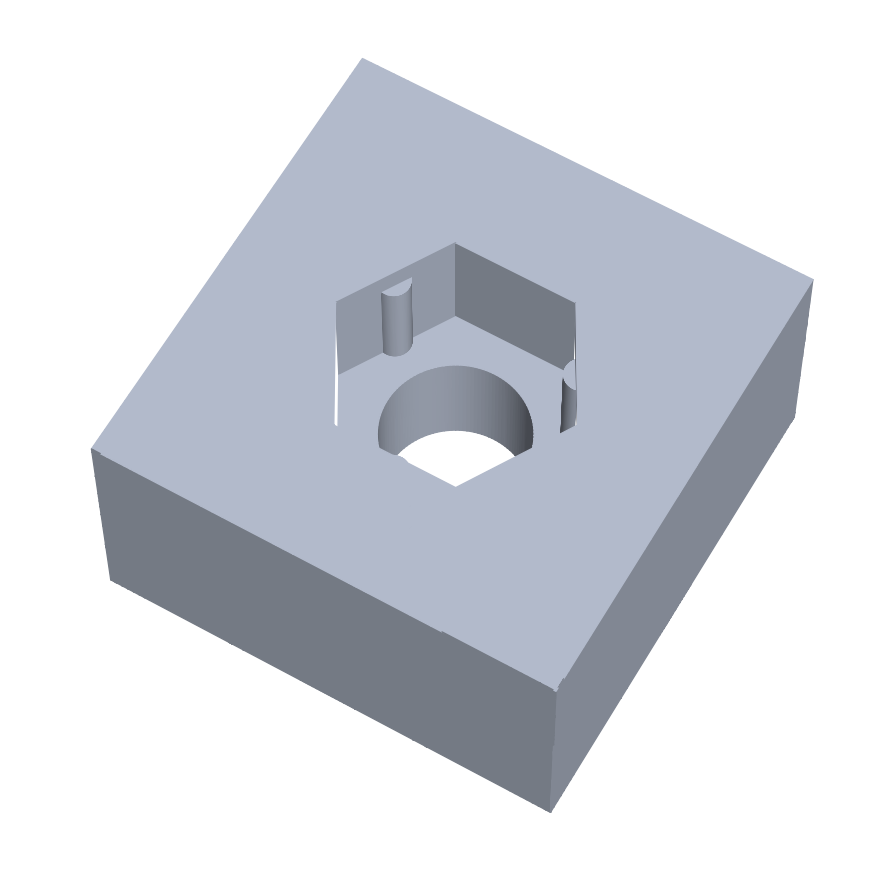 |
| Sonnet 5.5, M3 trial 1, cut across: the pocket is exactly as wide as the nut, with no gap. Dan's test print at that size wouldn't take the nut | Opus 5.5, M5 trial 2: the small round ridges on the pocket's walls are meant to grip the nut. No test print had ribs until round 3, where a pocket with three round ribs took an M5 pressed in on a bolt and held it upside down. These ribs are within 0.2 mm of that one, so the check passes them, saying which print it assumed from |

#### Estoa light box (harder task)

> "I'm making a round light to hang on my wall: an Adafruit DotStar LED disc, the 255-LED one. … for now I only need that box, with the disc screwed onto it."

| The real one | A roof over air |
|---|---|
|  | 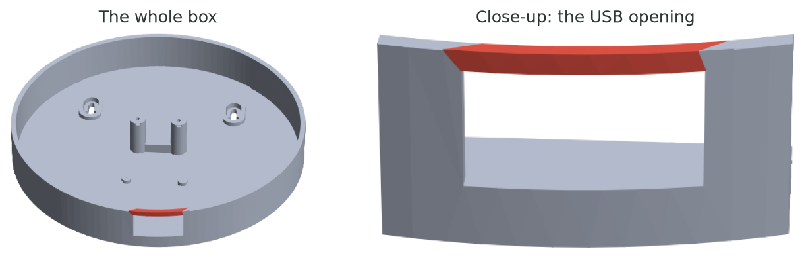 |
| Dan's build | Gemini 4 Argon, trial 2: the top edge of the USB opening (red) spans thin air and would sag |

We ran out of time to make the test-print loop work on this task.

## What wasn't graded, and the prints that would settle it

A check is not graded when no recorded print decides it. A trial can have more than one. Dan's call on 2026-10-30 was no more prints before publishing; he later printed a third round (2026-11-11 and 12), and what the records still can't decide is future work; `docs/limitations.md` has the full list.

<!-- not-graded:start (written by scripts/failure_tables.py; don't edit by hand) -->
| Not graded because | Example | Trials | The print that would settle it |
|---|---|---|---|
| A tripod head recess under 5 mm deep | 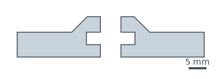<br><sub>Haiku 5.5, tripod plate, trial 3</sub> | 34 | Recesses 3, 4 and 4.5 mm deep for the 5 mm head |
| A nut pocket with ribs, clips or a lip unlike any printed | 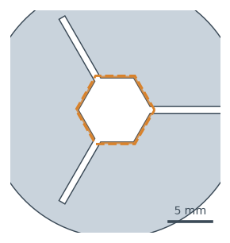<br><sub>Haiku 5.5, knob M5, trial 1</sub> | 32 | That rib shape and bite. Round 3 printed 3 and 6 round ribs, 6 flat ribs and two lips; each model's ribs differ, so one print settles only designs like it |
| A nut pocket no recorded print settles | 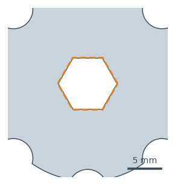<br><sub>DeepSeek V4.1 Flash, knob M5, trial 6</sub> | 13 | A print of that pocket |
| A roof ledge 1.5 to 2 mm wide | 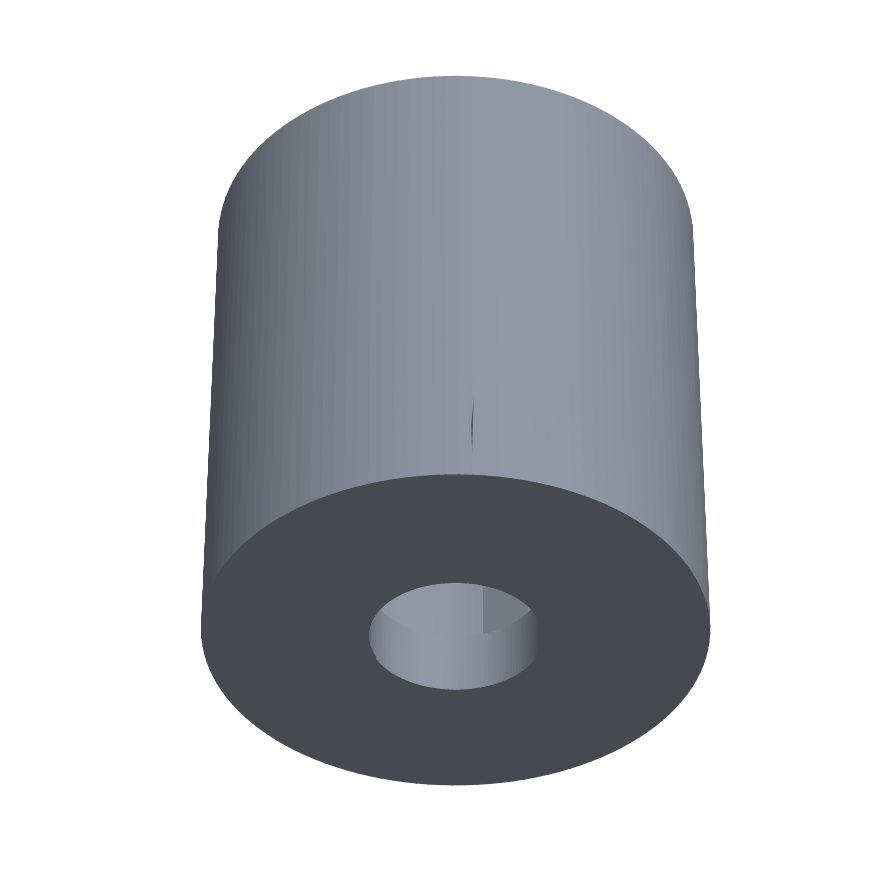<br><sub>Qwen 3.8 Flash, knob M3, trial 10</sub> | 11 | Ring roofs 1.6 to 1.9 mm wide: round 3's 1.5 mm ledge printed and its 2 mm ledge tangled |
| A plate width outside 37 to 39 mm | 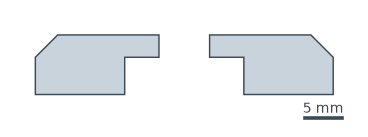<br><sub>DeepSeek V4.1 Flash, tripod plate, trial 2</sub> | 11 | Dovetail plates from 34 to 45 mm tried in the clamp |
| A pocket shape the checker can't read | 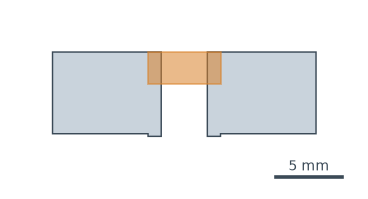<br><sub>GPT-6 Luna, knob M3, trial 1</sub> | 3 | None: the checker needs fixing |
| A test print whose pockets are ribbed or unsettled | 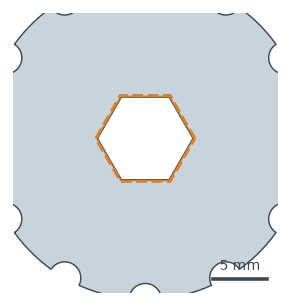<br><sub>Sonnet 5.5, knob M3, trial 5</sub> | 2 | The ribbed pockets above, and coupon B2's finer steps |
| A bearing seat between printed sizes, or ribbed | 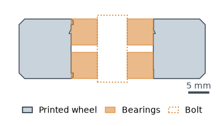<br><sub>GLM 5.3 Flash, bearing wheel, trial 2</sub> | 1 | A ribbed, lobed or slotted seat: only plain round seats were printed (22.1 to 22.3 mm took a 608 and held it) |
<!-- not-graded:end -->

Ribbed pockets were the biggest gap. Two models' answers, cut where the nut is tightest, with the M5 nut's outline dashed. Round 3 printed crush ribs, so Opus's now passes; Sol's clips are still not graded:

| Crush ribs | Clips |
|---|---|
| 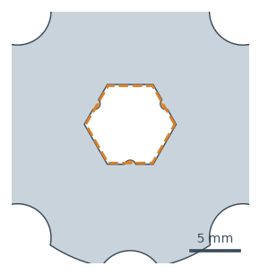 | 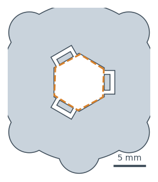 |
| Opus 5.5 M5 t2: three ribs reaching 0.3 mm into the nut's flats, in a pocket 0.25 mm over the nut. | GPT-6.1 Sol M5 t1: three clips cut free so they can flex. |

## Harder tasks: a first look

I wanted to run evals on the real-world scenarios that I had done in the past, and I tried to start with that. It would have been very long and expensive to try to get these eval steps right, so I decided to start with much simpler tasks that I know are more clear-cut. You can get to the answer quicker as far as which models perform well. Then the plan was, after that, to move to the more complicated tasks, but even the simpler tasks needed a lot of tuning to get right. So they took longer than expected, and I only got to the more complicated tasks near the end of the hackathon. With more time, I feel like I could have gotten them better, including more test printing at home that validates it's able to grade more of the results.

Estoa has merged, and its trials are in the results above. Servo mount has merged too, but its graders haven't had the audit or the verdict review the other tasks had, so its numbers aren't in the results; its count comes from its own runs.

| Task | Branch | What it tests | Model trials | Result | Cost |
|---|---|---|---|---|---|
| Estoa light | merged in [a04b153](https://github.com/oveddan/functional-print-eval/commit/a04b153), run `pilot-estoa` | A solid enclosure that hangs on the wall for an ESP32 that powers an LED disc | 30 + 35 | first print 5 of 30 pass; with test prints first 5 of 35 (README, Results) | $26.08 |
| Servo mount | merged in [e7dc82b](https://github.com/oveddan/functional-print-eval/commit/e7dc82b), runs `servo-first-look`, `servo-first-look-2`, `servo-datasheet` | A 3D-printed mount for a servo that's going to drive a robotic arm | 29 | 4 pass, 23 fail, 2 not graded (regraded 2026-11-12 on round 3's frames and channels, and Dan's rule that no gap for the rib fails) | $4.81 |

### Estoa light

The failures that come up most, by trial: a roof that can't be bridged (11 of 18), an insert post with less plastic than the 1.85 mm that bulged on the real build (6), and a keyhole it can't hang from (6): Haiku's three run from the slot downward, and the others are sized wrong for the screw's head or too thick for how far the screws stand out of the wall. Most of the not graded checks need something nobody recorded, such as the board's thickness.

The failure is when an overhang or a roof is designed in a way that cannot be 3D printed without an error. It designed basically a roof that cannot be 3D printed.

### Servo mount

One check decides most trials: R3, "the tabs sit flush", doesn't pass on 24 of 29. The plates leave no room for the rib on each tab. That includes 9 of the 12 `all_given` trials, where the rib's size is in the prompt, against 11 of 12 in `can_ask`. That's the same mistake as Claude's own test print D.

The servos that we were working with have a rib on the top where the holes go to mount it to something. Many of the models did not even consider that when designing their 3D models. I'm not sure why, but this would prevent it from being mounted in a flush manner. It really wouldn't work well at all.

## Assumptions, calls and known limits

### Assumptions the verdicts rest on

These are treated as true without a print that shows them for that exact case. The full table, and the prints that would settle each, is in `docs/limitations.md`.

<!-- assumptions:start (written by scripts/results_table.py; don't edit by hand) -->
| Assumption | Check | What rests on it in the saved runs |
|---|---|---|
| The webcam bolt is 10 mm long under its head. Nobody recorded it. | tripod R5 | Every tripod R5 verdict (145 pass, 9 fail), so all 32 tripod passes |
| One 38 mm plate fit the clamp; 37 to 39 mm passes on an estimate of the jaws' travel. | tripod R2 | Every graded tripod R2 verdict (132 pass, 28 fail) |
| A roof with the bolt's hole cut through it tangles at the models' shapes and sizes, as it did on the Arca plate and coupon A's H cell (a 20 mm square with a 6 mm hole, printed once). | `bridges` | 115 trials that fail on `bridges` alone, on a roof with a hole cut through it (Dan's call: they fail) |
| Each hole's centre is at the middle of where Dan's readings put it, 16.85 mm out. Source: the middle of 16.60 to 17.11, from Dan's calipers; no reading pins it closer. | estoa-light R1 | Graded apart: 17 pass, 0 fail of the estoa-light designs it decides |
| Each hole's centre is 16.85 mm out, as in R1's assumption. Source: the middle of 16.60 to 17.11, from Dan's calipers; the board's 1.6 mm is in the args since 2026-11-13. | estoa-light R2 | Graded apart: 2 pass, 2 fail of the estoa-light designs it decides |
<!-- assumptions:end -->

### Whose calls these are

From the audit of the saved failures (issue 15):
- **Dan's:** a test print can't fail a trial on its own; declining is its own verdict, never a pass; a roof with the bolt's hole cut through it fails `bridges`; nothing new is printed or measured before publishing (2026-10-30; he later offered round 3), so what the records can't decide is not graded; one printer and one filament; M3 at +0.1 mm goes in by hand "with force", so it counts as holding (his memory of one print); the person answers the clamp's width as 38 mm, the Arca-Swiss standard his plate fit (new runs only); the test-print loop may print the final plate, not only the model's test prints.
- **Claude's, delegated by Dan** ("do what you think is best"): DeepSeek V4.1 Flash's M5 test print labelled `final` stays a fail, which Dan reviewed and kept. These aren't Dan's expert judgment. Also Claude's: one official set of counts, with no second, more optimistic score (issue 35).

### Known limits

- **Small samples.** Ten `can_ask` trials per model on each of the four scored tasks for 11 models (Grok 4.7 has two), five on `estoa-light`, and fewer in some other conditions. One pass more or less moves a task's rate by 10 points.
- **One printer, one filament.** The fit and bridge limits hold for a Bambu Lab X1C in one PLA only.
- **One person's projects.** The tasks come from Dan's builds and mostly one agent's mistakes. Only the tripod's request was approved before it ran.
- **The phone stand can't run**, and print-settings mistakes (failure class C10) aren't tested: a submission has no field for them, and nothing is sliced.
- **Code review findings not fixed.** Two reviews of `main` (issues 2 and 4, closed as not planned) listed findings that weren't fixed; they stand as known limits. Among them, as last checked on those issues: model-written part code can still read files in the repository while it builds (it gets no network and no environment); a nut pocket 0.8 to 1.5 times the nut's size counts as nut-sized for the knob's R3, so a pocket too small for the nut can pass R3 and be left to R4; `bridges` samples one plane per layer and directions every 5°, so a feature one layer thick can be missed and verdicts can depend on the part's rotation; `bed_fit` uses the nominal bed and has no failing test. Code added since 2 November hasn't had that full review.
- **Detail text can differ by platform.** Every saved verdict reproduces on Linux as on macOS, but tied bridge directions can come out mirrored in the detail text.

## What's built and what isn't

Built: the four runnable task families above with references and checks; the runner with the lookup-table person and its conditions (`can_ask`, `all_given`, `can_run_code`, `can_test`); sandboxed builds; regrading; the test-print loop and the crash replay; the results page; the test print designs and their recorded outcomes (`coupons/`, `results/predictions/`).

Not built: an assembly simulation (parts moving into place along the manual's steps); a printer simulator with a hidden error; any score beyond pass, fail, not graded and declined; a comparison with a hand ranking; a simulated builder. The failure atlas (`report/atlas/`) builds only on Dan's Mac: it uses `sips` and points at local photos.

## Where things are

The eval design guide suggests `tasks/`, `reference/`, `graders/`, `results/` and `transcripts/`. Here:

| Guide | This repo |
|---|---|
| `tasks/` | `tasks/<task>/brief.md` (the request), `hidden_facts.yaml` (what the person can measure), `requirements.yaml` (the checks) |
| `reference/` | `tasks/<task>/reference.yaml` |
| `graders/` | `pbe/graders/`; the submission format and building in `pbe/parts/` |
| `run_eval.py` | `pbe/eval.py` (`uv run python -m pbe.eval`), with the model loop in `pbe/runner/` |
| `requirements.txt` | `pyproject.toml` and `uv.lock` |
| `results/` | `results/runs/<run>/summary.csv` and each trial's `grades.json`; test print records in `results/predictions/` |
| `transcripts/` | every trial's `transcript.json`, beside its grades in `results/runs/` |

Also:
- `seeds/`: the real failures behind the tasks (tripod, Estoa, side projects, the test prints), each tagged with a failure class from `seeds/classes.yaml`. They're evidence, not tasks, and their `grader:` fields are planned, not built.
- `catalog/`: the hardware bin (`hardware.yaml`, with real thread lengths) and the printer (`printer.yaml`).
- `coupons/`: the test print designs and the scripts that predicted their outcomes.
- `docs/`: `scoring.md` (the quality bar), `limitations.md`, and the write-ups of each experiment. `plan.md` is the working plan. `changes/` (one file per change, built into `CHANGELOG.md` by `scripts/changelog.py`) ties every change to its evidence.
- `scripts/`: the results page, the README's results table, the reproduce script and the experiments.
- `examples/arca-plate/`: the Arca plate before and after its first print.

## Future work

- **More test prints** to turn assumptions into records: the models' roof shapes, ring roofs, finer nut clearances, the clamp's jaw travel, the bolt's length. The list is in `docs/limitations.md`.
- **Letting the model suggest hardware**, with only the printer and filament fixed (issue 12).
- **Letting the model ask clarifying questions**, not only for measurements (issue 13).
- **A research step, as a recorded lookup**, so reruns stay identical (issue 16).
- More trials per model, the Estoa task's first runs (issue 37), and the assembly simulation.

## Prior art

| Work | License | How it's used |
|---|---|---|
| BenchCAD (`BenchCAD/BenchCAD-main`, HF `BenchCAD/BenchCAD`) | MIT code, CC-BY data (per its README; read its LICENSE before reuse) | CadQuery sandbox, standard fastener families |
| BenchCAD 2.0 library (`BenchCAD-org/benchcad-2`) | MIT | part-family format (a build file plus a check file), cited |
| BenchCAD 2.0 harness (`BenchCAD-org/benchcad-2-main`) | none | ideas only, cited |
| CADEngBench (arXiv 2608.09296, `coderjs-lab/cadengbench`) | none | layered grading, cited and reimplemented |
| Hephaestus-CCX (arXiv 2605.17448) | — | typed requirements, cited |
| Epoch Furniture Assembly, IKEA-Manual, FDM-Bench, VLM DfM rules (2311.12668), FEABench, EngDesign, SKY-001, NVIDIA ASPIRE, τ-Bench and τ²-Bench, Anthropic's "Demystifying evals for AI agents" | various | read as prior art; nothing copied |

## Where this came from

Over the past month, I've been working on a bunch of 3D printing projects at home. Back in grad school, I did a lot of 3D printing, and it would take me a while to get anything done. I had to leave 3D prints overnight and wouldn't know if they would work. I would come in the morning, and then something was broken. This month, I had access to a 3D printer.

I was asked a week before a gallery show to make [a piece](https://x.com/oveddan/status/2113742922080272443) for it. Starting with an LED disc I had from 5 years back, I collaborated with Opus 5.5 to 3D model, fabricate and program the concept around it: it rewards stillness; built with a presence sensor, ESP32, frosted glass. Working with Opus 5.5, I was able to do a lot more than I could do before. It told me about heat-set threaded inserts I could use that I didn't even know about, which melt into plastic with a soldering iron, so that a screw can securely join two pieces. The piece was fabricated with a combination of 3D printed PLA, and frosted glass. In the front, where the lights are shown, the sides are made of transparent, sanded PLA. In the back, opaque white PLA.


*The enclosure coming apart and back together: top ring, frosted glass, wall, LED disk, radar, spider, back box and lid. A render from [the piece's portfolio page](https://danoved.xyz/portfolio/estoa).*

A key part of this process was definitely doing test prints:
- to see how the frosting looked
- to see if the inserts can be inserted into the hole size that the model created and we printed.

|  |  |
|---|---|
| Oct 2: the frosting test print, unsanded; the layer lines show every LED as a streak | after wet-sanding at 120, then 220 grit |

Just because something says it's the size doesn't mean it's going to fit snugly into a print of PLA.

|  |  |  |
|---|---|---|
| Oct 1: making the original test print | using a soldering iron to insert it | Oct 2: screwing it to a top piece |
|  |  |  |
| Oct 4: the back plate print not working with the material molding | Oct 5: a test print that fixes it | the back plate, nicely fixed |

One common issue is that the model kept designing prints for the enclosure that held the battery without knowing its size, or how the cable would go from the battery to the board. So this led to designs that would not work; the holder for the battery was too small, so it couldn't fit in properly, and the cable from the battery would never reach the USB-C port. Test prints would have caught this, or if it asked me for measurements. We went through multiple iterations. I printed a final backplate. It took maybe 6 hours and tons of material, and there were all these issues with it. I printed out something it designed, but the way it was designed, I could not reach the insert to screw into.


*The full back box printing overnight, Oct 4, at 100% infill. From the session records: a skeleton test print on Oct 3 caught the first battery bay, drawn from a guessed 154 mm battery and a guessed cable exit (the real power bank is 155 x 74 x 18 mm). The test piece after it left out the bay's end stop, so this box had only 0.5 mm of play there and had to be reprinted.*

I bought an old light from the flea market, and I wanted to install it, but I didn't have anything to connect it to the ceiling. I worked with Opus 5.5 to design something to hold the cable, and then something that would make it flush with the ceiling. It came out great, but there were always a few mistakes on the way, such as: the part that hangs on the cable did not have enough spacing to allow the cable to properly slide through and grip. The holes, which were 6.6 mm, were too narrow for a 6 mm cable, as it didn't give any room to flex. The original test print for that part also was too thick, so it couldn't hang properly on the hook.

I was just working with Opus 5.5, but it would have been great to be able to know: which model is the best for this task, which is going to be the cheapest to run, and which is going to get me to the answer (my final print) the fastest with the least amount of trial and error, and the least amount of material used.
